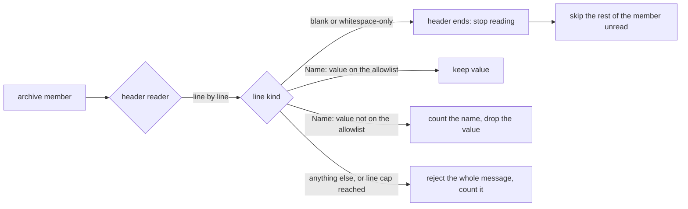
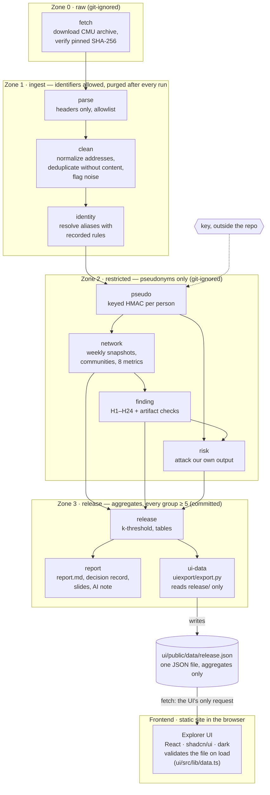
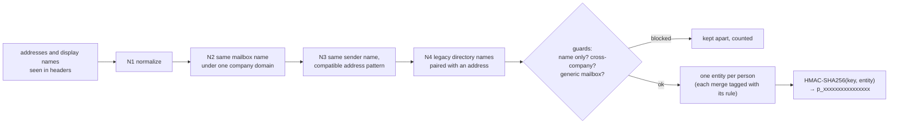
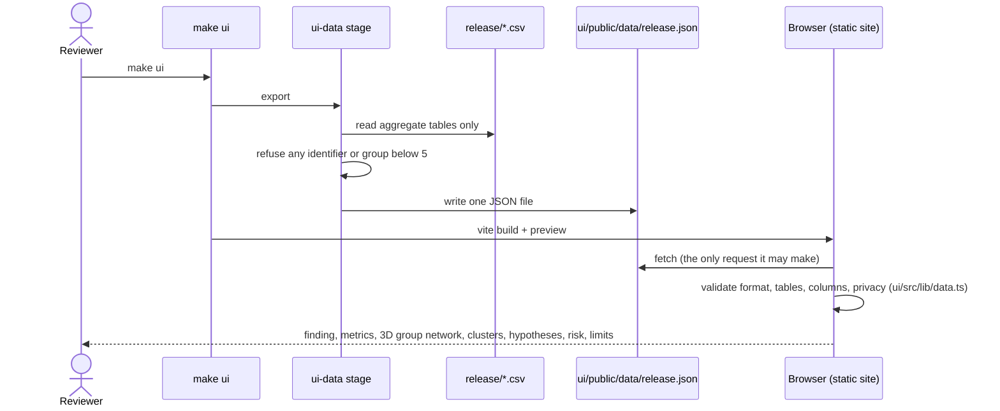
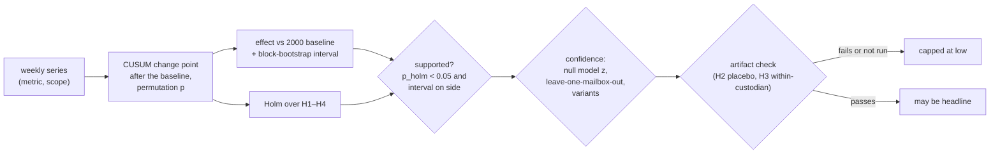
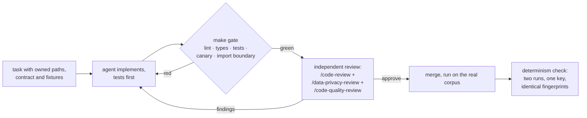
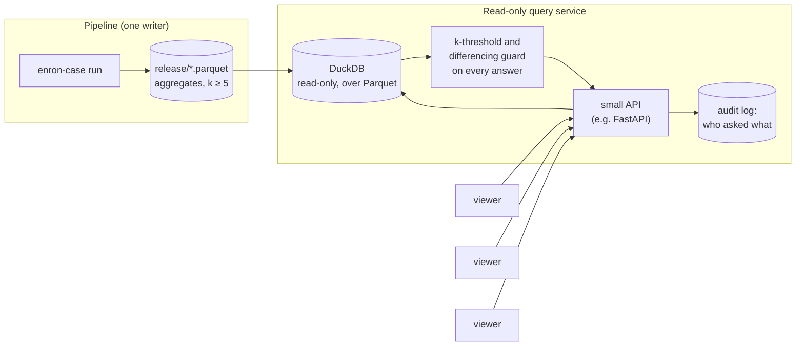
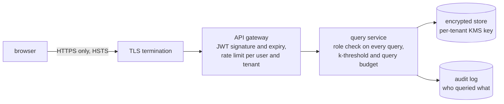

# Headers-only network analysis of the Enron email corpus

An engineering case study: a privacy-first pipeline that reads **only the headers** of the public
Enron email corpus. It cleans and pseudonymizes them, tests pre-stated hypotheses about how the
organization's communication network changed in 2001, attacks its own output to measure
re-identification risk, and publishes only aggregates. An optional dark-themed explorer UI shows
the published results.

The corpus is public; the pipeline is built as if it were not.

**Results in brief.** One list of 24 hypotheses (H1–H24), all defined by the project owner, in
three batches, each committed before it was computed.

- **H1–H4** (committed before any real data was analysed): two of four passed every planned
  test, then failed checks against known artifacts of the data (stale baseline groups; a change
  in which mailboxes hold mail). **No finding from H1–H4 is claimed.**
- **H5–H24** (H5–H14 committed after the H1–H4 results, H15–H24 after the H5–H14 results):
  within-custodian paired comparisons, with Holm's correction across those twenty. **No
  hypothesis is held true.** H16 (the share of a custodian's sent-to contacts who also wrote to
  the custodian in the same window) met its stated rule, also with mail volume equalised, but
  fails the retention check added after a data-science review: among custodian-to-custodian
  contacts, whose messages are visible whatever an inbox kept, the change is not established,
  and the same subset rises before the crisis. H16 remains the strongest lead, largely explained
  by how much inbox mail was kept.
- **Found along the way:** the reference-year timestamps in the corpus are shifted by several
  hours, and every Bcc line repeats the Cc line.

Numbers and limits are in [release/report.md](release/report.md); every number there is produced
by the run.

---

## Contents

- [Quick start](#quick-start)
- [Content never enters the system](#content-never-enters-the-system)
- [From the download to the UI](#from-the-download-to-the-ui)
  - [The whole flow](#the-whole-flow)
  - [Stages](#stages)
  - [How a person becomes a pseudonym](#how-a-person-becomes-a-pseudonym)
  - [How the UI gets its data](#how-the-ui-gets-its-data): one JSON file, `ui/public/data/release.json`
- [Network science methods](#network-science-methods)
- [Libraries and why each is here](#libraries-and-why-each-is-here)
- [How correctness is kept](#how-correctness-is-kept)
- [Next steps](#next-steps)
- [Reading order](#reading-order)
- [What is and is not committed](#what-is-and-is-not-committed)
- [Layout](#layout)

---

## Quick start

Prerequisites: Python 3.12, [uv](https://docs.astral.sh/uv/), `make`, internet access for the
first run (about 440 MB, checked against a pinned SHA-256). Node 20+ only for the optional UI.

```bash
make key      # once: random key outside the repository (~/.config/enron-case/key)
make all      # the one command: fetch, verify, run every stage, run the tests, write the report
```

The full corpus (about 517,000 files) runs end to end in roughly two and a half minutes on a
laptop. Without a key, `make all` stops with exit code 3; it never creates a key silently.

| Command | Does |
|---------|------|
| `make sample` | the whole pipeline on a bundled synthetic corpus, in seconds, into `release-sample/` |
| `make gate` | lint, strict type checks, all tests, the privacy canary, the import-boundary test |
| `make ui` | builds and serves the explorer over `release/` (not part of `make all`) |
| `make ui-sample` | the explorer over the synthetic release |
| `make ui-gate` | UI lint, type check, tests, build, and a check that the build has no external URL |
| `make clean` | removes local data and regenerated sample output |

Underneath is a CLI (`enron-case run | stage | verify | check-key | review-merges`), documented in
[contracts/cli.md](specs/001-enron-network-analysis/contracts/cli.md).

---

## Content never enters the system

> **The rule of the brief:** *Content never enters your system. Read headers only. You decide
> which header fields still count as content or as direct identifiers. Draw that line
> deliberately and explain it.*

### Where the line is drawn

Every header field in the corpus gets one of four rulings. The single source is
[contracts/header-allowlist.md](specs/001-enron-network-analysis/contracts/header-allowlist.md);
the parser enforces it and a test compares the two.

| Ruling | Fields | Where the value can go | Why |
|--------|--------|------------------------|-----|
| **Usable metadata** | `Date` | pseudonymized events, truncated to the hour; published weekly | *When* is the only fact needed beyond *who*. Second-level timestamps fingerprint people, so they are coarsened at the boundary. |
| **Direct identifier, ingest zone only** | `From`, `To`, `Cc`, `Bcc`, `X-From`, `X-To`, `X-cc`, `X-bcc` | ingest zone only; replaced by keyed pseudonyms, then purged | Needed to know who talked to whom and to link one person's several addresses. Display names are used to resolve identities and then discarded. |
| **Content, never stored** | `Subject`, `X-Folder` (and folder names in the archive path) | nowhere; dropped as the line is read | A subject line is a one-line summary of the body written by its author. Folder names are topic labels written by the mailbox owner. Both are content in everything but position. A folder name is reduced at once to one of four classes (sent, inbox, deleted, other). |
| **Dropped** | `X-FileName`, `X-Origin`, `Message-ID`, MIME fields, anything unknown | nowhere | No analytical use (`X-Origin` and `X-FileName` repeat the mailbox owner; `Message-ID` was assigned per stored copy, measured: no group of duplicate copies shares one, so it cannot deduplicate). Unknown fields are denied by default; only their *names* are counted. |

The hardest call is **`Subject`**. Keeping a keyed hash of it would have improved deduplication and
allowed thread and reply-time analysis. We rejected it: a hash of a short, guessable string is a
content fingerprint. The cost is named in the report: no threads, no reply times, and duplicates
found from sender, second and recipients alone.

### How the line is enforced



- **The reader cannot reach a body.** It reads line by line and stops at the first blank line. It
  never calls the standard email parser, which loads the body as payload. A message without a
  clean header end is rejected rather than parsed, so body lines can never pass for header fields.
  An independent review found exactly this weakness before the fix.
- **Default deny.** A field not on the allowlist is dropped as its line is read. Its value is never
  bound to a variable that outlives that line.
- **Only known field names are published.** Stray names, which can be fragments of text, are
  folded into one `(other)` count.
- **A canary test** plants markers in bodies, subjects, folder names and file names of a
  synthetic corpus, runs the whole pipeline and fails if any marker appears in any table, log,
  manifest or document.
- **An import-boundary test** fails if any package after the pseudonymization boundary imports
  ingest-side code. A **path guard** refuses any read or write outside a package's zones.

**Honest limit.** "Never enters" means our code never decodes, parses, holds, stores or logs
content. Body bytes still pass through the gzip decompressor on the way to being skipped, and the
downloaded archive on disk contains them. With real customer data the equivalent control is a
connector that requests metadata fields only, so content never leaves the source (see
[next steps](#next-steps)).

---

## From the download to the UI

### The whole flow



The frontend never touches the pipeline, the restricted zone or the key. Its single input is
`ui/public/data/release.json`, which the `ui-data` stage writes from the release tables alone;
there is no API, no database and no other request.

Each arrow is a **versioned table contract**
([data-contracts.md](specs/001-enron-network-analysis/contracts/data-contracts.md)). Every write
is validated against its schema and leak-checked: no `@` in the restricted zone, and no address
or pseudonym in the release. Every write is also fingerprinted in `release/run_manifest.json`, so
two runs with one key can be compared byte for byte.

### Stages

| Stage | Package | Reads | Writes |
|-------|---------|-------|--------|
| fetch | `ingest` | CMU URL | archive in `data/raw` |
| parse | `ingest` | archive (headers only) | `header_records` |
| clean | `clean` | `header_records` | `messages` |
| identity | `identity` | `messages`, `header_records` | `entities`, `address_map` |
| pseudo | `pseudo` | the three above, the key | `events`, `entities_p` |
| network | `network` | `events`, `entities_p` | `snapshots`, `communities`, `metric_series` |
| finding | `finding` | metric series and network | `hypothesis_results`, `artifact_results`, `exploratory_results` |
| risk | `risk` | release variants, public corpus (as the attacker would) | `risk_results` |
| release | `release` | restricted aggregates and counts | `release/*.csv` |
| report | `report` | `release/` only | `release/report.md`, `docs/*.md` |
| ui-data | `uiexport` | `release/` only | `ui/public/data/release.json` |

### How a person becomes a pseudonym



The same key and the same input always give the same pseudonym. Without the key a pseudonym
cannot be reversed, and it cannot be confirmed by hashing a guessed address. It is still
pseudonymization, not anonymization: the risk stage shows that person-level pseudonymized edges
are re-identifiable. That is why only aggregates are published.

### How the UI gets its data



The UI is a static site with no API and no database. Its only input is
`ui/public/data/release.json`, written by the `ui-data` stage
([src/enron_case/uiexport/export.py](src/enron_case/uiexport/export.py)) from `release/`
alone (the aggregate tables and the run manifest's parameters). The export refuses any identifier-shaped value or group below five; the browser checks the
file again on load ([ui/src/lib/data.ts](ui/src/lib/data.ts)): format version, every table and
column, and the privacy guard. A malformed file is shown as an error, never replaced. Only when no
`release.json` exists does it fall back to the synthetic sample of the same shape that `make
ui-sample` writes. So the UI cannot show anything the report could not. Its views:

| View | Shows |
|------|-------|
| Overview | the finding, the artifact checks that ruled out H2 and H3, and the within-custodian results (H16, the strongest lead, fails its retention check) |
| Metrics | each weekly metric by scope, with the change point, public events and baseline marked |
| Network | a rotatable **3D graph of groups** and their ties, week by week (2D fallback without WebGL) |
| Clusters | a **chord diagram** of mail between and within groups for the baseline year, the crisis weeks or all weeks; each group's size, within-group share and top partner groups; and the group whose cross-group share changed most, with the stale-baseline caveat |
| Hypotheses | H1–H4 with their artifact checks, and H5–H24 |
| Data quality, Privacy and risk, Limits | the cleaning funnel, header rulings, the attacks before and after mitigation, and the limits |

Every node, arc and segment is a **group of at least five people**, never an individual; group
membership is not published. A Content-Security-Policy blocks other origins, and a build check
fails on any external URL: no CDN, no web fonts, no analytics.

---

## Network science methods

What the code computes, for a reader who knows network science. Full definitions:
[docs/metrics.md](docs/metrics.md), [docs/hypotheses.md](docs/hypotheses.md),
[docs/hypotheses-exploratory.md](docs/hypotheses-exploratory.md). Parameters are `Config` fields
in `src/enron_case/config.py`.

### The network (`network/snapshots.py`)

- **Nodes** are resolved persons (pseudonyms). Lists, role and system addresses are not nodes.
- **Ties** are directed and weighted, aggregated per ISO week (Monday, UTC) over 2000-01-01 to
  2002-03-31; every week gets a row, also empty ones. A message to n distinct resolved
  recipients gives each recipient weight **1/n**, so one message adds 1 in total and a
  mass mailing does not dominate. Self-ties are dropped; messages flagged as noise (for example
  more than 50 recipients) are not in the network.
- **Two scopes.** The corpus is about 150 collected mailboxes, and a tie is visible only if one
  end is one of them. The **observed** network (internal person → internal person) is therefore
  a union of ego networks around the custodians, and its size follows what was collected. The
  **core** keeps only ties whose two ends are both custodians: the one subgraph seen from both
  sides (the sender's sent mail and the recipient's inbox).
- A week with fewer than 5 active persons (`k_min`) has every metric null, not zero.

### Communities (`network/communities.py`)

Louvain modularity optimisation (`networkx.community.louvain_communities`, `weight="weight"`,
`seed=config.seed`) on the **undirected** weighted observed network of the baseline year 2000
(w(u→v) + w(v→u) per pair; nodes and edges inserted in sorted order so the result is
reproducible). Communities are numbered by size; a person with no baseline tie gets −1 and is left
out of the cross-community share.

The partition is then **frozen**: every week and every variant uses it. Re-fitting each week
would make "crossing established groups" meaningless, since each week's partition is fitted to
minimise its own crossing weight. Freezing has a cost that produced the H2 artifact: a partition
fits its training period best, so out of sample the crossing share rises as groups drift, with or
without any event. The planned H1–H4 checks could not see this (the null model randomises ties
in every week alike, so it tests degree, not staleness). The **baseline placebo** did: fitted on
the first half of 2000 and measured on the calm second half, the share already jumps far beyond
the 2.0 standard-deviation threshold ([release/artifact_checks.csv](release/artifact_checks.csv)).

### The eight metrics (`network/metrics.py`)

Per scope and week: A = active persons (an end of at least one tie), n = |A|, E = directed ties,
w = tie weight, c(·) = frozen community.

| Metric | Formula |
|--------|---------|
| `volume` | number of distinct messages with at least one tie in the scope |
| `active_persons` | n |
| `density` | \|E\| / (n (n − 1)) |
| `reciprocity` | \|{(u, v) ∈ E : (v, u) ∈ E}\| / \|E\| (unweighted) |
| `indegree_gini` | Gini of s(v) = Σ_u w(u, v) over A, zeros included: 2 Σᵢ i·s₍ᵢ₎ / (n Σ s) − (n + 1)/n |
| `cross_community_share` | Σ w over ties with c(u) ≠ c(v), divided by Σ w over ties with both c ≥ 0 |
| `external_share` | Σ w to external persons / Σ w to all persons, over all mail of the scope's senders (internal persons, or custodians for the core) |
| `tie_turnover` | 1 − \|E_t ∩ E_{t−1}\| / \|E_t ∪ E_{t−1}\| (1 − Jaccard of directed tie sets; null after an undefined week) |

### Testing H1–H4 (`finding/stats.py`, `nullmodel.py`, `hypotheses.py`, `select.py`, `artifacts.py`)



- **Change point.** Weighted directional CUSUM: with S_τ = Σ_{i<τ} (x_i − x̄),
  T = max_τ −d · S_τ · √(n / (τ (n − τ))), τ over the weeks after the baseline that leave at
  least 4 weeks after them (d = +1 up, −1 down). p = (1 + #{T_perm ≥ T}) / (1 + 1000), permuting
  the order of the weeks.
- **Effect.** (mean after the change week − mean of 2000) / sample sd of 2000.
- **Interval.** Moving-block bootstrap, blocks of 4 weeks, 1000 replicates; baseline and after
  period resampled separately with the change week fixed; 95 % percentile interval.
- **Null model (degree-preserving).** Within each week, recipients are permuted among events of
  equal weight and equal `in_network` flag. Each sender keeps its out-weight and each recipient
  its in-weight (inside and outside the network); only who is tied to whom changes. The series is
  recomputed on 20 rewired copies, the effect taken at the same change week, and
  z = (effect − mean null) / sd null. Passes when d · z > 1.645 (one-sided): the change is not a
  volume or degree change.
- **Leave-one-mailbox-out.** Each custodian in turn: drop every event touching them, recompute,
  take the effect at the same change week. Passes when every effect has the hypothesised sign.
- **Variants.** Recipient cap 20 and monthly window, each re-estimated from scratch (own change
  point, own interval).
- **Holm** step-down correction of the four permutation p-values.
- **Artifact checks** (added after the first real run, labelled as such). *Baseline placebo*
  (H2): refit Louvain on the first half of 2000, effect of the second half; fails when
  |effect| > 2.0. *Within-custodian* (H3): for custodians with at least 30 sent events in both
  periods, the change in each one's own weighted external share from 2000 to after the change
  point; median with a bootstrap interval over custodians; passes only if the interval lies
  below zero. A failed check, or one that could not run, caps confidence at low.

### Within-custodian hypotheses H5–H24 (`finding/exploratory.py`)

- **Unit and comparison.** Each custodian against themselves: d_i = m_i(crisis) − m_i(reference),
  with windows fixed by public dates (2001-08-14 to 2001-12-02 against the same weeks of 2000).
  Measures are ratios or per-active-week rates over all of a custodian's sent or received
  messages (not only network ties); a custodian needs at least 20 messages in each window. H16
  is ego-level reciprocity: the share of a custodian's sent-to contacts who also wrote to the
  custodian in the same window (anything they sent, not necessarily a reply; headers carry no
  thread).
- **Test.** Wilcoxon signed-rank (two-sided) on d; median of d with a percentile bootstrap
  interval over custodians (2000 draws); Holm across all twenty.
- **Pre-crisis placebo.** The same difference for January–April 2001 against January–April 2000;
  passes if its interval covers zero or its median is less than half the crisis median.
- **Leave-one-out.** The median recomputed without each custodian; every one must keep the sign.
- **Mail-volume equalisation** (added after seeing results). For every hypothesis not rejected
  and without a caveat, each custodian's sent and received messages in both windows are
  subsampled to the smaller window's count, the measure recomputed, the difference averaged over
  40 seeded subsamples, and the test rerun. It is reported next to the outcome, not part of the
  rule. Next to its p, `equalised_p_holm` is p times the family size of twenty, capped at 1:
  Holm's multiplier for the family's smallest p and conservative for every other rank.
- **Retention check** (added after a data-science review, run with the project's
  `/data-scientist-review` skill, and after results were seen). Inbox retention differs by
  person and period, so a reply can be missing because the inbox lost it. For H16 the measure
  is recomputed counting only contacts who are themselves custodians, whose messages survive in
  their own sent folders whatever the receiving inbox kept; crisis against reference and the
  pre-crisis placebo, as above. It passes only if the crisis interval lies on the hypothesised
  side over at least k custodians and the placebo passes. A hypothesis that fails it cannot be
  held true. H16 fails it.
- **Placebo power.** Fewer custodians meet the minimum in the placebo windows than in the crisis
  comparison (`placebo_custodians` against `custodians`), so a passing placebo has less power and
  does not exclude a pre-existing trend.

### Re-identification attacks as graph matching (`risk/attack.py`)

The attacks target **R0**, a pseudonymised node-level weekly edge list. The attacker's auxiliary
graph is the public corpus parsed with their own naive parser, labelled by address. The aggregate
releases R1 and R2 contain no node to match, so the attacks return nothing on them.

- **A1, outsider: temporal degree fingerprint.** Each node becomes a vector of its distinct
  out-neighbours and distinct in-neighbours per week, computed by the same function on both
  sides. Each pseudonym is matched to the Euclidean-nearest address (nearest neighbour, not
  one-to-one).
- **A2, insider: seeded propagation.** Starting from 3 custodians whose addresses are known,
  every unmatched pseudonym p is scored against every unused address a by the number of
  (week, already-matched neighbour) contacts they share, divided by √(contacts of a) so busy
  addresses do not win by size. A match needs support ≥ 2 and a strict best on both sides
  (one-to-one); each round's matches seed the next until nothing changes. This is
  de-anonymisation in the spirit of seed-based graph matching (Narayanan–Shmatikov style
  propagation), on time-stamped edges.

Scoring is separate, runs in the ingest zone and emits counts only. Results are in
[release/risk.csv](release/risk.csv): on R0, A1 re-identifies about a quarter and A2 more than
half of the targets; on R1 and R2, nobody.

### Method by hypothesis family

| Family | Compared | Method | Decision rule |
|--------|----------|--------|---------------|
| H1–H4 (committed before any data) | weekly network series, after a searched change week vs 2000 | CUSUM + permutation p, standardised effect, block bootstrap, Holm over 4 | supported if p_holm < 0.05 and interval on the hypothesised side; confidence from null-model z, leave-one-mailbox-out, variants |
| Artifact checks (H2, H3) | placebo half-year in 2000; custodians against themselves | refit Louvain on half the baseline; within-custodian median change with bootstrap | failed or not run caps confidence at low; no headline |
| H5–H24 (within-custodian) | each custodian, fixed crisis window vs same weeks a year earlier | paired differences, Wilcoxon signed-rank, median bootstrap, Holm over 20 | confident if p_holm < 0.05, interval on side, placebo passes, leave-one-out stable, no caveat and (H16) the retention check passes; volume-equalised result reported alongside |
| A1, A2 (risk) | release R0, R1, R2 against the public corpus | nearest-neighbour fingerprint matching; seeded propagation | share of targets re-identified (top-1), with interval |

---

## Libraries and why each is here

### Pipeline (Python 3.12)

| Library | Role here | Why this one |
|---------|-----------|--------------|
| **Polars** | every stage table; Parquet in and out | Fast, typed columnar frames with list and struct columns, which recipients need. Lazy group-bys fit 1.3 M events comfortably on a laptop. |
| **NetworkX** | baseline communities (Louvain); the only graph algorithm the pipeline calls a library for | The network is tens of thousands of nodes, well within reach. Readable, seeded algorithms matter more here than raw speed. Snapshots, metrics and the null model are Polars table operations. |
| **NumPy** | bootstrap, permutation and attack arithmetic | Vectorised resampling with seeded generators. |
| **SciPy** | the normal quantile behind the one-sided null-model threshold; the Wilcoxon signed-rank test of H5–H24 | Standard, tested implementations instead of a hand-typed critical value or a home-made rank test. |
| `tarfile`, `email.utils`, `hmac`, `hashlib` (standard library) | streaming the archive, parsing dates, keyed pseudonyms, fingerprints | No dependency needed, and easy to audit: the code that touches raw data stays small and standard. |
| **uv** | environment and lockfile | Pinned, reproducible installs in seconds (`uv sync --locked`). |
| **pytest** + **Hypothesis** | unit, contract, privacy and property tests | Property tests check that dedupe ignores input order, that the header reader never reads past the header, and that k-suppression never leaks. |
| **Ruff** + **mypy** (strict) | lint, formatting, types | `mypy --strict` checks `src/` and `tests/`; no `Any` in a signature (untyped JSON is `object`, narrowed); the gate fails on any finding. |

### Explorer UI (`ui/`)

| Library | Role here | Why this one |
|---------|-----------|--------------|
| **React 18** + **TypeScript** (strict) | the application | Typed components; the data file is validated at runtime against TypeScript types. |
| **Vite** | dev server and build | Fast builds, a static output that is easy to host and to scan for external URLs. |
| **Tailwind CSS** | styling and the dark theme tokens | One set of design tokens, no runtime CSS. |
| **shadcn/ui** on **Radix UI** | cards, tabs, tables, badges, slider, select, tooltip | Accessible primitives copied into the repo rather than imported from a registry, so there is no external fetch. |
| **Recharts** (via shadcn charts) | metrics over time, change-point and event markers | Declarative charts that match the shadcn theme. |
| **d3-force** | the flat (2D) group network layout, the fallback without WebGL | One force layout computed once and kept stable while the week slider moves. |
| **d3-chord** | the Clusters chord diagram, drawn as plain SVG | About 3 kB with one dependency already in the bundle; plain SVG lets the privacy test check every arc. |
| **react-force-graph-3d** + **three** | the 3D group network | Loaded as a separate chunk only when the browser has WebGL; bundled, so still no external request. |
| **lucide-react**, **@fontsource-variable/inter** | icons, bundled font | Bundled assets, so no external request. |
| `class-variance-authority`, `clsx`, `tailwind-merge` | component variants and class composition | The standard shadcn helpers. |
| **Vitest** + **Testing Library** + **jsdom** | UI tests, including a privacy test | Checks the data contains no `@`, no pseudonym and no group below five, and that no view renders per person. |
| **ESLint** (+ React hooks rules) | lint | Part of `make ui-gate`. |

---

## How correctness is kept



- **Ground truth no agent produced.** A synthetic corpus in the same layout as the real one, with
  known duplicates, aliases, noise, a planted change and canary markers. It has a reference answer
  for every table.
- **Hypotheses before results.** H1–H4 were committed before any real data was analysed; H5–H14
  were committed after the H1–H4 results and before being computed, H15–H24 after the H5–H14
  results and before being computed, and Holm's correction runs across those twenty, so adding hypotheses makes each one harder to pass. All
  outcomes are published. Checks added after seeing a result (the artifact checks, mail-volume
  equalisation, the H16 retention check) are labelled as such.
- **Identity checked by a person.** A seeded sample of real identity merges was judged in a
  terminal by a person (`enron-case review-merges`); only counts are kept (checked and judged
  correct, in total and per identity rule) and published in `data_quality.csv` with an exact
  binomial interval, so real identifiers never entered an AI conversation.
- **Typed and reviewed.** `mypy --strict` checks `src/` and `tests/`, with no `Any` in a
  signature. Every change is reviewed with three skills: `/code-review` (correctness),
  `/data-privacy-review` (the content and identifier promises) and the project's own
  `/code-quality-review` (AGENTS.md rules, typing, and a gate whose exit code was checked);
  changes to the analysis, cleaning or hypotheses also with `/data-scientist-review` (methodology).
- **Reproducibility.** One command, a pinned lockfile and corpus checksum, and seeded randomness.
  Two full real runs with one key give identical fingerprints for every output.
- **Numbers are never typed.** The report, decision record and slides are rendered from release
  tables; a test fails on any number it cannot trace to a table cell.

The full story, including what was rejected and why, is in
[docs/ai-workflow.md](docs/ai-workflow.md) and [docs/ai-workflow-log.md](docs/ai-workflow-log.md).

---

## Next steps

### Many users on the UI: when DuckDB makes sense

Today the UI is a static site over one pre-aggregated JSON file. **For that, many users need no
database:** any static host or CDN serves the same file to everyone, and nothing person-level can
leak because nothing person-level is in it.

DuckDB becomes the right tool when the UI must **query** rather than display:

- several releases, tenants or customers;
- filters and drill-downs that cannot all be pre-computed;
- re-aggregation on demand (other windows, departments as groups);
- an audit trail of who asked what.

DuckDB fits that well. It runs in-process with no server to operate and reads Parquet in place, so
the release tables need no load step. Many processes can open it **read-only** at once, and only
one process writes. That matches this workload: the pipeline writes once per run, and many viewers
read.



The condition that matters is in the middle box. Once users can ask their own questions,
**suppression has to run on every query result, not only on pre-built tables**, and repeated
queries open the door to differencing attacks. A service like this needs a query budget or
differential privacy, not only a minimum group size. The person-level restricted zone should stay
out of reach of the service entirely.

### Toward real customer data

| Step | What changes |
|------|--------------|
| Metadata-only connectors | Microsoft Graph and Slack APIs request header fields only, so content never leaves the source instead of being skipped after download. |
| Key custody and an entity registry | The key lives in the customer's KMS. A persisted registry of surrogate IDs keeps pseudonyms stable when identity rules change. |
| Formal privacy budget | Replace the noise sketch (release R2) with differential privacy accounted across every published output. |
| Group-level attack | Attack the published group graph itself (communities matched to the public corpus), not only person-level releases. |
| Retention, residency, works council | Restricted data expires on a schedule, processing stays in the customer's region, and the questions and thresholds are reviewed before the first run. |
| Orchestration and monitoring | Run the stages under a scheduler (e.g. Dagster or Prefect) with the run manifest as the lineage record, and alert on contract or privacy violations. |
| Better identity resolution | A public-suffix list instead of the short table; an evaluated probabilistic model alongside the explainable rules. |

### Securing the explorer as a product

*Proposal; none of this is implemented.* Today the explorer is a static site over public
aggregates: it has a Content-Security-Policy and a build check against external URLs, but no
login, roles or server. Before it serves real customer data:



| Control | What changes |
|---------|--------------|
| Transport | HTTPS everywhere: TLS termination at the edge, HSTS, TLS between internal services too. The existing CSP stays. |
| Authentication | Sign-in through the customer's identity provider (OIDC/SSO). Short-lived signed JWTs (minutes), refresh through the provider, signing-key rotation, and revocation on offboarding or suspected theft. |
| Authorisation | Roles such as viewer (published aggregates), analyst (re-aggregation within thresholds), admin (users, no data access beyond viewer) and auditor (audit log only), checked server-side on every query, never only in the UI. Least privilege by default; the role definitions are agreed with the works council before go-live. |
| Rate limits and budgets | Per user and per tenant. Besides protecting the service, a query budget is a privacy control: it limits differencing attacks that combine many overlapping aggregates. |
| Encryption | At rest for every store (Parquet, database, backups, logs) with KMS-managed keys per tenant; the pseudonymisation key held by the customer, in their KMS. In transit everywhere. |
| Audit | Append-only log of who asked which query, with which role, and how much budget it used; readable by the auditor role and the customer. |
| Supply chain | Dependency and container image scanning in CI, pinned versions (as today), signed images. |
| Testing | Load tests (for example k6 or Locust) with realistic query mixes and tenant counts; an external penetration test before go-live and periodically after; abuse tests that try to re-identify people through the query interface, extending the attacks in `risk/` from releases to live queries. |

### Multi-tenant SaaS: database constraints and scale

*Proposal; the current pipeline serves one corpus on one machine.*

**Tenant isolation.** Three options:

| Option | Isolation | Cost | Fit here |
|--------|-----------|------|----------|
| Database (and storage) per tenant | strongest: separate files, keys, region and deletion | more instances to run and migrate | **chosen for analytical data** |
| Schema per tenant | medium: one engine, separate namespaces | one shared failure and resource domain | possible for small tenants |
| Shared tables with a tenant key and row-level security | weakest: one missing predicate leaks across tenants | cheapest to run | only for non-sensitive control data |

Communication metadata is sensitive, every tenant needs its own pseudonymisation key and often its
own region, and deleting a tenant must be provable. A separate store per tenant gives all three:
deletion is dropping the tenant's prefix and destroying its key.

**Stores.**

- **Analytical data**: Parquet per tenant, read by DuckDB in the query service, as in the
  current design. Object storage laid out as `region/tenant/zone/table/week=…/`, each tenant
  prefix encrypted with its own KMS key.
- **Transactional data** (users, roles, audit log, job state): PostgreSQL. This is small and
  not person-level, so shared tables with a tenant key and row-level security are acceptable
  here, with the policy tested in CI.

**Scale.**

- The pipeline runs as **per-tenant jobs** on a queue, with workers scaled horizontally; one
  tenant's run never shares a process with another's.
- **Incremental processing by week**: a new week of headers updates that week's snapshots and
  metrics instead of recomputing the whole history. Frozen baseline communities and fixed
  windows make this natural; change-point tests over the whole series are cheap to rerun.
- **Partitioned Parquet** by tenant and week, so queries read only the weeks they need.
- The UI reads **cached aggregate releases** (or read replicas), not the pipeline's working
  files.
- **Noisy-neighbour limits**: per-tenant worker quotas, query timeouts and memory caps.

**Constraints from privacy.** No cross-tenant joins and no shared identity resolution: one
person in two customers' data stays two unrelated pseudonyms. Differential-privacy budgets are
tracked per tenant (and per release), and a query that would exceed the budget is refused.

**What to measure.** Query latency (p50, p95) per role; pipeline run time against tenant size
(mailboxes, messages per week); cost per tenant (compute, storage, KMS calls); budget
consumption per tenant.

---

## Reading order

1. [release/report.md](release/report.md): the data, the finding and its artifact checks, every
   hypothesis, the re-identification risk, the limits.
2. [docs/decision-record.md](docs/decision-record.md): one page on architecture, trade-offs and what
   would change with real customer data.
3. [docs/slides.md](docs/slides.md): the 15-minute presentation (Marp-compatible).
4. [docs/ai-workflow.md](docs/ai-workflow.md): how AI agents built this and what kept them correct.
5. [docs/hypotheses.md](docs/hypotheses.md), [docs/hypotheses-exploratory.md](docs/hypotheses-exploratory.md)
   and [docs/metrics.md](docs/metrics.md): hypotheses H1–H4 and H5–H24 (the second file is the
   dated record of when each was stated and keeps their original numbers E1–E20 = H5–H24), the
   metric definitions and the decision rules.
6. [docs/architecture.md](docs/architecture.md): every architecture diagram.
7. [specs/001-enron-network-analysis/](specs/001-enron-network-analysis/): the specification, plan,
   research decisions, data contracts and task list the code was built from.

## What is and is not committed

| Committed | Never committed |
|-----------|-----------------|
| source code, tests, specs, contracts | the raw corpus (`data/raw`) |
| `release/`: aggregate tables, `report.md`, `run_manifest.json` | the ingest zone (addresses, names; purged after each run) |
| `docs/`: decision record, slides, AI-workflow note, all numbers injected | the restricted zone (pseudonymized person-level data) |
| the synthetic corpus generator and a synthetic UI sample | the key, or anything derived from it except an 8-character fingerprint |

## Layout

```text
src/enron_case/   one package per stage: ingest, clean, identity, pseudo, network, finding,
                  risk, release, report, uiexport; contracts/ holds the table schemas;
                  synth/ generates the synthetic corpus and fixtures
tests/            unit, contract, privacy and integration tests, all on synthetic data
ui/               the explorer (React, TypeScript, Vite, Tailwind, shadcn/ui)
docs/             architecture, hypotheses, metrics, decision record, slides, AI-workflow note
specs/            Spec Kit specification, plan, research, contracts and tasks
.claude/skills/   Spec Kit skills and the project's data-privacy-review, code-quality-review and
                  data-scientist-review skills
```
