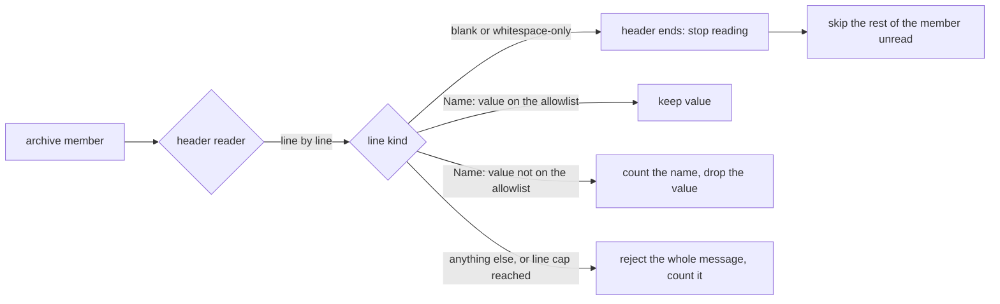
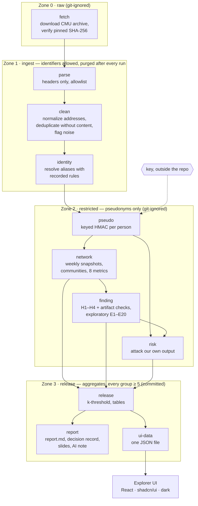
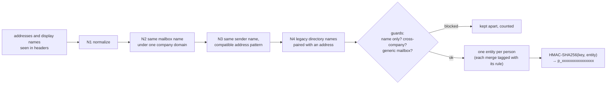
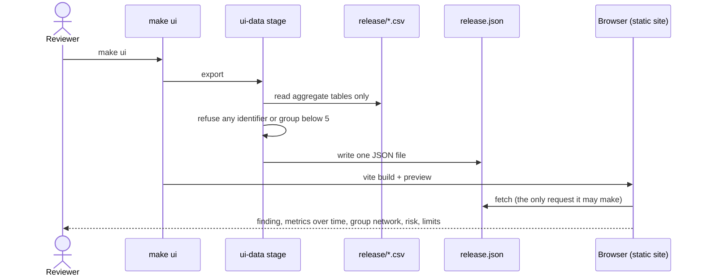
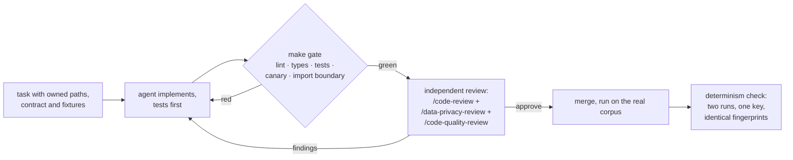
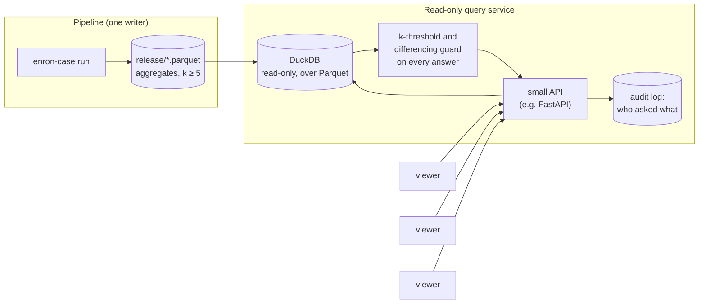

# Headers-only network analysis of the Enron email corpus

An engineering case study: a privacy-first pipeline that reads **only the headers** of the public
Enron email corpus. It cleans and pseudonymizes them, tests pre-stated hypotheses about how the
organization's communication network changed in 2001, attacks its own output to measure
re-identification risk, and publishes only aggregates. An optional dark-themed explorer UI shows
the published results.

The corpus is public; the pipeline is built as if it were not.

**Results in brief.**

- **Pre-registered (H1–H4):** two of four hypotheses passed every planned test, then failed
  checks against known artifacts of the data (stale baseline groups; a change in which mailboxes
  hold mail). **No pre-registered finding is claimed.**
- **Exploratory (E1–E20):** two further families, each committed before it was computed and
  corrected together. One result reached the confident standard: **communication became more
  mutual in the crisis** (E12). Of the people a custodian wrote to, a larger share also wrote
  back than in the same weeks a year earlier, and the effect holds with mail volume equalised. It
  is presented as an exploratory lead, not a pre-registered finding.
- **Found along the way:** the reference-year timestamps in the corpus are shifted by several
  hours, and every Bcc line repeats the Cc line.

Numbers and limits are in [release/report.md](release/report.md); every number there is produced
by the run.

---

## Contents

- [Quick start](#quick-start)
- [Content never enters the system](#content-never-enters-the-system)
- [From the download to the UI](#from-the-download-to-the-ui)
- [Libraries and why each is here](#libraries-and-why-each-is-here)
- [How correctness is kept](#how-correctness-is-kept)
- [Next steps](#next-steps)
- [Reading order](#reading-order)
- [What is and is not committed](#what-is-and-is-not-committed)
- [Layout](#layout)

---

## Quick start

Prerequisites: Python 3.12, [uv](https://docs.astral.sh/uv/), `make`, internet access for the
first run (about 440 MB, checked against a pinned SHA-256). Node 20+ only for the optional UI.

```bash
make key      # once: random key outside the repository (~/.config/enron-case/key)
make all      # the one command: fetch, verify, run every stage, run the tests, write the report
```

The full corpus (about 517,000 files) runs end to end in roughly two and a half minutes on a
laptop. Without a key, `make all` stops with exit code 3; it never creates a key silently.

| Command | Does |
|---------|------|
| `make sample` | the whole pipeline on a bundled synthetic corpus, in seconds, into `release-sample/` |
| `make gate` | lint, strict type checks, all tests, the privacy canary, the import-boundary test |
| `make ui` | builds and serves the explorer over `release/` (not part of `make all`) |
| `make ui-sample` | the explorer over the synthetic release |
| `make ui-gate` | UI lint, type check, tests, build, and a check that the build has no external URL |
| `make clean` | removes local data and regenerated sample output |

Underneath is a CLI (`enron-case run | stage | verify | check-key | review-merges`), documented in
[contracts/cli.md](specs/001-enron-network-analysis/contracts/cli.md).

---

## Content never enters the system

> **The rule of the brief:** *Content never enters your system. Read headers only. You decide
> which header fields still count as content or as direct identifiers. Draw that line
> deliberately and explain it.*

### Where the line is drawn

Every header field in the corpus gets one of four rulings. The single source is
[contracts/header-allowlist.md](specs/001-enron-network-analysis/contracts/header-allowlist.md);
the parser enforces it and a test compares the two.

| Ruling | Fields | Where the value can go | Why |
|--------|--------|------------------------|-----|
| **Usable metadata** | `Date` | pseudonymized events, truncated to the hour; published weekly | *When* is the only fact needed beyond *who*. Second-level timestamps fingerprint people, so they are coarsened at the boundary. |
| **Direct identifier, ingest zone only** | `From`, `To`, `Cc`, `Bcc`, `X-From`, `X-To`, `X-cc`, `X-bcc` | ingest zone only; replaced by keyed pseudonyms, then purged | Needed to know who talked to whom and to link one person's several addresses. Display names are used to resolve identities and then discarded. |
| **Content, never stored** | `Subject`, `X-Folder` (and folder names in the archive path) | nowhere; dropped as the line is read | A subject line is a one-line summary of the body written by its author. Folder names are topic labels written by the mailbox owner. Both are content in everything but position. A folder name is reduced at once to one of four classes (sent, inbox, deleted, other). |
| **Dropped** | `X-FileName`, `X-Origin`, `Message-ID`, MIME fields, anything unknown | nowhere | No analytical use (`X-Origin` and `X-FileName` repeat the mailbox owner; `Message-ID` was assigned per stored copy, measured: no group of duplicate copies shares one, so it cannot deduplicate). Unknown fields are denied by default; only their *names* are counted. |

The hardest call is **`Subject`**. Keeping a keyed hash of it would have improved deduplication and
allowed thread and reply-time analysis. We rejected it: a hash of a short, guessable string is a
content fingerprint. The cost is named in the report: no threads, no reply times, and duplicates
found from sender, second and recipients alone.

### How the line is enforced



- **The reader cannot reach a body.** It reads line by line and stops at the first blank line. It
  never calls the standard email parser, which loads the body as payload. A message without a
  clean header end is rejected rather than parsed, so body lines can never pass for header fields.
  An independent review found exactly this weakness before the fix.
- **Default deny.** A field not on the allowlist is dropped as its line is read. Its value is never
  bound to a variable that outlives that line.
- **Only known field names are published.** Stray names, which can be fragments of text, are
  folded into one `(other)` count.
- **A canary test** plants markers in bodies, subjects, folder names and file names of a
  synthetic corpus, runs the whole pipeline and fails if any marker appears in any table, log,
  manifest or document.
- **An import-boundary test** fails if any package after the pseudonymization boundary imports
  ingest-side code. A **path guard** refuses any read or write outside a package's zones.

**Honest limit.** "Never enters" means our code never decodes, parses, holds, stores or logs
content. Body bytes still pass through the gzip decompressor on the way to being skipped, and the
downloaded archive on disk contains them. With real customer data the equivalent control is a
connector that requests metadata fields only, so content never leaves the source (see
[next steps](#next-steps)).

---

## From the download to the UI

### The whole flow



Each arrow is a **versioned table contract**
([data-contracts.md](specs/001-enron-network-analysis/contracts/data-contracts.md)). Every write
is validated against its schema and leak-checked: no `@` in the restricted zone, and no address
or pseudonym in the release. Every write is also fingerprinted in `release/run_manifest.json`, so
two runs with one key can be compared byte for byte.

### Stages

| Stage | Package | Reads | Writes |
|-------|---------|-------|--------|
| fetch | `ingest` | CMU URL | archive in `data/raw` |
| parse | `ingest` | archive (headers only) | `header_records` |
| clean | `clean` | `header_records` | `messages` |
| identity | `identity` | `messages`, `header_records` | `entities`, `address_map` |
| pseudo | `pseudo` | the three above, the key | `events`, `entities_p` |
| network | `network` | `events`, `entities_p` | `snapshots`, `communities`, `metric_series` |
| finding | `finding` | metric series and network | `hypothesis_results`, `artifact_results`, `exploratory_results` |
| risk | `risk` | release variants, public corpus (as the attacker would) | `risk_results` |
| release | `release` | restricted aggregates and counts | `release/*.csv` |
| report | `report` | `release/` only | `release/report.md`, `docs/*.md` |
| ui-data | `uiexport` | `release/` only | `ui/public/data/release.json` |

### How a person becomes a pseudonym



The same key and the same input always give the same pseudonym. Without the key a pseudonym
cannot be reversed, and it cannot be confirmed by hashing a guessed address. It is still
pseudonymization, not anonymization: the risk stage shows that person-level pseudonymized edges
are re-identifiable. That is why only aggregates are published.

### How the UI gets its data



The UI is a static site. Its only input is a file built from the published release, so it cannot
show anything the report could not. The network view draws **groups of at least five people**,
never individuals. A Content-Security-Policy blocks other origins, and a build check fails on any
external URL: no CDN, no web fonts, no analytics.

---

## Libraries and why each is here

### Pipeline (Python 3.12)

| Library | Role here | Why this one |
|---------|-----------|--------------|
| **Polars** | every stage table; Parquet in and out | Fast, typed columnar frames with list and struct columns, which recipients need. Lazy group-bys fit 1.3 M events comfortably on a laptop. |
| **NetworkX** | baseline communities (Louvain), graph helpers | The network is tens of thousands of nodes, well within reach. Readable, seeded algorithms matter more here than raw speed. |
| **NumPy** | bootstrap, permutation and attack arithmetic | Vectorised resampling with seeded generators. |
| **SciPy** | the normal quantile behind the one-sided null-model threshold | One standard function instead of a hand-typed critical value. |
| `tarfile`, `email.utils`, `hmac`, `hashlib` (standard library) | streaming the archive, parsing dates, keyed pseudonyms, fingerprints | No dependency needed, and easy to audit: the code that touches raw data stays small and standard. |
| **uv** | environment and lockfile | Pinned, reproducible installs in seconds (`uv sync --locked`). |
| **pytest** + **Hypothesis** | unit, contract, privacy and property tests | Property tests check that dedupe ignores input order, that the header reader never reads past the header, and that k-suppression never leaks. |
| **Ruff** + **mypy** (strict) | lint, formatting, types | `mypy --strict` checks `src/` and `tests/`; no `Any` in a signature (untyped JSON is `object`, narrowed); the gate fails on any finding. |

### Explorer UI (`ui/`)

| Library | Role here | Why this one |
|---------|-----------|--------------|
| **React 18** + **TypeScript** (strict) | the application | Typed components; the data file is validated at runtime against TypeScript types. |
| **Vite** | dev server and build | Fast builds, a static output that is easy to host and to scan for external URLs. |
| **Tailwind CSS** | styling and the dark theme tokens | One set of design tokens, no runtime CSS. |
| **shadcn/ui** on **Radix UI** | cards, tabs, tables, badges, slider, select, tooltip | Accessible primitives copied into the repo rather than imported from a registry, so there is no external fetch. |
| **Recharts** (via shadcn charts) | metrics over time, change-point and event markers | Declarative charts that match the shadcn theme. |
| **d3-force** | the group network layout | One force layout computed once and kept stable while the week slider moves. |
| **lucide-react**, **@fontsource-variable/inter** | icons, bundled font | Bundled assets, so no external request. |
| `class-variance-authority`, `clsx`, `tailwind-merge` | component variants and class composition | The standard shadcn helpers. |
| **Vitest** + **Testing Library** + **jsdom** | UI tests, including a privacy test | Checks the data contains no `@`, no pseudonym and no group below five, and that no view renders per person. |
| **ESLint** (+ React hooks rules) | lint | Part of `make ui-gate`. |

---

## How correctness is kept



- **Ground truth no agent produced.** A synthetic corpus in the same layout as the real one, with
  known duplicates, aliases, noise, a planted change and canary markers. It has a reference answer
  for every table.
- **Hypotheses before results.** H1–H4 were committed before any real data was analysed; each
  exploratory family (E1–E10, E11–E20) was committed before it was computed, and Holm's
  correction runs across all twenty, so adding hypotheses makes each one harder to pass. All
  outcomes are published. Checks added after seeing a result (the artifact checks, mail-volume
  equalisation) are labelled as such.
- **Identity checked by a person.** A seeded sample of real identity merges was judged in a
  terminal by a person (`enron-case review-merges`); only the two counts are kept and published
  in `data_quality.csv`, so real identifiers never entered an AI conversation.
- **Typed and reviewed.** `mypy --strict` checks `src/` and `tests/`, with no `Any` in a
  signature. Every change is reviewed with three skills: `/code-review` (correctness),
  `/data-privacy-review` (the content and identifier promises) and the project's own
  `/code-quality-review` (AGENTS.md rules, typing, and a gate whose exit code was checked).
- **Reproducibility.** One command, a pinned lockfile and corpus checksum, and seeded randomness.
  Two full real runs with one key give identical fingerprints for every output.
- **Numbers are never typed.** The report, decision record and slides are rendered from release
  tables; a test fails on any number it cannot trace to a table cell.

The full story, including what was rejected and why, is in
[docs/ai-workflow.md](docs/ai-workflow.md) and [docs/ai-workflow-log.md](docs/ai-workflow-log.md).

---

## Next steps

### Many users on the UI: when DuckDB makes sense

Today the UI is a static site over one pre-aggregated JSON file. **For that, many users need no
database:** any static host or CDN serves the same file to everyone, and nothing person-level can
leak because nothing person-level is in it.

DuckDB becomes the right tool when the UI must **query** rather than display:

- several releases, tenants or customers;
- filters and drill-downs that cannot all be pre-computed;
- re-aggregation on demand (other windows, departments as groups);
- an audit trail of who asked what.

DuckDB fits that well. It runs in-process with no server to operate and reads Parquet in place, so
the release tables need no load step. Many processes can open it **read-only** at once, and only
one process writes. That matches this workload: the pipeline writes once per run, and many viewers
read.



The condition that matters is in the middle box. Once users can ask their own questions,
**suppression has to run on every query result, not only on pre-built tables**, and repeated
queries open the door to differencing attacks. A service like this needs a query budget or
differential privacy, not only a minimum group size. The person-level restricted zone should stay
out of reach of the service entirely.

### Toward real customer data

| Step | What changes |
|------|--------------|
| Metadata-only connectors | Microsoft Graph and Slack APIs request header fields only, so content never leaves the source instead of being skipped after download. |
| Key custody and an entity registry | The key lives in the customer's KMS. A persisted registry of surrogate IDs keeps pseudonyms stable when identity rules change. |
| Formal privacy budget | Replace the noise sketch (release R2) with differential privacy accounted across every published output. |
| Group-level attack | Attack the published group graph itself (communities matched to the public corpus), not only person-level releases. |
| Retention, residency, works council | Restricted data expires on a schedule, processing stays in the customer's region, and the questions and thresholds are reviewed before the first run. |
| Orchestration and monitoring | Run the stages under a scheduler (e.g. Dagster or Prefect) with the run manifest as the lineage record, and alert on contract or privacy violations. |
| Better identity resolution | A public-suffix list instead of the short table; an evaluated probabilistic model alongside the explainable rules. |

---

## Reading order

1. [release/report.md](release/report.md): the data, the finding and its artifact checks, every
   hypothesis, the re-identification risk, the limits.
2. [docs/decision-record.md](docs/decision-record.md): one page on architecture, trade-offs and what
   would change with real customer data.
3. [docs/slides.md](docs/slides.md): the 15-minute presentation (Marp-compatible).
4. [docs/ai-workflow.md](docs/ai-workflow.md): how AI agents built this and what kept them correct.
5. [docs/hypotheses.md](docs/hypotheses.md), [docs/hypotheses-exploratory.md](docs/hypotheses-exploratory.md)
   and [docs/metrics.md](docs/metrics.md): the pre-registered and exploratory hypotheses, the
   metric definitions and the decision rules.
6. [docs/architecture.md](docs/architecture.md): every architecture diagram.
7. [specs/001-enron-network-analysis/](specs/001-enron-network-analysis/): the specification, plan,
   research decisions, data contracts and task list the code was built from.

## What is and is not committed

| Committed | Never committed |
|-----------|-----------------|
| source code, tests, specs, contracts | the raw corpus (`data/raw`) |
| `release/`: aggregate tables, `report.md`, `run_manifest.json` | the ingest zone (addresses, names; purged after each run) |
| `docs/`: decision record, slides, AI-workflow note, all numbers injected | the restricted zone (pseudonymized person-level data) |
| the synthetic corpus generator and a synthetic UI sample | the key, or anything derived from it except an 8-character fingerprint |

## Layout

```text
src/enron_case/   one package per stage: ingest, clean, identity, pseudo, network, finding,
                  risk, release, report, uiexport; contracts/ holds the table schemas;
                  synth/ generates the synthetic corpus and fixtures
tests/            unit, contract, privacy and integration tests, all on synthetic data
ui/               the explorer (React, TypeScript, Vite, Tailwind, shadcn/ui)
docs/             architecture, hypotheses, metrics, decision record, slides, AI-workflow note
specs/            Spec Kit specification, plan, research, contracts and tasks
.claude/skills/   Spec Kit skills and the project's data-privacy-review and code-quality-review skills
```
