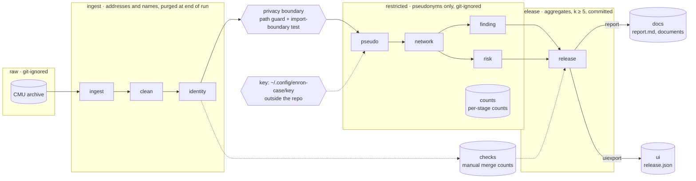
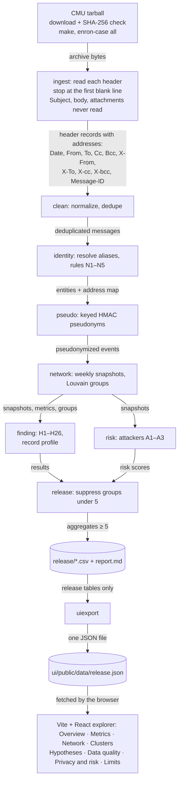
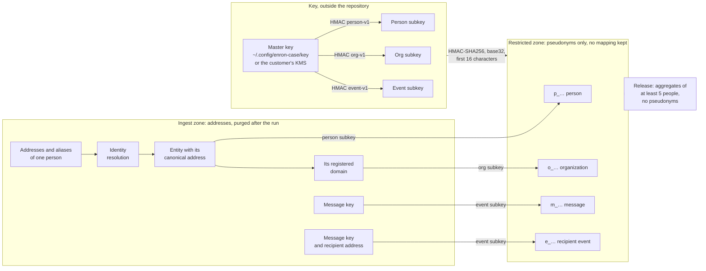
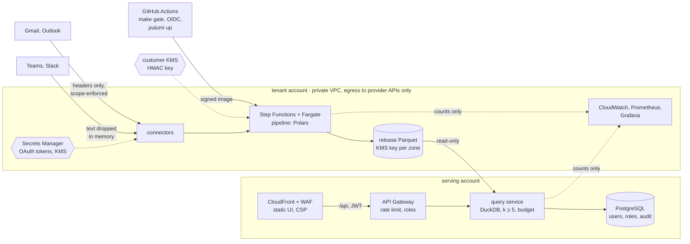

# Headers-only network analysis of the Enron email corpus

An engineering case study: a privacy-first pipeline that reads only the headers of the public Enron
email corpus, so message content never enters the system. It cleans and pseudonymizes the headers,
tests pre-stated hypotheses about how the communication network changed in the 2001 crisis,
attacks its own output to measure re-identification risk, and publishes only aggregates.

## Run it

Prerequisites: [uv](https://docs.astral.sh/uv/) (it fetches Python 3.12) and Node.js 20+.

```bash
# 1. Install uv, then open a new terminal so it is on your PATH
curl -LsSf https://astral.sh/uv/install.sh | sh        # macOS, Linux (or on macOS: brew install uv)
powershell -ExecutionPolicy ByPass -c "irm https://astral.sh/uv/install.ps1 | iex"   # Windows

# 2. Install Node.js 20+: https://nodejs.org (or: brew install node | winget install OpenJS.NodeJS.LTS)

# 3. Get the code and run everything
git clone https://github.com/marcusvieira88/network-science.git
cd network-science
make                     # macOS, Linux; `make check` does the same without serving the explorer
uv run enron-case all    # Windows (or .\run.cmd); `uv run enron-case check` without serving
```

It installs locked dependencies, creates a key outside the repository if needed, fetches and
verifies the corpus, runs the pipeline and every test, then serves the explorer at
http://localhost:4173. Each step prints one line as it finishes.

**How long it takes.** The first run takes about **25 minutes**, most of it the corpus download;
later runs take about **4 minutes**, because the verified corpus is kept in `data/raw/`.

| Step | First run | Later runs |
|------|-----------|------------|
| Install dependencies (uv, npm) | 1–2 min | seconds |
| Download and verify the corpus (about 440 MB) | about 20 min, depending on the connection | skipped |
| Pipeline on the real corpus | about 2.5 min | about 2.5 min |
| Python and UI tests, build | about 1 min | about 1 min |

## Results in brief

- **Content line:** `Subject` and folder names count as content and are dropped as each line is
  read; only `Date` and the address fields are used, and addresses never leave the ingest zone.
- **Data quality:** about 517,000 files, half of them duplicate copies, give about 250,000
  messages; about 85,400 addresses resolve to about 84,800 entities.
- **Finding:** what the headers establish for the crisis year is a change in the *record*; no
  change in behaviour is established. For the same custodians, the share of weekday sent mail
  stamped outside working hours falls from about half to a few percent, step by step from May
  to August 2001, and the received mail kept per month rises to up to about three times the
  reference months: the `Date` convention changed (most likely the mail system) between the
  windows every comparison sets against each other. Confidence: high that the record changed;
  its cause is not established.
- **Structure:** no structural change is established either. H26 (post hoc, stated before
  computing) asks whether custodians left during the crisis: a custodian who stops sending
  while their own mailbox keeps receiving mail, so a mailbox that was no longer collected does
  not count. Fewer than five of the 66 custodians at risk did so in the crisis window, not a
  higher share than in the same weeks a year earlier nor above every earlier window, and no
  published robustness variant reaches significance. Limits: with this few custodians only a
  large wave was detectable, and departures after the bankruptcy filing fall where collection
  ends.
- **Behaviour:** no hypothesis among H1–H25 is held true. H2/H3 passed their tests but are
  explained by artifacts (stale baseline groups; a changing mailbox mix); H16 fails its retention
  check; H25, a post-hoc replication of the published "denser network in the crisis", does not
  establish it within custodians.
- **Risk:** person-level pseudonymized edges are re-identifiable: an outsider (A1) matches about
  a quarter of people, an insider knowing a few custodians (A2) more than half, one knowing all of
  them (A3; the corpus names them) about as many. So only aggregates of at least five people
  are published.

## Architecture and data flow

Data lives in zones. A path guard (`zones.py`) confines each package to the zones it may use, and
an import-boundary test keeps everything after `pseudo` away from the identifier-side packages. The
ingest zone is deleted at the end of every run; `risk` alone may score its guesses against it,
emitting counts only.



Each arrow names what crosses it; every table crossing a zone is validated against a contract.



## Pseudonymization

Stage `pseudo` crosses from ingest to restricted. Identity resolution runs first, so an entity of
any type (person, role, list, system, unknown) gets one pseudonym however many addresses it used.



Each subkey is the HMAC of its label under the master key, so IDs of different kinds cannot be
compared. Same key, same IDs, so runs compare; another key shares none (quickstart V4). Unlike a
plain hash, a guessed address cannot be confirmed without the key. Collision odds for 84,759
entities at 80 bits: n²/2⁸¹ ≈ 3 × 10⁻¹⁵; the stage aborts on one.

The key file has mode 600 and is made by `make` if absent. Real runs refuse the published sample
key; the manifest keeps an 8-character fingerprint. With customer data the key stays in their KMS
(`GenerateMac`, never exported); rotation changes every pseudonym.

Limits: key holders can test candidate addresses; a busy `o_` may betray a famous domain;
structure still re-identifies (R0: 25–59 % in `release/risk.csv`).

## Decision record

| Trade-off | Gained | Paid |
|-----------|--------|------|
| Strict content line, including `Subject` | no content fingerprint, not even hashed | no threads or reply times; dedupe without content |
| Rule-based identity resolution | deterministic, explainable, precise | missed aliases |
| Aggregates-only release | nothing person-level published | no person-level analysis for readers |

**With real customer data:** metadata-only scopes where the provider has one (Gmail, Outlook), so
mail content never leaves the source; Teams and Slack have none, so their text is dropped in memory,
retention schedules, and works council review of questions and thresholds before the first run.

## AI workflow

Built spec-first with GitHub Spec Kit (in `specs/`). A lead agent froze the configuration,
contracts and a synthetic corpus with known answers; ten agents then built one work package each
in parallel worktrees, testing against that ground truth. `make gate` (lint, strict typing, tests,
a privacy canary, an import-boundary test) ran on every change.

Skills used ([`.claude/skills/`](.claude/skills/); detail in
[`docs/ai-workflow.md`](docs/ai-workflow.md)):

- **Spec Kit (SDD):** `speckit-constitution` (seven principles), `speckit-specify` (five user
  stories), `speckit-plan` (zones, contracts), `speckit-tasks` (just over a hundred tasks).
  Implementation ran from `tasks.md` through agent briefs (lead plus ten agents), not the
  `speckit-implement` skill. Planned, not run: `speckit-converge`.
- **Review skills (custom, written for this project):** `data-privacy-review` (caught
  differencing below the minimum group size), `code-quality-review` (strict typing of tests, no
  `Any`), `data-scientist-review` (showed H16 to be a retention artifact).
- **Built-in:** `code-review` (blocked a header reader running into message bodies). Planned, not
  run: `security-review`.

The lead's checks showed H2/H3 to be artifacts; a final review against prior work added the
record change, H25 and attacker A3. A person decided the content line, judged a sample
of real identity merges in a terminal (so real identifiers never entered an AI conversation) and
rejected the artifact results.

## Compared with prior work

Our counts agree with published ones (517,401 files = the 2004 release minus 30 later deletions;
250,537 messages, within 1 % of content-based dedupes); our identity resolution is weaker than
published manual cleanups; within custodians the published 2001 network changes are not established. Citations: [related work](docs/technical-overview.md#related-work-and-how-this-compares).

## Limits

- Body bytes pass through the decompressor on the way to being skipped; the archive on disk holds them.
- About 150 mailboxes collected by an investigation: what people kept differs by person and period.
- Every crisis comparison, H1–H4 included, crosses the change of the `Date` convention; the placebo windows cannot see it.
- Groups are frozen on 2000 ties. People with no 2000 tie fall outside every group, and in the
  crisis months about two-thirds of the messages in the group graph touch them.
- Identity precision on real data rests on a manual sample, not ground truth.
- The noise release is a sketch without a formal privacy budget.

## Next steps

In order; each step is a gate for the next. Details: [technical overview](docs/technical-overview.md#next-steps), [deployment on AWS](docs/deployment-aws.md).

1. **Connectors instead of a file.** The corpus here is a public archive downloaded once; real data
   comes from the customer's tools, pulled through their APIs with OAuth admin consent, the
   narrowest scopes, tokens in a secrets manager, and incremental sync (webhooks or delta queries):
   - **Gmail / Google Workspace:** the `gmail.metadata` scope returns headers but never bodies or
     attachments, so the promise is enforced by Google, not only by our code.
   - **Microsoft 365 (Outlook):** Microsoft Graph `Mail.ReadBasic.All` reads mail without body or
     attachments; Graph Data Connect for bulk export inside the customer's tenant.
   - **Microsoft Teams and Slack:** no metadata-only scope exists; message APIs return text. The
     connector keeps sender, recipients/channel, time and thread IDs and drops the text in memory
     before anything is written, with the canary test extended to cover it. Weaker than a scope,
     so stated as such to the customer.

   Each connector is a new ingest-side package: identifiers stay behind the pseudonymization
   boundary and `Subject` is still discarded at the allowlist.

2. **An API to serve the explorer.** Today the browser fetches one static `release.json`. Replace
   it with a read-only query API: Polars stays the processing engine of the pipeline, which writes
   the release tables as Parquet; DuckDB serves them, querying Parquet in place with no load step.
   Every answer passes the same k ≥ 5 suppression as the release, plus a differencing guard.
3. **Security on the API.** JWT authentication through the customer's own identity provider (IdP: the system their staff
   already sign in with, such as Microsoft Entra ID, Okta or Google Workspace) via OIDC, user roles (viewer,
   analyst, admin) checked on every route, rate limits and a query budget per user and tenant,
   HTTPS only, encrypted storage with per-tenant keys, an audit log of who asked what.
4. **Load and penetration tests** against that architecture: load tests (k6 or Locust) with
   realistic query mixes and tenant counts; an external penetration test; abuse tests that try to
   re-identify people through the API, extending the attacks in `risk/` from releases to queries.
5. **Deploy on AWS**, giving each privacy guarantee a second line in the platform:



   Zones become buckets and IAM roles mirror `zones.ALLOWED`; the key stays in the customer's KMS;
   images are signed only after `make gate`; one account per tenant, residency by region.
   Infrastructure is written with Pulumi in Python, the pipeline's language: typed, tested
   infrastructure, with the IAM policies generated from `zones.ALLOWED` in code.
6. **Analysis:** a record-profile view in the explorer; differential privacy for releases; a
   group-level attack.

## More detail

[Technical overview](docs/technical-overview.md) · [report](release/report.md) ·
[decision record](docs/decision-record.md) · [AI workflow](docs/ai-workflow.md) ·
[specification, plan and tasks](specs/001-enron-network-analysis/)
