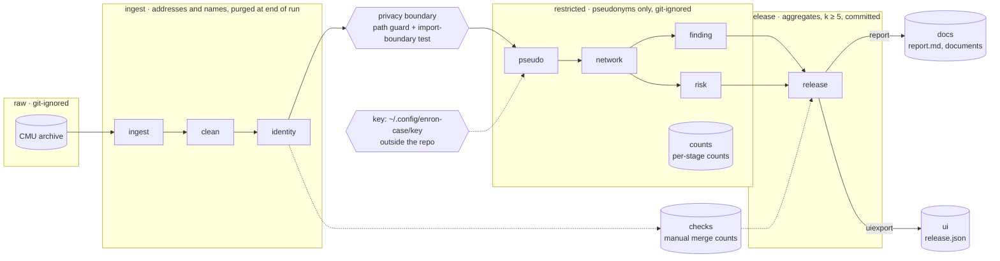
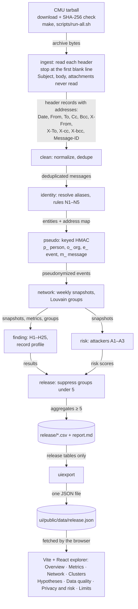
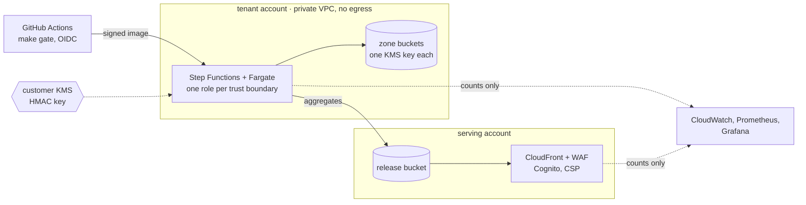

# Headers-only network analysis of the Enron email corpus

An engineering case study: a privacy-first pipeline that reads only the headers of the public Enron
email corpus, so message content never enters the system. It cleans and pseudonymizes the headers,
tests pre-stated hypotheses about how the communication network changed in the 2001 crisis,
attacks its own output to measure re-identification risk, and publishes only aggregates.

## Run it

Prerequisites: Python 3.12, [uv](https://docs.astral.sh/uv/), Node 20+, `make`.

```bash
make          # `make check` does the same without serving the explorer
```

It installs locked dependencies, creates a key outside the repository if needed, fetches and
verifies the corpus, runs the pipeline and every test, then serves the explorer at
http://localhost:4173. A fresh clone took about 24 minutes, 20
of them the download; the pipeline itself takes about 2.5.

## Results in brief

- **Content line:** `Subject` and folder names count as content and are dropped as each line is
  read; only `Date` and the address fields are used, and addresses never leave the ingest zone.
- **Data quality:** about 517,000 files, half of them duplicate copies, give about 250,000
  messages; about 85,400 addresses resolve to about 84,800 entities.
- **Finding:** what changed in the crisis year is the *record*, not measurable behaviour. For
  the same custodians, the share of weekday sent mail stamped outside working hours drops from
  about half to a few percent between April and May 2001, and the mail kept per month grows
  several-fold: the `Date` convention changed (most likely the mail system) right between the
  windows every comparison sets against each other. Confidence: high that the record changed;
  its cause is not established.
- **Behaviour:** no hypothesis among H1–H25 is held true. H2/H3 passed their tests but are
  artifacts (stale baseline groups; a changing mailbox mix); H16 fails its retention check; H25,
  a post-hoc replication of the published "denser network in the crisis", finds no change within
  custodians.
- **Risk:** person-level pseudonymized edges are re-identifiable: an outsider (A1) matches about
  a quarter of people, an insider knowing a few custodians (A2) more than half, one knowing all of
  them (A3; the corpus names them) about as many. So only aggregates are published, every group
  at least five people, leaving no person-level record to match.

## Architecture and data flow

Data lives in zones. A path guard (`zones.py`) confines each package to the zones it may use, and
an import-boundary test keeps everything after `pseudo` away from the identifier-side packages. The
ingest zone is deleted at the end of every run; `risk` alone may score its guesses against it,
emitting counts only.



Each arrow names what crosses it; every table crossing a zone is validated against a contract.



## Decision record

| Trade-off | Gained | Paid |
|-----------|--------|------|
| Strict content line, including `Subject` | no content fingerprint, not even hashed | no threads or reply times; dedupe without content |
| Rule-based identity resolution | deterministic, explainable, precise | missed aliases |
| Keyed HMAC pseudonyms | stable, not confirmable by hashing guesses | key holders can test candidates; structure still re-identifies |
| Aggregates-only release | nothing person-level published | no person-level analysis for readers |

**With real customer data:** metadata-only connectors so content never leaves the source,
retention schedules, and works council review of questions and thresholds before the first run.

## AI workflow

Built spec-first with GitHub Spec Kit (in `specs/`). A lead agent froze the configuration,
contracts and a synthetic corpus with known answers; ten agents then built one work package each
in parallel worktrees, testing against that ground truth.

`make gate` (lint, strict typing, tests, a privacy canary, an import-boundary test) and four
review skills kept it correct. They caught a header reader that could run on into message bodies and showed
H2/H3, then H16, to be artifacts; a final review against prior work found the record change and
added H25 and attacker A3.

A person decided the content line, judged a sample of real identity merges in a terminal (so real
identifiers never entered an AI conversation), rejected the artifact results, and chose what to cut.

## Compared with prior work

Our counts agree with published ones (517,401 files = the 2004 release minus 30 later deletions;
250,537 messages, within 1 % of content-based dedupes); our identity resolution is weaker than
published manual cleanups; within custodians we do not find the published 2001 network changes. Citations: [related work](docs/technical-overview.md#related-work-and-how-this-compares).

## Limits

- Body bytes pass through the decompressor on the way to being skipped; the archive on disk holds them.
- About 150 mailboxes collected by an investigation: what people kept differs by person and period.
- Every crisis comparison crosses the change of the `Date` convention; the placebo windows cannot see it.
- Identity precision on real data rests on a manual sample, not ground truth.
- The noise release is a sketch without a formal privacy budget.

## Next steps

**Deploy on AWS** so each privacy guarantee in the code gets a second line in the platform:



- Zones become buckets; IAM roles mirror `zones.ALLOWED`. Ingest stays on task storage, never
  versioned, and is deleted.
- The key stays in the customer's KMS (`GenerateMac`, never exported); rotating it changes every
  pseudonym.
- Images built and signed only after `make gate`, deployed by OIDC with no stored keys.
- Account per tenant, residency by region; telemetry carries counts only, with alarms on a
  failed stage or an unpurged ingest zone.

Also: the record profile as a view in the explorer; a query API with a privacy budget; differential
privacy for releases; a group-level attack.
Details: [deployment on AWS](docs/deployment-aws.md).

## More detail

[Technical overview](docs/technical-overview.md) · [report](release/report.md) ·
[decision record](docs/decision-record.md) · [AI workflow](docs/ai-workflow.md) ·
[specification, plan and tasks](specs/001-enron-network-analysis/)
