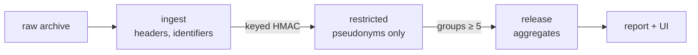

# Headers-only network analysis of the Enron email corpus

An engineering case study: a privacy-first pipeline that reads only the headers of the public Enron
email corpus, so message content never enters the system. It cleans and pseudonymizes the headers,
tests pre-stated hypotheses about how the communication network changed in the 2001 crisis,
attacks its own output to measure re-identification risk, and publishes only aggregates.

## Run it

Prerequisites: Python 3.12, [uv](https://docs.astral.sh/uv/), Node 20+, `make`.

```bash
make
```

One command installs locked dependencies, creates a key outside the repository if none exists
(and says so), downloads and verifies the corpus, runs the pipeline, runs every test (Python and
UI), builds the explorer UI on the real results, serves it at http://localhost:4173, and prints
where the report and the UI are. It takes a few minutes, mostly the download.

## Results in brief

- **Content line:** `Subject` and folder names count as content and are dropped as each line is
  read; only `Date` and the address fields are used, and addresses never leave the ingest zone.
- **Data quality:** about 517,000 files parsed, about half of them duplicate copies, leaving about
  250,000 messages; about 85,400 addresses resolved to about 84,800 entities.
- **Finding:** no hypothesis among H1–H24 is held true. H2 and H3 passed their tests but are
  artifacts of the data (stale baseline groups; a change in which mailboxes hold mail). H16 (a larger share of
  contacts writing back in the crisis) is the strongest lead but fails the retention check: it is largely
  explained by how much inbox mail was kept.
- **Risk:** person-level pseudonymized edges are re-identifiable: one attack matches about a
  quarter of people, a second more than half. So only aggregates are published, every group at
  least five people, where both attacks match nobody.

## Decision record



**Architecture.** Four data zones; a path guard refuses any read or write outside a package's own zones,
and an import-boundary test keeps everything after pseudonymization away from identifiers. Every
table crossing a zone is validated against a written contract. The UI reads one JSON file built
from the release tables only.

| Trade-off | Gained | Paid |
|-----------|--------|------|
| Strict content line, including `Subject` | no content fingerprint, not even hashed | no threads or reply times; dedupe without content |
| Rule-based identity resolution | deterministic, explainable, precise | missed aliases |
| Keyed HMAC pseudonyms | stable, not confirmable by hashing guesses | key holders can test candidates; structure still re-identifies |
| Aggregates-only release | nothing person-level published | no person-level analysis for readers |

**With real customer data:** metadata-only connectors so content never leaves the source; the key
in the customer's custody; retention schedules and data residency; works council review of
questions, thresholds and outputs before the first run; a formal differential-privacy budget.

## AI workflow

Built spec-first with GitHub Spec Kit: constitution → spec → plan → tasks → implement, all in
`specs/`. A lead agent froze the configuration, contracts and a synthetic corpus with known
answers; ten agents then built one work package each in parallel, in separate worktrees, testing
against that ground truth rather than each other's code.

Output was kept correct by `make gate` (lint, strict typing, tests, a privacy canary that plants
markers in bodies and subjects, an import-boundary test) and by review skills: `/code-review`,
`/data-privacy-review`, `/code-quality-review` and `/data-scientist-review`. They caught a header
reader that could run on into message bodies; showed H2/H3, and later H16, to be artifacts; and a
two-run determinism check caught a bootstrap that depended on row order.

A person decided the content line, judged a sample of real identity merges in a terminal (so real
identifiers never entered an AI conversation), rejected the artifact results, and chose what to cut.

## Limits

- Body bytes pass through the decompressor on the way to being skipped; the archive on disk holds them.
- About 150 collected mailboxes, shaped by an investigation: what people kept differs by person and period.
- Identity precision on real data rests on a manual sample, not ground truth.
- The noise release is a sketch without a formal privacy budget.

## More detail

[Technical overview](docs/technical-overview.md) · [report](release/report.md) ·
[decision record](docs/decision-record.md) · [AI workflow](docs/ai-workflow.md) ·
[specification, plan and tasks](specs/001-enron-network-analysis/)
