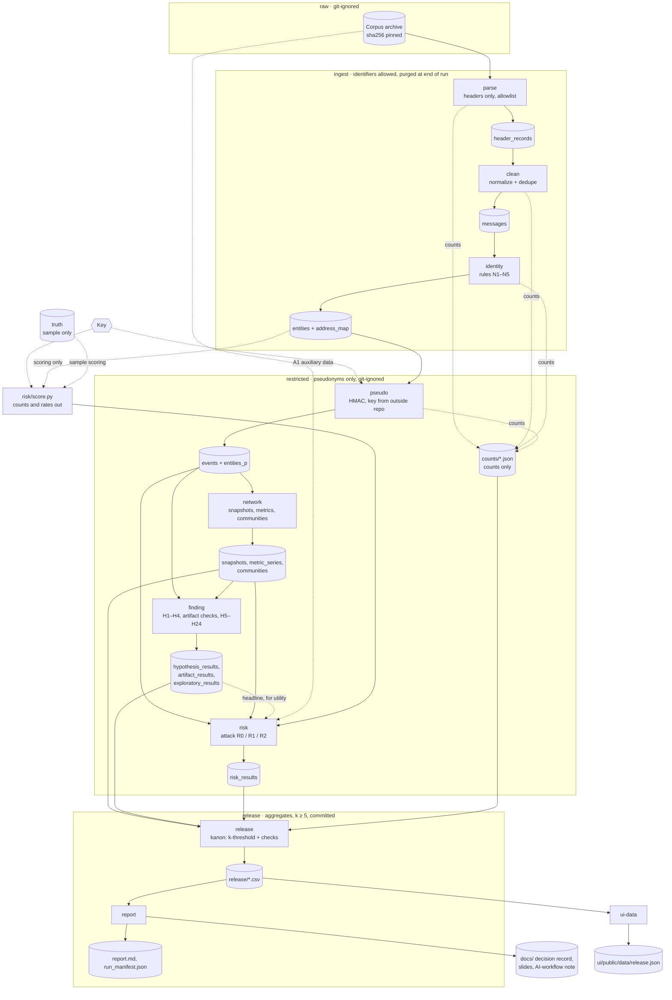
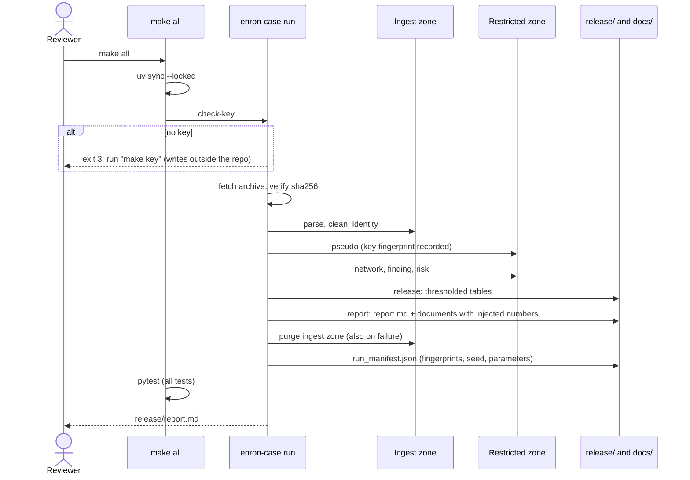
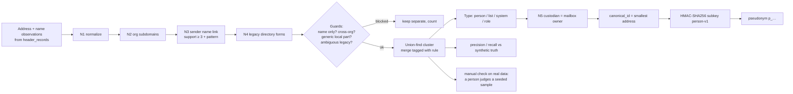
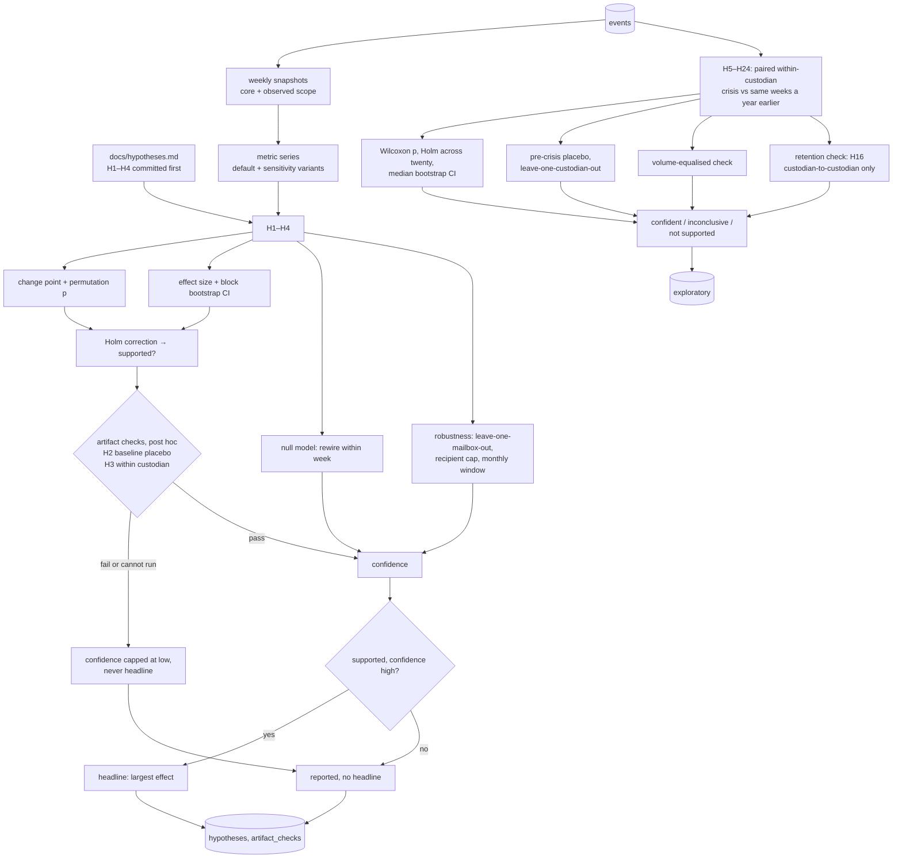
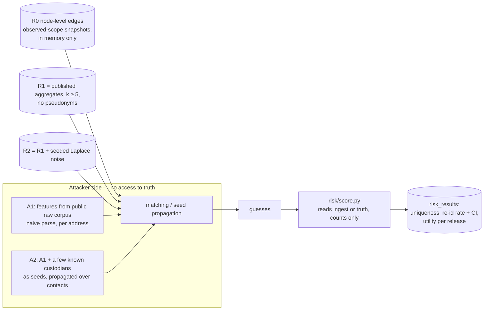
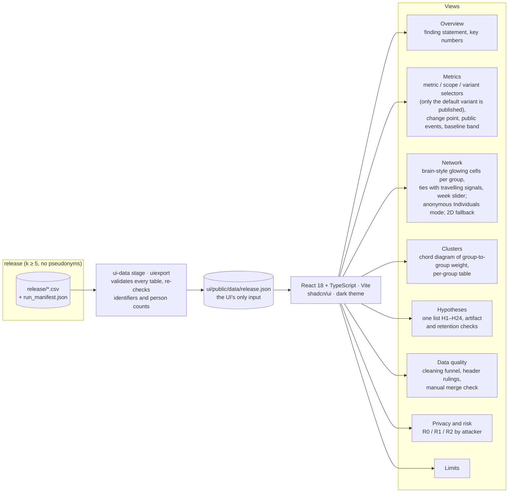

# Architecture

How data flows through the pipeline, where the privacy boundary sits, and how the explorer UI is
fed, as implemented. The design began in `specs/001-enron-network-analysis/plan.md` and
`research.md`; table schemas are in `specs/001-enron-network-analysis/contracts/data-contracts.md`
(contract 1.4) and in code in `src/enron_case/contracts/`.

### Data zones and stages

Eleven stages run in order (`src/enron_case/cli.py`, `STAGES`). Each is a function in
`enron_case.<package>.stage`; the zone a stage may touch is decided by its package.

`counts` is a sub-zone of restricted (`data/restricted/counts/`) holding only the counts side
outputs of each stage (`ingest_counts`, `clean_counts`, `identity_counts`, `pseudo_counts`,
`identity_manual`). `truth` holds the synthetic ground truth and exists only for the sample
corpus. `ui` and `docs` are write targets of the last two stages and can be built only from
`release`.

Four mechanisms make the picture enforceable:

1. **Path guard** (`zones.py`). `ALLOWED` maps each package to the zones it may read or write;
   anything else raises `PrivacyViolation` (exit 6). Two documented exceptions in `risk` are
   pinned to single modules by `tests/privacy/test_zones.py`: only `risk/aux_public.py` reads
   the raw archive (the attacker's own copy of the public corpus) and only `risk/score.py`
   reads the ingest zone, the truth and the key (to score guesses, returning counts only).
2. **StageContext** (`context.py`) is the only way a stage reads or writes data: `ctx.read`,
   `ctx.write`, `ctx.write_counts`, `ctx.read_counts`, `ctx.path`. Every table write is
   conformed and validated against its contract, leak-checked (no `@` in restricted; no
   address or pseudonym pattern in release) and fingerprinted for the run manifest. Only the
   `release` package may write release tables; counts files refuse any `@`.
3. **Import boundary** (`tests/privacy/test_import_boundary.py`). `network`, `finding`, `risk`,
   `release`, `report` and `uiexport` may not import `ingest`, `clean` or `identity`;
   `uiexport` may import only release-side helpers.
4. **One release gate** (`release/kanon.py`). Every release table passes `kanon.enforce`: no
   identifier pattern, no person count below k in any column of
   `schemas.PERSON_COUNT_COLUMNS`, only the default variant in `weekly_metrics`, no lone
   recoverable cell in `degree_distribution`. A violation aborts the run.

The privacy canary (`tests/privacy/test_canary.py`) plants markers in bodies, subjects, folder
names, file names and display names of the synthetic corpus and checks that none reaches the
restricted zone, the release, the manifest or the logs, and that body and subject markers appear
nowhere at all.

### One-command run

`ui-data` is not part of the default run; `make ui` runs it, then builds and serves the UI.
`enron-case run --sample` (`make sample`) runs the same stages on the synthetic corpus into
`release-sample/` with a fixed test key; documents are written only on real-corpus runs.
`enron-case review-merges` is the manual merge check: it shows a seeded sample of merges in a
terminal and stores only two counts (`identity_manual`).

### Identity resolution and pseudonymization

Events are emitted per recipient **entity**, so several aliases of one recipient make one event,
not several. Registered domains use a multi-label suffix table (`config.MULTI_LABEL_SUFFIXES`),
so N2 does not merge across companies under `co.uk`-style suffixes.

### Analysis and evidence

H5–H24 were stated in `docs/hypotheses-exploratory.md` (as E1–E20) before they were computed,
after H1–H4 had been run; they are reported as one list H1–H24 everywhere. In the real-corpus run
**no hypothesis is held true**: H2 and H3 pass the pre-registered rule but fail their artifact
checks (baseline drift; a change in which mailboxes hold mail), H1 and H4 are not supported, and
of H5–H24 none is confident. H16, the strongest lead, fails its retention check and is capped at
inconclusive.

### Re-identification test

R1 and R2 contain no person-level records, so the attackers have nothing to match: their rate is
zero by construction. That is reported as such, not as a measured group-level attack (none was
built).

### Explorer UI

Rules for the UI:

1. It is a static site. Its only input is `release.json`, produced from `release/` alone (the
   release tables plus the manifest's run block without fingerprints or timings), so it cannot
   show anything the report could not. `ui/src/lib/data.ts` validates the file at load.
2. The network and cluster views draw **groups** (baseline communities with at least k members)
   and the weekly tie weight between them. The Network view's 3D scene (three.js through
   `react-force-graph-3d`) is loaded on demand; without WebGL it falls back to a 2D `d3-force`
   layout. The Individuals mode draws, inside each group, as many points as the group has
   persons, at seeded random positions: decoration with no id, label, tooltip or data. There is
   no person-level node, tooltip or table anywhere (`ui/src/privacy.test.ts`).
3. No outside requests: fonts and assets are bundled; no analytics, no CDN.
   `ui/scripts/check-build.mjs` (run by `make ui-gate`) scans the build for external URLs.
4. `make all` does not need Node. `make ui` exports the data, builds and serves the interface.
