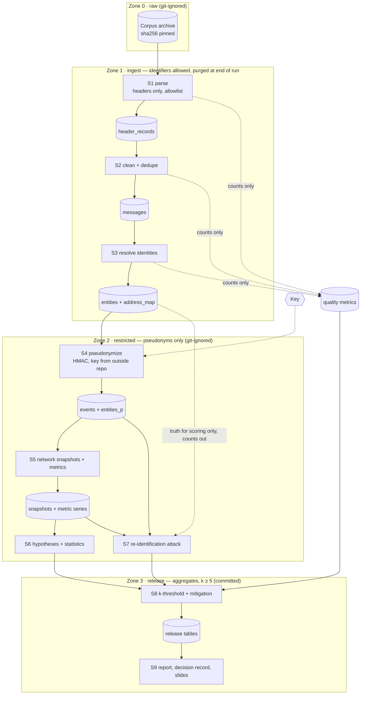
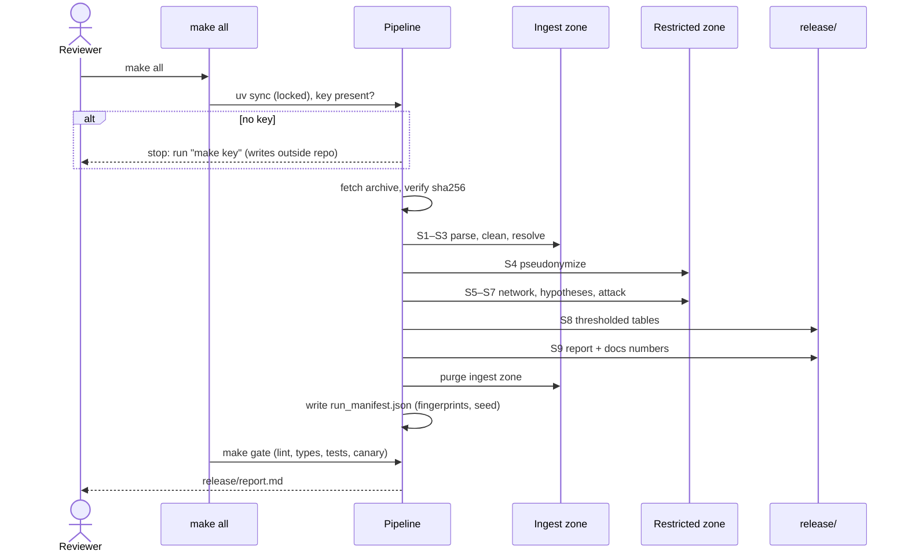
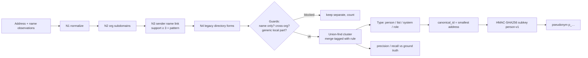
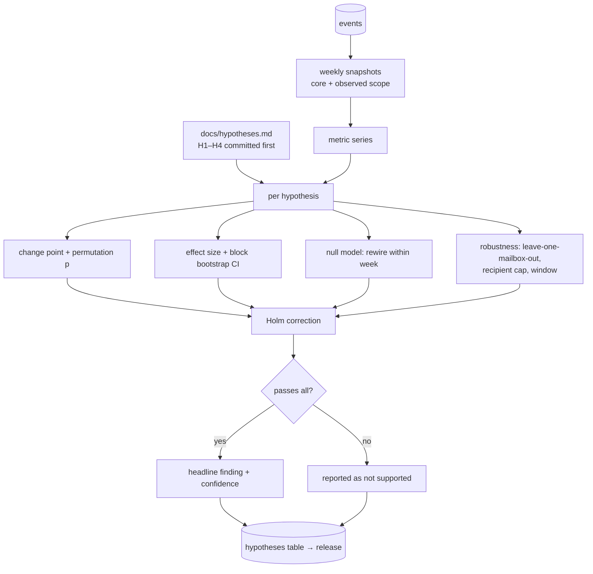
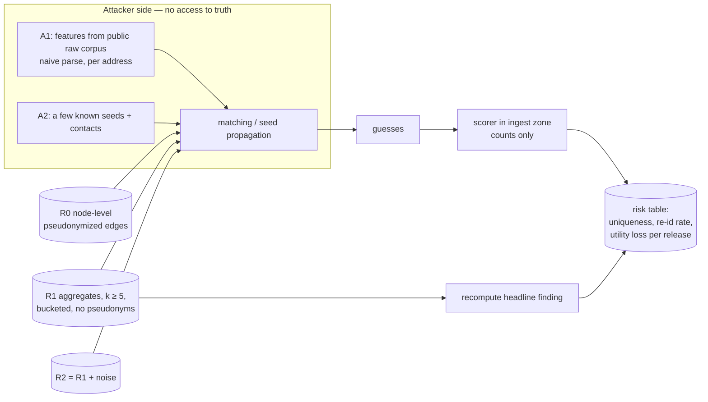
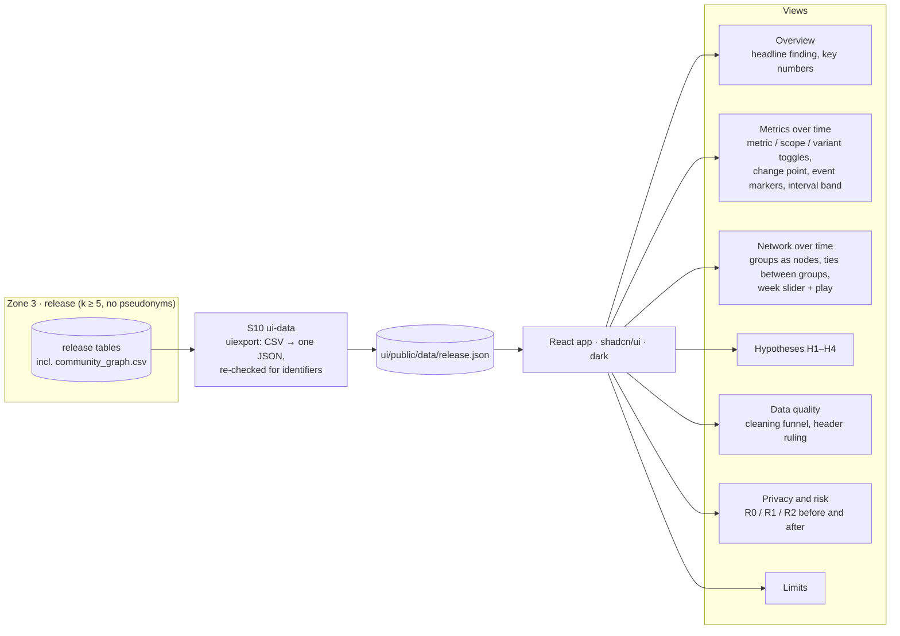

# Architecture

How data flows through the pipeline, where the privacy boundary sits, and how the explorer UI is
fed. Kept in step with the code; the source of the design is
`specs/001-enron-network-analysis/plan.md` and `research.md`.

### Data zones and stages

Three rules make the picture enforceable:

1. A package may open files only in its allowed zones (`zones.py` path guard).
2. Packages right of the boundary may not import packages left of it (AST test).
3. Only S8 writes to `release/`, and it refuses any table with a group below k.

### One-command run

### Identity resolution and pseudonymization

### Analysis and evidence

### Re-identification test

### Explorer UI

Rules for the UI:

1. It is a static site. Its only input is `release.json`, produced from `release/` alone, so it
   cannot show anything the report could not.
2. The network view draws **groups** (baseline communities with at least k members) and the
   weekly tie weight between them. There is no person-level node, tooltip or table anywhere.
3. No outside requests: fonts and assets are bundled; no analytics, no CDN. A test scans the
   build for external URLs.
4. `make all` does not need Node. `make ui` builds and serves the interface after a run.
