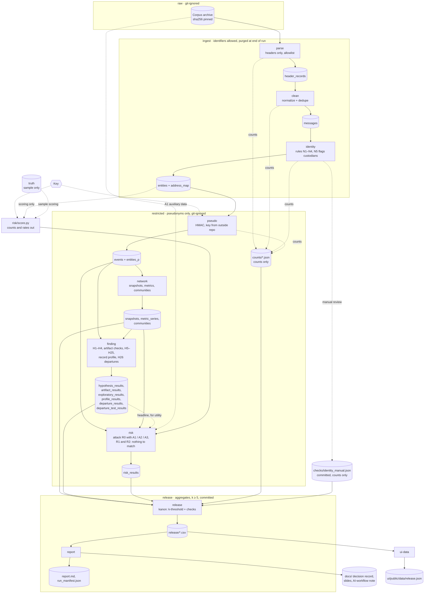
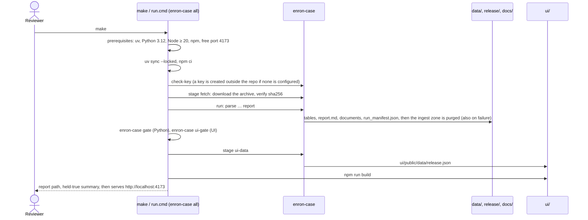
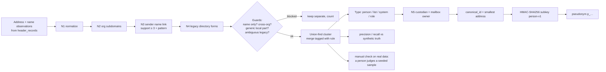
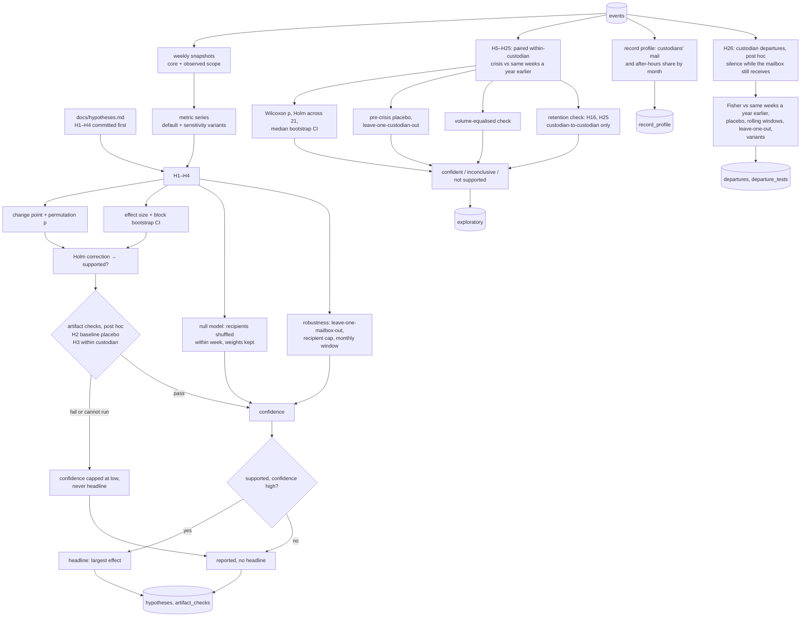
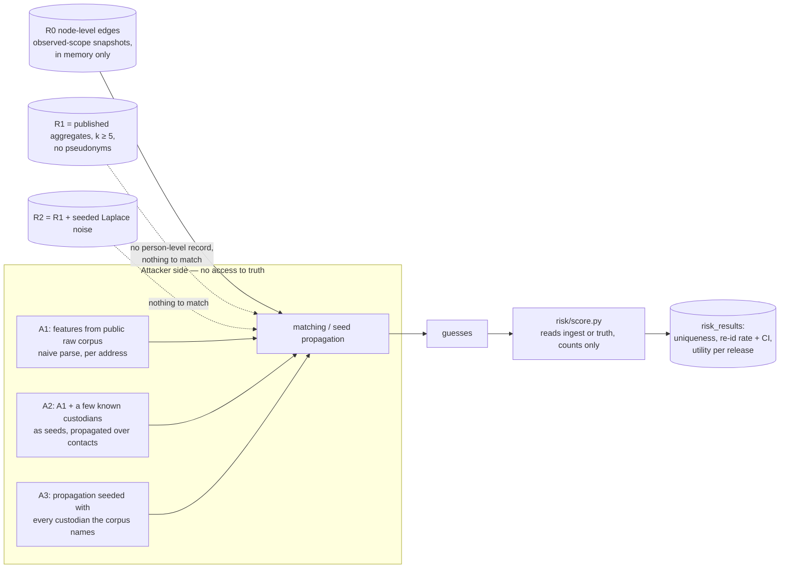
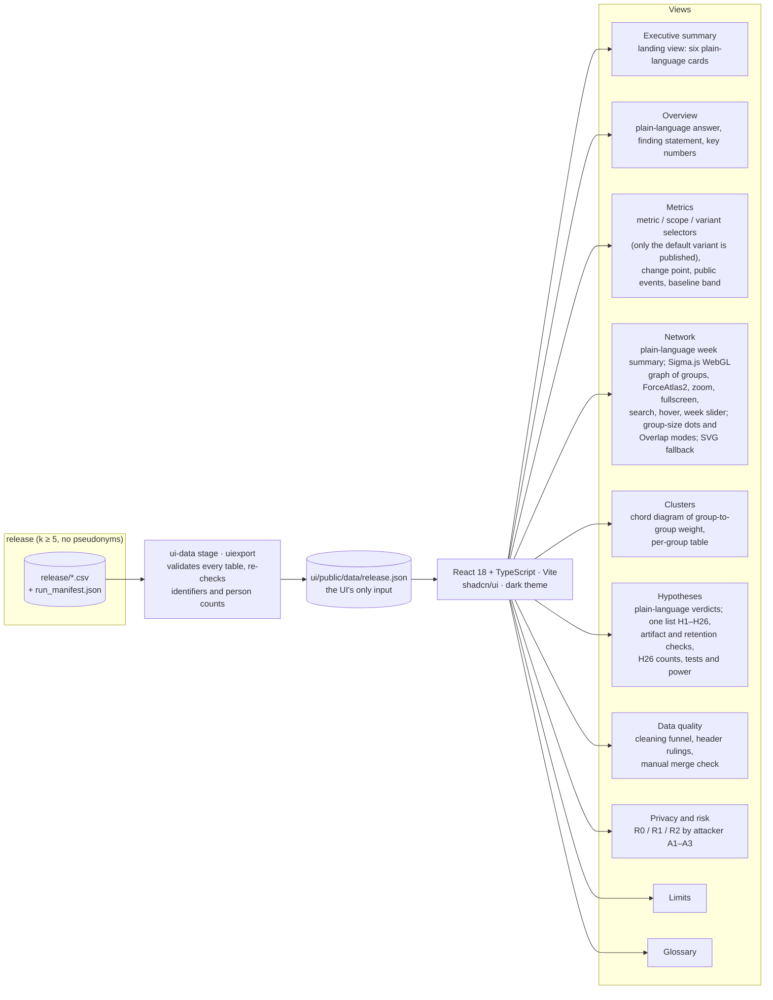

# Architecture

How data flows through the pipeline, where the privacy boundary sits, and how the explorer UI is
fed, as implemented. The design began in `specs/001-enron-network-analysis/plan.md` and
`research.md`; table schemas are in `specs/001-enron-network-analysis/contracts/data-contracts.md`
(contract 1.7) and in code in `src/enron_case/contracts/`.

### Data zones and stages

Eleven stages run in order (`src/enron_case/cli.py`, `STAGES`). Each is a function in
`enron_case.<package>.stage`; the zone a stage may touch is decided by its package.

`counts` is a sub-zone of restricted (`data/restricted/counts/`) holding only the counts side
outputs of each stage (`ingest_counts`, `clean_counts`, `identity_counts`, `pseudo_counts`,
`identity_manual`). `truth` holds the synthetic ground truth and exists only for the sample
corpus. `checks` (`checks/` at the repository root, committed) holds the counts of checks a
person made: `enron-case review-merges` writes `identity_manual.json` there as well as to
`counts`, and the release stage falls back to the committed copy when a run has none, so a fresh
clone publishes the same manual-check rows. `ui` and `docs` are write targets of the last two
stages and can be built only from `release`. `logs` (`data/logs/`, git-ignored) holds run logs,
never data: only the orchestrator writes there, the seconds each stage took
(`stage_timings.json`), which stay out of the committed manifest because they change on every run.

Four mechanisms make the picture enforceable:

1. **Path guard** (`zones.py`). `ALLOWED` maps each package to the zones it may read or write;
   anything else raises `PrivacyViolation` (exit 6). Two documented exceptions in `risk` are
   pinned to single modules by `tests/privacy/test_zones.py`: only `risk/aux_public.py` reads
   the raw archive (the attacker's own copy of the public corpus) and only `risk/score.py`
   reads the ingest zone, the truth and the key (to score guesses, returning counts only).
2. **StageContext** (`context.py`) is the only way a stage reads or writes data: `ctx.read`,
   `ctx.write`, `ctx.write_counts`, `ctx.read_counts`, `ctx.path`. Every table write is
   conformed and validated against its contract, leak-checked (no `@` in restricted; no `@`,
   `p_…` or `o_…` pattern in release: a pattern check, which a bare name would pass) and
   fingerprinted for the run manifest. Only the
   `release` package may write release tables; counts files refuse any `@`.
3. **Import boundary** (`tests/privacy/test_import_boundary.py`). `network`, `finding`, `risk`,
   `release`, `report` and `uiexport` may not import `ingest`, `clean` or `identity`;
   `uiexport` may import only release-side helpers.
4. **One release gate** (`release/kanon.py`). Every release table passes `kanon.enforce`: no
   identifier pattern, no person count below k in any column of
   `schemas.PERSON_COUNT_COLUMNS`, only the default variant in `weekly_metrics`, no core row
   where observed minus core `n_active` would count 1 to k − 1 persons (the core is nested in
   the observed network; the builder suppresses that core row), no lone recoverable cell in
   `degree_distribution`, and no `departures` row whose complement (at risk minus a published
   count) is below k. A violation aborts the run.

The privacy canary (`tests/privacy/test_canary.py`) runs the pipeline on the synthetic corpus,
which carries markers in bodies, subjects, folder names and file names, and checks that none of
those four appears in any zone at all (ingest, restricted, release, ui, docs, logs) or in a log
line. It also checks that no `@`, display name or mailbox owner's folder name reaches the
restricted zone, the release, the UI data, the documents, the manifest or the logs.

### One-command run

Each step prints one line and logs to `data/logs/<step>.log`; the first failing step stops the
run with its exit code. `make check` (`uv run enron-case check` on Windows) does everything
except serving. On a fresh clone the whole
run took about 25 minutes (about 20 the download, on that connection); the pipeline itself takes
about 2.5 minutes (the one command prints each step's time, and each run writes the seconds per
stage to `data/logs/stage_timings.json`, which is not committed; the manifest holds no
durations). `enron-case run` purges the ingest zone when it ends, also on failure. A single
`enron-case stage X` keeps it, so the next stage can read it, and prints a warning: finish with
a full `run`, or delete `data/ingest/`, when done.
`enron-case run --sample` (`make sample`) runs the same stages on the synthetic corpus into
`release-sample/` with a fixed test key; documents are written only on real-corpus runs.
`enron-case review-merges` is the manual merge check: it shows a seeded sample of merges in a
terminal and stores only counts (`identity_manual`: `manual_checked`, `manual_correct` and the
same per rule when the review records them; the committed `checks/identity_manual.json` holds
the two totals only).

### Identity resolution and pseudonymization

Events are emitted per recipient **entity**, so several aliases of one recipient make one event,
not several. Registered domains use a multi-label suffix table (`config.MULTI_LABEL_SUFFIXES`),
so N2 does not merge across companies under `co.uk`-style suffixes.

### Analysis and evidence

Three timing labels are used on every surface. H1–H4 are "pre-registered" (before any real
data). H5–H24 are "stated before computed, after earlier results": written in
`docs/hypotheses-exploratory.md` (as E1–E20) after H1–H4 had been run. H25 (E21), a replication
test of the "denser network in the crisis" reported by Diesner & Carley (2005), and H26,
custodian departures, are "post hoc": stated after every other result was known, and before
being computed. They are reported as one list H1–H26 everywhere. In the real-corpus run **no
hypothesis is held true**: H2 and H3 pass the pre-registered rule but fail their artifact checks
(baseline drift; a change in which mailboxes hold mail), H1 and H4 are not supported, and of
H5–H25 none is confident. H16, the strongest lead, is not established once inbox retention is
accounted for and is capped at inconclusive; H20 is inconclusive (its placebo fails); H14, H21
and H22 changed the other way; H25 is not established within custodians.

H26, a structural question stated post hoc (O1 in `docs/hypotheses-exploratory.md`), asks
whether custodians left during the crisis: a departure is a custodian who stops sending for 16
weeks while their own mailbox keeps receiving mail that only it can hold, so a mailbox that was
no longer collected (a record end) does not count. It is **not established**: too few
departures in the crisis window to publish, and not a higher share than a year earlier.

The finding: the record changed (high confidence that it changed; cause not established). No
behavioural finding about the crisis year is claimed. The record profile (`record_profile`)
shows the share of the custodians' weekday sent mail stamped outside working hours dropping from
about half (up to April 2001) to a few percent (from August 2001 on), falling from May 2001,
while the received mail kept per month grows up to about 3.5 times the largest reference month
(about five times October on October). The `Date` convention changed between the windows every
comparison sets against each other, so the report states that change first.

### Re-identification test

R0, which is never published, is the only release measured. R1 and R2 contain no person-level
records, so the attackers have nothing to match: their rate is 0 by construction, not a
measurement. No group-level attack was built.

### Explorer UI

Rules for the UI:

1. It is a static site. Its only input is `release.json`, produced from `release/` alone (the
   release tables except `record_profile`, plus the manifest's run block without
   fingerprints), so it shows nothing that is not in the release. `ui/src/lib/data.ts`
   validates the file at load. The ten views are listed in `ui/src/lib/views.ts`.
2. The network and cluster views draw **groups** (baseline communities with at least k members)
   and the weekly tie weight between them. The Network view draws them with Sigma.js (WebGL)
   through React Sigma and graphology, loaded as a separate chunk when the view opens; positions
   come from one deterministic ForceAtlas2 run over all weeks. It has zoom, fullscreen, search by
   group label and hover highlighting; without WebGL, or if the WebGL view fails, it shows an SVG
   network laid out with `d3-force`. The group-size dots mode draws, inside each group, as many dots as the group has
   persons, at seeded random positions: the dots only show how many people a group has, not real
   individuals or ties; they carry no label, tooltip, hover text, tie or data (Sigma keys are
   opaque sequence numbers). The Overlap mode (WebGL only) draws the week's six
   heaviest group pairs by message count as intersecting outlined contours (one `@sigma/layer-webgl` layer, drawn from group nodes only); an overlap is mail
   between groups, never shared members. The release's `other` bucket (people with no tie in the
   baseline plus communities under k) is not a group: neither view draws or lays it out as one;
   both call it "Outside the 2000 groups" and state the share of mail involving it
   (`ui/src/lib/outside.ts`, docs/metrics.md). There is
   no person-level node, tooltip or table anywhere (`ui/src/privacy.test.ts`).
3. No outside requests: fonts and assets are bundled; no analytics, no CDN.
   `ui/scripts/check-build.mjs` (run by `make ui-gate`) scans the build for external URLs.
4. `make` builds and serves the UI as its last steps (so it needs Node 20+); `make ui` exports
   the data, builds and serves the interface on its own. The UI does not show the month-by-month
   record profile, which is in the report; its Executive summary names the record change through
   H5 and the two comparison windows.
