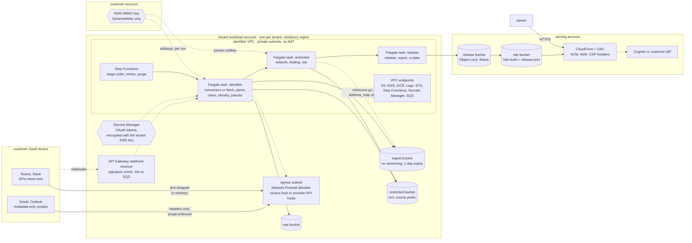
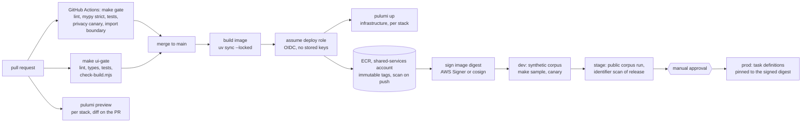
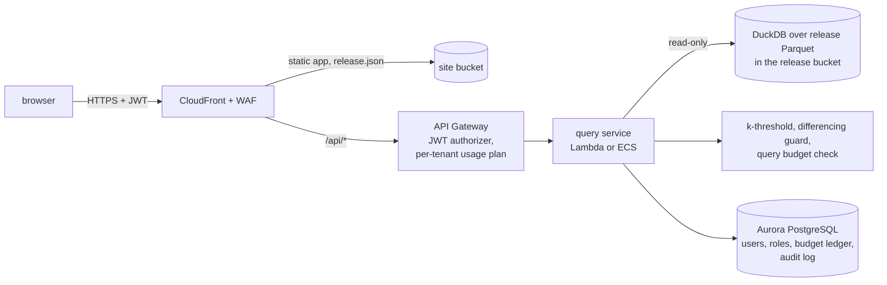
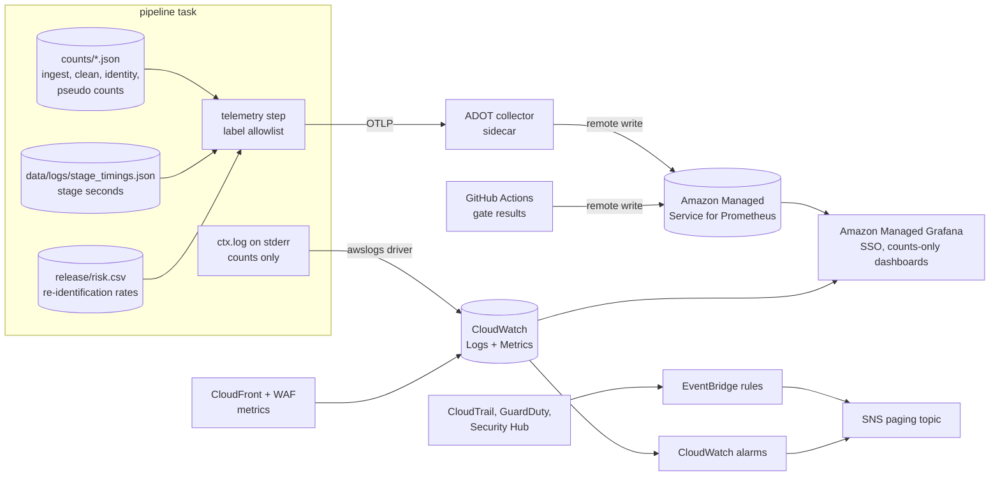

# Deploying on AWS

*Proposal; none of this is implemented.* Today the pipeline runs on one machine (`make`,
`enron-case all`) and the explorer is a static build over one `release.json`. This document
maps that design onto AWS so that its privacy guarantees carry over. Each guarantee in the code
gets a second, independent enforcement in the platform. The code stays the first line of defence.
It complements the [technical overview's next steps](technical-overview.md#next-steps), which
cover the query service, explorer security controls and the multi-tenant data model. This
document says how to build those on AWS.

| Guarantee today | Where it lives in code | Second line on AWS |
|---|---|---|
| A package touches only its zones | `zones.ALLOWED`, `zones.check` | One IAM role per task group; bucket and KMS key policies per zone |
| Identifiers never outlive the run | `zones.purge_ingest` in the `finally` of `cli.run_pipeline` | Ingest on the task's own disk or in a bucket without versioning, explicit delete, a lifecycle backstop and an alarm |
| The key never enters the repository or a log | `pseudo/keys.py` | KMS HMAC key: `GenerateMac` only, never exportable, held by the customer |
| Only aggregates with k ≥ 5 are published | `release/kanon.py`, `StageContext.write` leak checks | Release in its own account; Macie scans it as a second identifier check |
| Logs carry counts only | `ctx.log`, `ctx.write_counts` refuses `@` | CloudWatch Logs data protection policy; telemetry label allowlist |
| No code reaches the data unreviewed | `make gate`, privacy canary, import-boundary test | Images built only by CI after the gate, signed, promoted by digest |

## Target architecture

**Diagram: today: static release.json.** The browser fetches one pre-computed file from CloudFront; there is no API and no database
to query, because every viewer of a tenant sees the same aggregates. The query path that adds
both is drawn under [Release and explorer](#release-and-explorer).

The diagram shows Design B (three tasks, an ingest bucket); Design A runs one task and has no
ingest bucket (see [below](#two-designs-for-the-ingest-zone)). Three AWS accounts per tenant boundary (plus the shared ones under
[Multi-tenant](#multi-tenant-isolation)):

- **Customer account** holds the HMAC key. We are granted `kms:GenerateMac` on it, nothing
  else, and the customer can revoke that grant at any time.
- **Tenant workload account** holds raw, ingest and restricted data and runs the pipeline. It
  has no route to the internet except the egress subnet, which reaches only the corpus host or,
  with customer data, the provider API hosts. Its one public endpoint is the webhook receiver
  (see [Connectors](#connectors)).
- **Serving account** holds the release and the explorer. It has no IAM path back to raw,
  ingest or restricted. The release task writes into it through a bucket policy that allows
  `s3:PutObject` from that one role.

## Zones on AWS

### Buckets and keys

Every zone in `zones.py` becomes a bucket or a prefix. Each bucket has S3 Block Public Access,
a policy that denies requests without `aws:SecureTransport`, and SSE-KMS with its own
customer-managed key. S3 Bucket Keys keep the cost of KMS requests low. Each key policy grants
`kms:Decrypt` only to the roles that may read that zone. A role without IAM access to a bucket
therefore also lacks the key that would decrypt it.

| Zone (`zones.Zone`) | AWS location | KMS key | Versioning / lock | Lifecycle |
|---|---|---|---|---|
| `raw` | raw bucket, workload account | `raw` key | versioning on | Kept for reruns of the public corpus. With customer connectors, no raw copy is kept at all |
| `ingest` | Design A: the Fargate task's ephemeral disk. Design B: ingest bucket, prefix `run=<id>/` | Fargate ephemeral-storage key / `ingest` key | **No versioning, no Object Lock, no replication, excluded from AWS Backup** | Explicit delete at the end of every run; a lifecycle rule that expires objects after 1 day (the S3 minimum) as a backstop |
| `restricted`, `counts` | restricted bucket; `counts/` prefix | `restricted` key | versioning on, noncurrent versions expire | Retention schedule agreed with the customer |
| `truth` | not deployed | – | – | Exists only for the synthetic sample, which runs in CI and dev |
| `release` | release bucket, serving account | `release` key | versioning on; Object Lock (governance mode) on published releases | Kept as the record of what was published |
| `ui` | site bucket, serving account | `site` key | versioning on (rollback) | Old builds expire |
| `docs` | release bucket, `docs/` prefix | `release` key | as release | as release |
| `checks` | restricted bucket, `checks/` prefix, written by the person's review session | `restricted` key | versioning on | Counts only, as today |

Versioning and Object Lock are left off ingest on purpose. A versioned bucket keeps every
deleted object as a noncurrent version, and Object Lock forbids the delete. Either would let
addresses and names outlive the run, which `purge_ingest` exists to prevent.

### Two designs for the ingest zone

- **Design A, one task per run (recommended at current size).** The whole of `enron-case run`
  runs in one Fargate task. The ingest zone lives on the task's ephemeral storage, encrypted
  with a customer-managed key, and is destroyed with the task. `purge_ingest` still runs.
  Identifiers never reach S3, so the ingest bucket does not exist. The real-corpus run takes
  about 2.5 minutes (`stages` in `release/run_manifest.json`, largest stage 47 s). The archive
  is about 440 MB, so a single task fits easily.
- **Design B, one task per trust boundary (for larger corpora).** Step Functions runs three
  tasks, each with its own role. The ingest zone becomes a prefix in the ingest bucket. The CLI
  already supports this split: `enron-case run --from parse --to pseudo --keep-ingest`, then
  `--from network --to risk --keep-ingest`, then `--from release --to report`. Non-full runs
  merge into the run manifest (`RunManifest.write(merge=True)`). A purge state deletes the
  run's ingest prefix and lists it to confirm it is empty. The Step Functions `Catch` on every
  state routes to the purge state, which mirrors the `finally` in `cli.run_pipeline`.

### IAM roles mirror `zones.ALLOWED`

| Task role (Design B) | Packages (`ALLOWED`) | S3 and KMS permissions |
|---|---|---|
| `fetch` | `ingest` (fetch stage) | raw: write. Runs in the fetch subnet, the only one with egress |
| `identifier` | `ingest`, `clean`, `identity`, `pseudo` | raw: read. Ingest: read and write. Restricted: write. Counts: write. HMAC key: `GenerateMac` |
| `restricted` | `network`, `finding`, `risk` | restricted: read and write. Ingest: read on `run=<id>/address_map*` only. Raw: read (`risk/aux_public.py`). HMAC key: `GenerateMac` (`risk/score.py`) |
| `release` | `release`, `report`, `uiexport` | restricted and counts: read. Release bucket (cross-account): write. Site bucket: write `data/release.json` |
| `purge` | `cli` (`purge_ingest`) | ingest: `s3:ListBucket`, `s3:DeleteObject` only |

IAM grants permissions to a task, not to a Python module. Two rules therefore stay in code and
in CI: the risk exceptions pinned to single modules (`tests/privacy/test_zones.py`) and the
import boundary (`tests/privacy/test_import_boundary.py`). In Design A one role carries the
union of these permissions, and the path guard alone separates the stages inside the task. That
is the price of the simpler design.

`ALLOWED` must stay the single source (AGENTS.md: no duplication). The Pulumi program, written in
Python, imports `enron_case.zones.ALLOWED` and generates the policy documents from it, so no copy
or export step exists. A unit test fails when the generated policies and `ALLOWED` disagree (see
[Infrastructure as code](#infrastructure-as-code)).

### Network

- The task subnets are private, with no NAT gateway and no route out. Gateway endpoint for S3;
  interface endpoints for KMS, ECR (api and dkr), CloudWatch Logs, STS, Step Functions, Secrets
  Manager and SQS. Endpoint policies admit only this account's buckets, keys, secrets and queues.
- The fetch stage runs in its own egress subnet, the only one with a route out: through AWS
  Network Firewall with a domain allowlist for the corpus host, then a NAT gateway. It writes
  only to the raw bucket. With customer data,
  this subnet is replaced by metadata-only connectors (technical overview, "Toward real customer
  data"), each with an allowlist for its API host.
- Security groups allow no inbound traffic, because no task serves anything.

### Connectors

With customer data the fetch stage is replaced by connectors to Gmail / Google Workspace,
Microsoft 365 (Outlook), Microsoft Teams and Slack (README, "Next steps", step 1). Each is an
ingest-side package inside the identifier task, so addresses and names stay behind the
pseudonymization boundary.

| Source | API and scope | Content guarantee |
|---|---|---|
| Gmail / Google Workspace | Gmail API, `https://www.googleapis.com/auth/gmail.metadata` (restricted scope, domain-wide delegation) | Headers only, enforced by Google: the scope cannot return bodies or attachments |
| Microsoft 365 (Outlook) | Microsoft Graph, application permission `Mail.ReadBasic.All` (admin consent); Graph Data Connect for bulk export | Headers only, enforced by Microsoft: the permission excludes `body`, `previewBody`, attachments and extended properties |
| Microsoft Teams | Microsoft Graph channel and chat message APIs | No metadata-only permission exists. The connector keeps sender, recipients or channel, time and thread IDs and drops the text in memory before anything is written |
| Slack | Slack Web API (`conversations.history`, `conversations.replies`) and Events API | As Teams: text dropped in memory, including the text inside event payloads |

Both mail scopes still return `Subject`; the header allowlist discards it, as today. For Teams and
Slack the guarantee rests on our code, not on the provider, and the privacy canary is extended
to feed messages with known text through the connector and fail if any of it is written.

- **Egress.** Connectors reach the provider API hosts only (for example `gmail.googleapis.com`,
  `oauth2.googleapis.com`, `graph.microsoft.com`, `login.microsoftonline.com`, `slack.com`),
  through the egress subnet's Network Firewall domain allowlist behind a NAT gateway. No other
  subnet gets a route out.
- **Tokens.** OAuth client secrets and refresh tokens live in Secrets Manager, encrypted with
  the tenant's KMS key and read through an interface endpoint by the identifier task role only.
  Each tenant grants the narrowest scope through admin consent and can revoke it at any time.
- **Incremental sync.** Webhooks only say that something changed; the connector then fetches the
  delta with the same scopes. Gmail push arrives through Google Cloud Pub/Sub (`users.watch`,
  then `users.history.list`); Microsoft Graph sends change notifications (subscriptions and
  delta queries); Slack sends Events API callbacks. The receivers sit behind API Gateway, with
  WAF, in the tenant workload account. A Lambda authorizer verifies each request before it is
  accepted: the OIDC token Pub/Sub attaches to push requests, the Graph validation handshake and
  `clientState` secret, and Slack's `X-Slack-Signature` HMAC with the request timestamp to block
  replays. The receiver forwards only resource IDs to an SQS queue; it drops any message text
  (Slack events carry it) in memory and logs counts only.
- **Rate limits.** Each provider throttles (HTTP 429 with `Retry-After`; Gmail and Graph also
  per-user and per-tenant quotas). Connectors honour `Retry-After`, otherwise back off
  exponentially with jitter seeded from `config.py`, and resume from the last stored history ID
  or delta token, so a throttled run continues rather than restarts. Throttle and retry counts go
  to the telemetry described [below](#monitoring-and-observability).

## The HMAC key

Today `pseudo/keys.py` loads a 32-byte master key from `ENRON_CASE_KEY`, `ENRON_CASE_KEY_FILE`
or `~/.config/enron-case/key`. The master is used in two ways only:

- `subkey(key, label)` = HMAC-SHA256(master, label), for `person-v1`, `org-v1`, `event-v1`;
- `key_fingerprint(key)` = HMAC-SHA256(master, `fingerprint-v1`), truncated to 8 hex chars.

Both are exactly what **AWS KMS `GenerateMac`** returns for an `HMAC_256` key with
`MacAlgorithm=HMAC_SHA_256`. The master can therefore live in KMS and never leave it. A run makes
about five `GenerateMac` calls: the fingerprint in `cli.load_key_fingerprint`, the three subkeys
in the `pseudo` stage, and the person subkey in `risk/score.py`. Today `keyed_digest` derives the
subkey again for every value; with KMS it is derived once per run. The
subkeys exist only in the task's memory for the length of the run. Pseudonyms are then computed
locally (`keyed_digest`), so 1.35 million events cost a handful of KMS calls, not 1.35 million.

- **Custody.** The key lives in the customer's account, one per tenant. Its key policy allows
  `kms:GenerateMac` only to the `identifier` and `restricted` task roles, with the condition
  `kms:MacAlgorithm = HMAC_SHA_256`. No principal is granted `kms:VerifyMac`, and no
  administrator role can use the key. To carry an existing key over, its material can be
  imported, which keeps the existing pseudonyms.
- **Secrets Manager** is the fallback if KMS HMAC keys are unavailable. It stores the hex key,
  encrypted with a KMS key, rotation off, and readable only by the same two roles. It is weaker:
  the key enters task memory and could be exfiltrated by compromised code.
- **The sample key** stays refused for real data (`load_run_key`). With KMS the check compares
  fingerprints, because the master is not available to compare.

**Rotation changes every pseudonym.** A pseudonym is HMAC(subkey, canonical id). With a new key,
the same person gets a new `p_…` and nothing links the two. Consequences:

- KMS has no automatic rotation for HMAC keys. Rotation is a deliberate act: create a key, move
  the alias, rerun.
- Today's pipeline recomputes the whole history on every run, so a rotation is a full rerun with
  the new key. `key_fingerprint` in the run manifest changes, which makes the rotation visible.
- Restricted tables from before and after a rotation must never be joined. Delete or
  re-pseudonymise the old ones. Published releases carry no pseudonyms, so they stay valid.
- Scheduling the old key for deletion (a 7 to 30 day wait) is crypto-shredding. Once it is gone,
  nobody, the customer included, can test a candidate address against the old pseudonyms.
- With the persisted entity registry proposed in the technical overview, rotation re-keys the
  registry instead of rerunning identity resolution.
- Rotate when compromise is suspected, when staff with key access leave, and on a schedule agreed
  with the customer and works council. Rotation is not a calendar default, because it breaks
  longitudinal comparison.

## Pipeline compute

- **One container image** (new `Dockerfile`): Python 3.12, `uv sync --locked`, entry point
  `enron-case`. It has no shell tools beyond what the CLI needs and runs as a non-root user with
  a read-only root filesystem, except for its working volume.
- **Orchestration: Step Functions.** The states follow the stage order of `cli.STAGES`, with
  retries on transient errors only. Exit codes from `errors.py` are not retried: a
  `PrivacyViolation` (exit 6) or `ContractViolation` stops the run and pages someone. Every
  failure path goes through the purge state.
- **Compute: ECS on Fargate** for the current size, using Design A. Measure the peak memory of a
  real run before sizing the task, because it is not recorded today. Fargate tasks go up to
  16 vCPU and 120 GB.
- **Scaling to many tenants.** A Step Functions `Map` over tenants starts one execution per
  tenant, in that tenant's account and region. One tenant's run never shares a process or a task
  role with another's (technical overview, "Scale"). For large corpora and queued work, **AWS
  Batch** on Fargate gives fair-share scheduling and per-tenant concurrency caps. Weekly
  incremental runs (technical overview) keep each job small.

## CI/CD and supply chain

**Diagram: today: static release.json.** The same pipeline later also builds and promotes the query service image.

- The existing `.github/workflows/gate.yml` already runs `make gate` and `make ui-gate` on every
  push. A deploy workflow runs only after both pass on `main`.
- GitHub OIDC with `aws-actions/configure-aws-credentials`. Each environment has its own role,
  whose trust policy is restricted to this repository, the `main` branch and that environment.
  No long-lived access keys exist anywhere.
- ECR uses immutable tags, enhanced scanning (Amazon Inspector) and a policy that blocks
  promotion on critical findings. The image is signed. The deploy job verifies the signature and
  writes the **digest**, never a tag, into the ECS task definition.
- **Environments.** `dev` sees only the synthetic corpus and the published sample key. `stage`
  runs the public corpus end to end and scans the release for identifiers. `prod` changes only
  through promotion of a digest that passed stage. With customer data, dev and stage never see
  customer data.

## Release and explorer

- The release task writes `release/*.csv`, `report.md` and `run_manifest.json` to the release
  bucket, and the `ui-data` stage writes `release.json` to the site bucket.
- **Static explorer.** The Vite build sits in a private S3 bucket behind CloudFront with Origin
  Access Control, so the bucket allows only that distribution. It is HTTPS only: viewer protocol
  policy redirect-to-https, an ACM certificate (in `us-east-1`, as CloudFront requires) and the
  `TLSv1.2_2021` security policy.
- **Security headers** come from a CloudFront response headers policy: HSTS,
  `X-Content-Type-Options`, `Referrer-Policy`, `frame-ancestors 'none'` and the existing
  Content-Security-Policy. That CSP is defined once, as `CONTENT_SECURITY_POLICY` in
  `ui/vite.config.ts`, and injected today as a meta tag. The deploy step reads that constant
  rather than copying it, and `ui/scripts/check-build.mjs` keeps refusing builds that reference
  other origins.
- **WAF** on the distribution: AWS managed rule groups (core rule set, known bad inputs, IP
  reputation) and a rate-based rule per IP.
- **Authentication.** Cognito user pools federated with the customer's IdP (SAML or OIDC). A
  Lambda@Edge viewer-request function validates the JWT signature, expiry and `tenant` claim on
  every request, including `release.json`, so one tenant cannot fetch another's release. Roles are
  Cognito groups mapped from IdP groups, using the role model in the technical overview. The
  token must reach the edge without loosening the CSP: the sign-in flow ends in a same-origin
  callback that sets an `HttpOnly`, `Secure`, `SameSite=Strict` cookie, so `connect-src 'self'`
  and `form-action 'none'` stay as they are. Today's `loadRelease` sends no credentials of its own.

### Query API, if added later

**Diagram: later: query API.** Needed only once users ask their own questions (own filters,
other windows, several releases or tenants) instead of viewing pre-computed results. The static
app and `release.json` stay on the path above; only `/api/*` requests reach the service.

- **API Gateway**: a REST API, for per-tenant usage plans and throttling, with a JWT authorizer
  on the same Cognito or customer IdP tokens as the explorer.
- **Analytical data**: the service (Lambda, or ECS for longer queries) runs DuckDB in-process
  over the release tables in the release bucket, read-only. No database server and no load step;
  the pipeline writes once per run, many viewers read. The release stage writes CSV today
  (`release/*.csv`); Parquet output is a small addition.
- **Every answer is guarded**: the k-threshold and differencing guard run on each result, not
  only on pre-built tables, and a per-tenant query budget is checked before execution.
- **Transactional data**: users, roles, the budget ledger and the audit log live in Aurora
  PostgreSQL, the store proposed in the technical overview. This data is small and not
  person-level.
- **Boundary**: the service's role can read only the release bucket. It has no route to the
  restricted zone.

## Multi-tenant isolation

Consistent with the technical overview's "database (and storage) per tenant":

- **AWS Organizations**, set up with Control Tower; the Pulumi program then deploys into the accounts it vends. Accounts:
  management, security tooling, log archive, shared services (ECR, CI roles), and one workload
  plus one serving account per tenant. Small tenants can share a serving account with one bucket
  and one KMS key each, but never share a workload account.
- **A KMS key per tenant and zone.** Deleting a tenant means deleting its buckets and scheduling
  its keys for deletion, which is provable deletion by crypto-shredding.
- **Tagging**: `tenant` (an opaque id, never a customer name in metric labels), `environment`,
  `zone`. Tags drive attribute-based access control and cost allocation.
- **Service control policies** at the organisation level deny:
  - regions outside the tenant's residency region (`aws:RequestedRegion`);
  - stopping CloudTrail, GuardDuty or Config;
  - removing S3 Block Public Access;
  - `kms:ScheduleKeyDeletion` and `kms:PutKeyPolicy` outside a break-glass role;
  - creating IAM users or access keys.
- **Data residency**: each tenant's workload and serving accounts run in the region its contract
  names. CloudFront is global, but only aggregates pass through it.

## Monitoring and observability

### The privacy rule for telemetry

Metric labels and log fields carry **counts, durations and stage names only**: never an address,
a name, a pseudonym (`p_`, `o_`, `e_`, `m_`), a header value, a Message-ID or a folder name. This
is the existing AGENTS.md rule ("never log a header value, an address, a name or the key; log
counts"), extended to metrics. Low cardinality is also what keeps Prometheus cheap: every
distinct label value is a separate time series. Allowed labels:

| Label | Values |
|---|---|
| `tenant` | opaque tenant id |
| `environment` | `dev`, `stage`, `prod` |
| `stage` | the 11 names in `cli.STAGES` |
| `counter` | keys of the counts contracts in `contracts/counts.py` (for example `files_parsed`, `messages_out`, `entities`, `events`) |
| `table` | release table names from `contracts/schemas.py` |
| `release_variant`, `attacker` | `R0`–`R2`, `A1`–`A3` |
| `check` | gate job names |

The exporter enforces this allowlist and drops any other label. Its test reuses the privacy
canary: on the synthetic corpus, the exported series must contain no canary marker, no `@` and
no pseudonym pattern.

### Telemetry flow

**Diagram: today: static release.json.** A query API, once added, is scraped by the same collector.

### Metrics: Prometheus

- **Amazon Managed Service for Prometheus** (AMP) is the metrics store, with one workspace per
  tenant region. Prometheus on ECS is the alternative where AMP is unavailable. A batch run lives
  minutes, too briefly to scrape reliably. The run therefore **pushes**: a final telemetry step
  sends OTLP to an **ADOT (AWS Distro for OpenTelemetry) collector** sidecar in the task, which
  remote-writes to AMP with SigV4. The query API, if built, is a long-running service and is
  scraped by the same collector.
- **What exists today and what an exporter would publish:**

  | Metric | Source in this repository | Status |
  |---|---|---|
  | Stage duration, `stage` label | `stages[].seconds` in `data/logs/stage_timings.json`, the git-ignored run log holding the latest seconds of each stage (`write_stage_timings` in `src/enron_case/manifest.py`, called by `run_pipeline` in `src/enron_case/cli.py`); the committed manifest keeps no durations, so identical runs commit identical bytes | exists |
  | Row counts per stage | `counts/ingest_counts.json`, `clean_counts.json`, `identity_counts.json`, `pseudo_counts.json`, written by `ctx.write_counts` (`src/enron_case/context.py`), shapes in `contracts/counts.py`; for example `files_parsed`, `messages_out`, `entities`, `events_in_network` | exists for `parse` to `pseudo`; `network`, `finding` and `risk` write no counts file |
  | Manual merge check | `counts/identity_manual.json` (`identity/review.py`) | exists |
  | Re-identification rate per release | `reid_top1`, `reid_ci_low`, `reid_ci_high` in `release/risk.csv`, by `release_variant` and `attacker` | exists |
  | k-suppression counts | suppressed (null) cells per release table, computed in `release/kanon.py` | computed, not emitted: needs a new counts output |
  | Ingest purge success | `zones.purge_ingest` raises `PrivacyViolation` (exit 6) on failure | needs a success counter from the orchestrator |
  | Gate results | `make gate`, `make ui-gate` exit codes in CI | needs a CI step that pushes them |

  The manifest's `tables` and `counts` hold fingerprints, not row counts. The values come from the
  counts files.
- **UI and CDN**: CloudFront (requests, 4xx and 5xx error rates, bytes) and WAF (allowed, blocked
  and rate-limited requests per rule) metrics, in CloudWatch.

### Dashboards: Grafana

**Amazon Managed Grafana** with sign-in through IAM Identity Center (the customer's IdP), and
Grafana roles mapped from IdP groups. Data sources: AMP and CloudWatch, plus Athena over the Cost
and Usage Report for cost. Every panel shows counts, rates and durations only.

- **Pipeline health**: run outcome per tenant, stage durations against their rolling median,
  rows in and out per stage (the parse-to-pseudo funnel), and the most recent gate results.
- **Privacy guardrails**: ingest purge success, k-suppressed cells per release table,
  re-identification rate per release and attacker against its threshold, `PrivacyViolation`
  count, KMS `GenerateMac` calls per run, and Macie findings on the release bucket.
- **UI traffic and security**: requests, error rates, WAF blocks and rate-limit hits, failed
  sign-ins, and CloudFront cache hit ratio.
- **Cost**: per tenant and per service (Fargate, KMS, S3, endpoints, security services), from
  the `tenant` cost-allocation tag.

### CloudWatch: logs, metrics, alarms

- **Logs.** Stage output (`ctx.log`, which writes to stderr) goes through the `awslogs` driver to
  one log group per stage, encrypted with a KMS key and kept for 90 days. A CloudWatch Logs **data
  protection policy** on every group audits and masks e-mail addresses. It is a second check
  behind the counts-only rule, which already holds in code: `write_counts` refuses `@`, and
  `cli.main` withholds unexpected exception details.
- **Metrics.** Pipeline counts via the embedded metric format alongside AMP, metric filters on
  `PrivacyViolation` and `error:` lines, and the CloudFront, WAF, Step Functions and KMS metrics
  AWS publishes.
- **Alarms**, all routed to one **SNS paging topic** per environment. The topic goes to the
  on-call tool (email or chat through AWS Chatbot), and only high-severity alarms page:
  - **Failed stage**: an EventBridge rule on a Step Functions execution ending `FAILED` or
    `TIMED_OUT`. Any non-zero exit code counts.
  - **Ingest not purged**: the purge success metric is missing or zero after a run. In Design B,
    also the ingest bucket's daily `NumberOfObjects` above zero, which should never happen once
    the run is over.
  - **Suppression anomalies**: CloudWatch anomaly detection on the share of suppressed cells per
    release table. A sudden drop may mean the threshold stopped applying; a sudden rise may mean
    broken input.
  - **WAF rate-limit spikes**: `BlockedRequests` on the rate-based rule above its baseline.
  - **KMS access anomalies**: `GenerateMac` by any principal other than the two task roles;
    more calls per run than the code makes; or `DisableKey`, `ScheduleKeyDeletion` or
    `PutKeyPolicy` on any tenant key. All detected from CloudTrail through EventBridge.
- **CloudTrail, GuardDuty, Security Hub.**
  - **CloudTrail** is an organisation trail into the log-archive account (Object Lock, compliance
    mode). It records management events everywhere, plus S3 data events on the raw, ingest and
    restricted buckets and KMS data events. EventBridge rules on it drive the KMS alarms above.
    S3 server access logs on the release and site buckets record who downloaded what.
  - **GuardDuty**, with S3 Protection and ECS Runtime Monitoring, reports exfiltration patterns,
    credential misuse and unusual API calls.
  - **Security Hub** aggregates GuardDuty, Inspector, Macie and Config findings against the AWS
    Foundational Security Best Practices standard. EventBridge sends high and critical findings
    to the SNS topic.
  - **Macie** scans the release bucket after each publish. It uses managed identifiers for e-mail
    addresses and names, plus a custom identifier for the pseudonym patterns. It is an
    independent second check behind `release/kanon.py`.

## Infrastructure as code

**Pulumi in Python**, the language of the pipeline and its checks. The infrastructure is typed
(`mypy --strict` and ruff would check it as they check `src/`), tested with pytest, and the IAM policies are
generated in code from `zones.ALLOWED` rather than copied.

- **One Pulumi Python project** (`infra/`) with one component resource per concern:
  - zone buckets and their KMS keys;
  - stage IAM roles, generated from `enron_case.zones.ALLOWED`;
  - the network: VPC, endpoints, Network Firewall with the egress allowlist;
  - Step Functions with the Fargate tasks and the ECS cluster;
  - connectors and the webhook receiver;
  - serving: release and site buckets, CloudFront, WAF, Cognito, Macie;
  - observability: AMP workspace, Managed Grafana, log groups, alarms, SNS.

  The organisation baseline (SCPs, organisation CloudTrail, GuardDuty, Security Hub, Config) is
  its own small project in the management account.
- **Stacks per environment and tenant**: `dev`, `stage`, `prod`, and in `prod` one stack per
  tenant account. Stack configuration holds the account, region and tenant id; the code is the
  same for all.
- **State** lives in a self-managed S3 backend in the shared-services account, encrypted with a
  KMS key and versioned. Pulumi Cloud would add a state UI, locking and audit history without
  running anything, but puts the state, which lists every resource of every tenant, with a
  third party; the self-managed backend keeps it in our accounts.
- **Secrets** go through Pulumi config secrets with the AWS KMS secrets provider
  (`awskms://`), so no plaintext secret sits in a stack file. OAuth tokens themselves stay in
  Secrets Manager; Pulumi creates the secret, not its value.
- **Policy as code** with Pulumi CrossGuard, run on every preview and update: no public bucket
  and no public-access-block disabled; a KMS key on every bucket; no versioning and no Object
  Lock on the ingest bucket; egress only through the firewall allowlist (no NAT gateway, no
  internet gateway in workload VPCs).
- **Tests**: unit tests of each component with Pulumi's mocks (`pulumi.runtime.set_mocks`) in
  pytest, with no cloud access. One test builds the stage roles and asserts that their policies
  grant exactly the zone access in `ALLOWED`, no more.
- **IAM from `ALLOWED`**: the program imports `enron_case.zones.ALLOWED` and builds the policy
  documents from it in Python, so a change to the zone table changes the roles in the same pull
  request, and the test above catches any drift.
- **CI**: `pulumi preview` on every pull request, with the diff posted to the PR, and
  `pulumi up` on merge to `main`, per stack, after `make gate`. Both authenticate through GitHub
  OIDC to a per-environment role; no access keys are stored. `prod` stacks update only after the
  manual approval shown in [CI/CD and supply chain](#cicd-and-supply-chain).

## What would change in the code

| File | Change |
|---|---|
| `src/enron_case/context.py` | Design B only: a storage adapter behind `StageContext.read`, `write`, `read_counts`, `write_counts` and `path`, so zones can be S3 prefixes. Stages that use `ctx.path` for raw files (the archive in `parse`) get a local copy. Validation, leak checks and fingerprints stay where they are |
| `src/enron_case/zones.py` | `Paths.dir` resolves a zone to a location (directory or S3 prefix). `purge_ingest` deletes the run prefix and verifies the listing is empty. `check` stays the in-process guard. `ALLOWED` is unchanged: the Pulumi program imports it to build the IAM policies |
| `src/enron_case/pseudo/keys.py` | A KMS-backed key source providing `subkey(label)` and the fingerprint through `GenerateMac`. Callers move from the master key to subkeys: `pseudo/stage.py`, `pseudo/pseudonymize.py` (`keyed_digest`), `risk/score.py` (`keyed_pid_of`), `cli.load_key_fingerprint`. The sample-key refusal compares fingerprints |
| `src/enron_case/cli.py` | A `purge-ingest` command for the purge state (today purging happens only inside `run_pipeline`) and a run-id prefix |
| new telemetry package | Reads the counts zone, `run_manifest.json` and `risk.csv`, applies the label allowlist and pushes OTLP. It needs its own `ALLOWED` entry (counts and release: read) and an import-boundary rule |
| `src/enron_case/release/kanon.py` | Emit suppressed-cell counts per table as a counts output |
| `ui/vite.config.ts` | No change. `CONTENT_SECURITY_POLICY` becomes the source of the CloudFront headers policy as well |
| new `infra/` | The Pulumi Python project: component resources, stacks, CrossGuard policy pack, pytest tests with Pulumi mocks |
| new `Dockerfile`, new `.github/workflows/deploy.yml` | Image build, OIDC, sign, promote by digest, `pulumi preview` on pull requests and `pulumi up` on merge. `gate.yml` unchanged |

## Rough cost

*Estimates only*, using approximate on-demand list prices in a typical EU or US region at the
time of writing. Check current prices before relying on them.

- **Pipeline compute.** A task of about 4 vCPU and 16 GB for about 5 minutes costs a few cents
  per run. Compute is not the cost driver.
- **KMS.** About USD 1 per key per month. With about six keys per tenant (one per zone, the HMAC
  key, logs), that is about USD 6 per tenant per month. Requests are negligible thanks to Bucket
  Keys and about five `GenerateMac` calls per run.
- **Network baseline.** Interface endpoints cost about USD 7 to 8 per endpoint per AZ per month.
  Six endpoints in two AZs come to roughly USD 90 per month, and Network Firewall for the fetch
  subnet adds several hundred dollars per month. Per tenant account, the **secure network
  baseline costs more than the compute**. Use one AZ for batch-only accounts, and a shared
  inspection VPC for fetch.
- **Security services.** GuardDuty, Security Hub, Config and Macie are usage-based, typically
  tens of dollars per small account per month.
- **Edge.** WAF costs about USD 5 per web ACL plus about USD 1 per rule per month plus request
  fees. CloudFront for a few MB of static files is negligible.
- **Observability.** AMP charges by ingested samples. A few hundred low-cardinality series per
  tenant cost a few dollars per month. Managed Grafana charges per active editor and viewer per
  month.

## What this does not solve

The platform enforces the code's boundaries a second time. It does not change what the data can
reveal. Person-level pseudonymised structure stays re-identifiable: attackers A2 and A3
re-identify more than half of people in release R0 (`release/risk.csv`). Hence only aggregates
are published, and the restricted zone must stay out of reach of any viewer or query service.
The k-threshold is not differential privacy. A live query API needs a formal budget, and the
noise release today is a sketch without one. Encryption, IAM and audit logs do not decide whether
an analysis is proportionate: the questions, thresholds and roles still need a data protection
impact assessment and works council agreement before the first run on real data.
