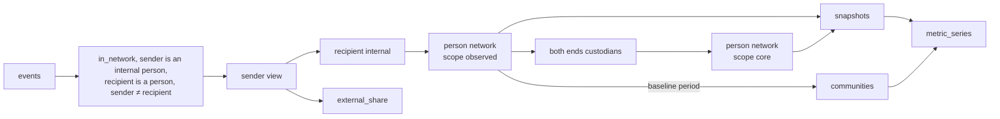

# Network metrics

Definitions of the network, its weekly snapshots and the eight metrics in `metric_series`
(research R9), and the rule that turns the checks of research R11 into a stated confidence.
Written before the code (`src/enron_case/network/`); the code implements exactly this.

## The person network

- **Sender view**: events with `in_network` true, `sender_type = person`, `sender_internal`
  true, `recipient_type = person`, and `sender_pid ≠ recipient_pid` (a person writing to
  themselves is not a tie). `in_network` already excludes messages flagged out of range,
  without recipients, self-only or above `recipient_cap`.
- **Person network, scope `observed`**: the sender view restricted to internal recipients.
- **Person network, scope `core`**: the observed network restricted to events whose sender and
  recipient are both custodians (`entities_p.is_custodian`), so every tie is seen from both
  mailboxes.
- **Period**: `week` is the Monday of the ISO week of `ts_hour` (UTC). The analysis covers events
  whose date lies in `config.analysis_start .. config.analysis_end`; the first and last week may
  be partial. Every week from the Monday of `analysis_start` to `analysis_end` gets a row, also
  weeks without events. In the `window=month` variant the period is the calendar month and
  `week` holds its first day.
- **Tie weight**: the event weight, `1 / n_recipients` per recipient (research R9), so a message
  to n recipients adds 1 in total.

## `snapshots`

One row per scope, week and directed pair (`src_pid`, `dst_pid`) of the person network:
`weight` is the summed event weight, `n_messages` the number of distinct `msg_pid`. Weekly
always; the monthly variant is computed directly from events.

## `communities`

Louvain (`networkx.community.louvain_communities`, `weight = weight`, `seed = config.seed`) on the
undirected weighted observed network of the baseline period: events dated
`config.baseline_start .. config.baseline_end`, weight of u→v and v→u summed into one edge.
Nodes and edges are added in sorted order so the result is reproducible. Communities are
numbered 0, 1, … by decreasing size, ties broken by their smallest `pid`.

The table lists every internal person in `entities_p`; a person with no tie in the baseline gets
`community = -1`. Communities are frozen: every variant and every week uses this one table.

In the release (`community_groups`, `community_graph`), communities with at least k persons become
`G01…`; everyone else — persons with `community = -1` and communities under k — is pooled as
`other`, published only if it reaches k. `other` is a leftover bucket, not a community: on the real
corpus nearly all of it is people with no tie in the baseline year who first appear in 2001–2002,
so its size and its share of the weekly mail grow after the baseline. The Network and Clusters
views therefore never draw it as a group: they call it "Outside the 2000 groups" (the baseline
year, from the run parameters), keep it out of the layout, the overlaps, the tie scale and the size
legend, and state instead the week's share of `n_messages` on rows touching it (Network) or the
period's share of weight involving it (Clusters, where it stays as the last, hatched grey arc with
no partner groups). The report's Limits section states its size. `cross_community_share` is
unaffected: it leaves out `community = -1` and never uses the release labels.

## Metrics

Notation for one scope and one period: A is the set of active persons (sender or recipient of at
least one tie), n = |A|, E the set of directed ties (u, v) with u ≠ v, w(u, v) their weight.

**Undefined periods.** When n < `config.k_min`, every metric of that scope and period is null,
not zero (too few people to describe without risk, and ratios are unstable). `n_active` is always
reported. A metric is also null when its denominator is zero, as stated per metric.

| Metric | Definition | Range | Edge behaviour |
|--------|------------|-------|----------------|
| `volume` | number of distinct messages (`msg_pid`) with at least one tie in the scope | 0 … ∞ | counts messages, not recipients |
| `active_persons` | n | k_min … ∞ | equals `n_active` when defined |
| `density` | \|E\| / (n (n − 1)) | 0 … 1 | 1 for a complete directed graph; 1/n for a star |
| `reciprocity` | share of ties (u, v) ∈ E for which (v, u) ∈ E | 0 … 1 | null if \|E\| = 0; unweighted |
| `indegree_gini` | Gini coefficient of weighted in-degree s(v) = Σ_u w(u, v) over v ∈ A, zeros included | 0 … 1 − 1/n | 0 when everyone receives the same; (n − 1)/n when one person receives everything; null if Σ s = 0 |
| `cross_community_share` | Σ w over ties whose ends are in two different baseline communities, divided by Σ w over ties whose ends both have a community ≥ 0 | 0 … 1 | ties touching community −1 are left out of both sums; null if the denominator is 0 |
| `external_share` | Σ w of sender-view events to external persons, divided by Σ w of all sender-view events, for the scope's senders | 0 … 1 | senders: internal persons (`observed`) or custodians (`core`); recipients may be anyone who is a person; null if the denominator is 0 |
| `tie_turnover` | 1 − \|E_t ∩ E_{t−1}\| / \|E_t ∪ E_{t−1}\|, directed and unweighted, t − 1 the previous period in the analysis window | 0 … 1 | null in the first period and when the previous period is undefined (n < k_min) |

Gini, with in-degrees sorted ascending x₍₁₎ ≤ … ≤ x₍ₙ₎:
G = 2 Σᵢ i·x₍ᵢ₎ / (n Σᵢ x₍ᵢ₎) − (n + 1) / n, equal to Σᵢ Σⱼ |xᵢ − xⱼ| / (2 n² x̄).

## Variants

`variant` in `metric_series` labels how the series was computed. Communities are not
recomputed.

| Variant | Change |
|---------|--------|
| `default` | as above, period `config.window` (week) |
| `cap=N` | events with `n_recipients > N` are dropped before everything else (default run: N = 20) |
| `window=month` | period is the calendar month |

**Two units for a recipient cap.** The `mass_mailing` message flag (clean stage,
`config.recipient_cap`, default 50) counts distinct recipient **addresses**, because it is set
before identity resolution. The `cap=N` variant counts recipient **entities** (`n_recipients` on
events: distinct recipient entities, the sender's own aliases left out). A message to several
aliases of one person counts each alias for the flag and the person once for the variant, so a
message can exceed the flag's cap without exceeding the same N in the variant. The two were not
unified: the flag would have to move after identity resolution.

The variants a run computes are `default` plus `config.sensitivity_variants`. For
leave-one-mailbox-out, `compute_series(…, exclude_pids=…)` drops every event whose sender or
recipient is an excluded person before everything else.

## Evidence and confidence (research R11)

The decision rule, the robustness checks and the confidence rule are defined in
`docs/hypotheses.md`, which is authoritative; this section restates them and must agree with it
and with `src/enron_case/finding/select.py`. For each hypothesis, with its metric, scope and
direction `d` (+1 up, −1 down), α = 0.05 (`config.alpha`):

| Check | Passes when |
|-------|-------------|
| (a) change point | CUSUM permutation p-value `p_perm` (enters (f); not a separate pass/fail check) |
| (b) effect | the 95 % (`config.ci_level`) block-bootstrap interval (`ci_low`, `ci_high`) lies wholly on the hypothesised side (`d · ci_low > 0`) |
| (c) null model | `d · null_z > 1.645` (one-sided `z_{1−α}`; the change is not explained by volume alone) |
| (d) leave-one-mailbox-out | every leave-one-out effect has the hypothesised sign (`loo_min_effect`, `loo_max_effect` report the range) |
| (e) variants | at least one non-default variant exists and every variant passes (`robust_variants_passed = robust_variants_total > 0`); a variant passes when its own `p_perm < α` and its own interval lies wholly on the hypothesised side |
| (f) multiple testing | Holm-adjusted `p_holm` < α across H1–H4 |

**Supported**, decided in this order:

- `inconclusive` if the effect cannot be computed;
- `no` if the interval lies wholly on the opposite side (`d · ci_high < 0`);
- `yes` if (b) and (f) pass;
- `no` if neither (b) nor (f) passes;
- `inconclusive` otherwise (exactly one of (b) and (f) passes).

**Confidence** (robustness checks (c), (d), (e) only):

- `high`: supported is `yes` and (c), (d), (e) all pass;
- `moderate`: supported is `yes` and exactly one of (c), (d), (e) fails;
- `low`: supported is `yes` with two or more of them failing, or supported is `no` or
  `inconclusive`.

A hypothesis whose check against a known artifact fails or could not run is capped at `low`
(`docs/hypotheses.md`, "Artifact checks"). The headline is the supported, high-confidence
hypothesis with the largest effect in its direction, if any.

## Known limits

- A tie is only visible when one end is a custodian; the observed network is a union of ego
  networks, and only the core is seen from both sides.
- Mailbox retention grows toward late 2001, so `volume` and `active_persons` rise for reasons
  unrelated to behaviour; ratios (density, shares, Gini) are less exposed but not immune.
- Gini depends on n; compare periods with similar `n_active` or read it with the null model.
