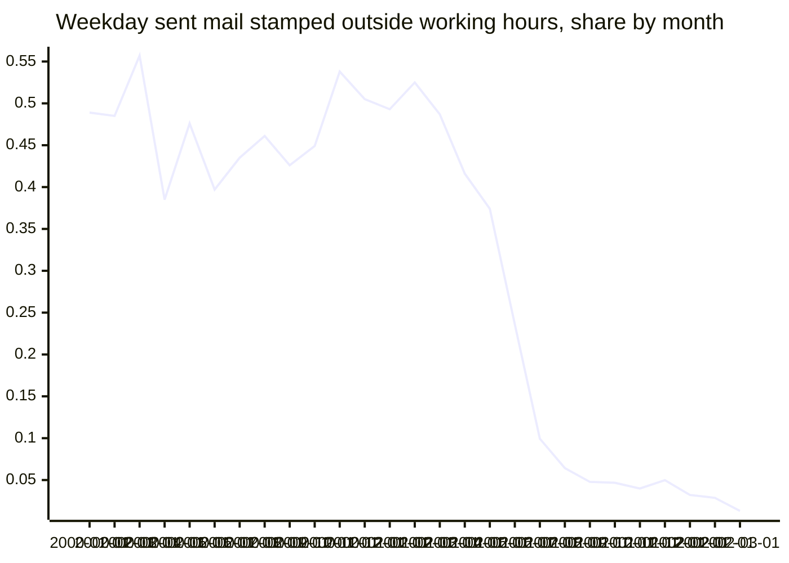

<!-- Generated by the report stage from src/enron_case/report/templates/slides.md.
     Edit the template, not this file. Every number is injected from release tables. -->

# A communication network in a crisis year, seen from headers alone

A headers-only, privacy-first analysis of the public Enron email corpus

- Question: how did the communication network change in the crisis year, seen from headers alone?
- Constraint: message content is never decoded, parsed, held, stored or logged, and nothing
  published identifies a person
- One command from the raw corpus to the report; every number on these slides comes from the run

---

## The rule, the line, the pseudonyms

- The header reader stops at the first blank line: body bytes pass through the decompressor
  and are skipped, never decoded, parsed, held, stored or logged
- **Content, never stored**: Subject, X-Folder
- **Identifiers, pseudonymized or discarded, never past the ingest zone**: Bcc, Cc, From, To, X-FileName, X-From, X-Origin, X-To, X-bcc, X-cc;
  **usable metadata**: Date
- `Subject` counts as content, a summary of the body: its line is discarded as the header is
  scanned. Cost: no threads, no reply times
- Keyed HMAC per resolved person; identifiers purged after every run; downstream code sees
  pseudonyms only; the release holds aggregates meeting k = 5

---

## What we found in the data

| Step | In | Out | Removed | Rule | Precision | Recall | Precision low | Precision high |
|---|---|---|---|---|---|---|---|---|
| files parsed | 517401 | 517364 | 37 | — | — | — | — | — |
| deduplicate | 517364 | 250537 | 266827 | exact+subset | — | — | — | — |
| resolve identities | 85388 | 84759 | 629 | N1-N4 | — | — | — | — |
| manual merge check | 50 | 50 | 0 | seeded sample, judged by a person | 1 | — | 0.929 | 1 |
| rejected files: no header end | 517401 | 517371 | 30 | file not parsed: no clean end of the header, or outside a mailbox folder | — | — | — | — |
| rejected files: outside maildir | 517401 | 517394 | 7 | file not parsed: no clean end of the header, or outside a mailbox folder | — | — | — | — |
| deduplicate: exact copies | 517364 | 250839 | 266525 | copies merged by the exact key alone (sender, second, recipient set) | — | — | — | — |
| deduplicate: subset copies | 250839 | 250537 | 302 | copies of messages that needed a subset merge, with any exact copies they had | — | — | — | — |
| flag: bad address | 250537 | 243854 | 6683 | messages flagged; kept in the network | — | — | — | — |
| flag: date out of range | 250537 | 250167 | 370 | messages flagged; kept, but left out of the network | — | — | — | — |
| flag: mass mailing | 250537 | 245771 | 4766 | messages flagged; kept, but left out of the network | — | — | — | — |
| flag: no recipients | 250537 | 242493 | 8044 | messages flagged; kept, but left out of the network | — | — | — | — |
| flag: self-only | 250537 | 246720 | 3817 | messages flagged; kept, but left out of the network | — | — | — | — |
| messages without a timestamp | 250537 | 250537 | 0 | kept in messages; no events are built from them | — | — | — | — |
| events in the network | 1328123 | 823488 | 504635 | sender-recipient events of messages without an exclusion flag | — | — | — | — |

Duplicates are found without content (sender, second, recipients) and land close to the
published content-based dedupes of this corpus (technical overview, related work).

---

## The finding: the record changed under the analysis

The finding: the record changed (high confidence that it changed; cause not established).

The share of the custodians' weekday sent mail stamped outside working hours is between 0.426 and 0.538 in the reference months and between 0.0399 and 0.0643 in the crisis months: the ranges do not overlap. From 2001-05-01 on, every month lies beyond every month up to the end of the reference window. Within the same people (H5, 32 custodians) the share changes by a median of -0.44 (interval -0.512 to -0.372), so it is not a change in who is in the data. As a hypothesis about behaviour, H5 could not be tested, because the convention changed under it; the same number is read here as a measurement of the record, not of behaviour. Working days do not move by hours within a year: the `Date` header was recorded under a different convention after the change, and every comparison of H5–H25 sets a window after it against a window before it; H1–H4 compare the weeks after their change week with the baseline year, so they span it too. The pre-crisis placebo compares two windows before it, so it cannot detect an artifact of that change. Confidence that the record changed: high (the rule: high when the monthly ranges of the two windows do not overlap and the change within the same people (H5) has an interval that excludes zero; moderate when the ranges do not overlap but that change is not measured or its interval includes zero; with overlapping ranges no change is claimed). Its cause, most likely a change of mail system, is not established: folder names would show it, and each is reduced at once to one of four classes and never kept. Mail kept: sent messages per month between 2115 and 2968 in the reference months and between 2162 and 5091 in the crisis months; received messages per month between 2778 and 5109 in the reference months and between 4124 and 17903 in the crisis months.

---

## The record, month by month

The crisis window lies after the change, the reference window and both placebo windows before it.

---

## Behaviour: every hypothesis, and when it was stated

H1–H4: pre-registered (before any real data was analysed); H5–H24: stated before computed, after earlier results; H25 and H26: post hoc (stated after every other result was known, still before its own result was computed).

| Hypothesis | Claim | Effect | Interval | Holm p | Supported | Confidence |
|---|---|---|---|---|---|---|
| H1 | communication concentrated on fewer people as the crisis approached | 0.171 | -0.2 to 0.581 | 1 | no | low |
| H2 | communication increasingly crossed established group boundaries | 13.8 | 12.2 to 19.7 | 0.004 | yes | low |
| H3 | the organization turned inward | -1.46 | -2.65 to -0.944 | 0.004 | yes | low |
| H4 | working relationships were rewired faster | -0.195 | -0.938 to 0.335 | 1 | no | low |

No behavioural finding about the crisis year is claimed. H2 and H3 passed the pre-registered statistical tests but failed their checks against a known artifact of the data (release/artifact_checks.csv): the apparent change is explained by how the data was collected and analysed, not by a detectable change in how people communicated. Every outcome is listed in the report.

Among the within-custodian hypotheses, none reached the standard to be held true. H16 (share of sent-to contacts who also wrote to the custodian) met its stated rule (median change 0.267, interval 0.144 to 0.386) but fails the retention check: among custodian-to-custodian contacts, whose messages can survive in either mailbox and so depend less on what one inbox kept, the change is not established: there the change is 0.111 (interval -0.111 to 0.3). It is not established on a measure that depends less on what one inbox kept.

---

## Structure: did the custodians leave? (post hoc)

No wave of custodian departures in the crisis can be established.

- Asked after every behavioural hypothesis had failed; stated and committed before computing
- A departure: a custodian stops sending while their own mailbox keeps receiving mail only it
  holds; if that mail stops too, the mailbox was no longer collected (a record end)
- Read in weeks from the presence of mail, so the hour shift of the record barely moves it;
  the growth of inbox mail kept is tested by a stricter variant

| Period | From | To | At risk | Departures | Record ends | Share departed |
|---|---|---|---|---|---|---|
| crisis | 2001-08-14 | 2001-12-02 | 66 | — | — | — |
| reference | 2000-08-14 | 2000-12-02 | 26 | — | — | — |
| placebo after | 2001-01-01 | 2001-04-30 | 51 | — | — | — |
| placebo before | 2000-01-01 | 2000-04-30 | 9 | — | — | — |
| crisis before the split | 2001-08-14 | 2001-10-15 | 66 | — | — | — |
| crisis from the split | 2001-10-16 | 2001-12-02 | 66 | — | — | — |

---

## Why we do not believe the two signals that passed

| Hypothesis | Check | Statistic | Interval | Units | Result | Reading |
|---|---|---|---|---|---|---|
| H2 | baseline placebo | 10.8 | 8.2 to 17.4 | 52 | fails | a calm half-year out of sample already jumps: the test effect is baseline drift |
| H3 | within custodian | -0.00987 | -0.0874 to 0.0675 | 42 | fails | no within-custodian change: the aggregate shift is a change in who is in the data |

- A calm half-year, out of sample, already jumps: groups fixed on a baseline go stale
- Custodians did not change their own external share: the aggregate moved with who is in the data
- Checks added after the first real run, and labelled as such

---

## Prior work, tested at the scope we can defend

- Prior work: the denser crisis-period network that Diesner and Carley (2005) report from a comparison of single months of this corpus, without a test
- H25, the post-hoc replication test of the denser crisis-period network that Diesner and Carley (2005) report from a comparison of single months of this corpus, compares each custodian's share of the other custodians they exchanged mail with: a median change of 0.00826 (interval 0 to 0.0331, Holm-adjusted p = 0.239, 31 custodians); outcome: not supported.
- Priebe et al. flag anomalies in the spring and in mid-August of the crisis year; our change
  weeks and the months over which the record changes lie in that same stretch
- Our design (custodians against themselves, frozen groups, retention checks) is why we do not
  report what they report

---

## The attack on person-level output, and what is published instead

| Release | Attacker | Unique share | Re-identified | Interval | Survives |
|---|---|---|---|---|---|
| R0 | A1 | 0.639 | 0.251 | 0.244 to 0.259 | — |
| R0 | A2 | 0.639 | 0.591 | 0.583 to 0.599 | — |
| R0 | A3 | 0.639 | 0.574 | 0.565 to 0.582 | — |
| R1 | A1 | 0 | 0 (by construction) | 0 to 0 | — |
| R1 | A2 | 0 | 0 (by construction) | 0 to 0 | — |
| R1 | A3 | 0 | 0 (by construction) | 0 to 0 | — |
| R2 | A1 | 0 | 0 (by construction) | 0 to 0 | — |
| R2 | A2 | 0 | 0 (by construction) | 0 to 0 | — |
| R2 | A3 | 0 | 0 (by construction) | 0 to 0 | — |

- R1 and A1: A1 re-identified a share of 0.251 on R0 (measured). On R1 the attack does not apply: no person-level record remains for it to match, so its rate there is 0 by construction, not a measurement; the mitigation target is met in that sense only. Finding survives: —.
- R1 and A2: A2 re-identified a share of 0.591 on R0 (measured). On R1 the attack does not apply: no person-level record remains for it to match, so its rate there is 0 by construction, not a measurement; the mitigation target is met in that sense only. Finding survives: —.
- R1 and A3: A3 re-identified a share of 0.574 on R0 (measured). On R1 the attack does not apply: no person-level record remains for it to match, so its rate there is 0 by construction, not a measurement; the mitigation target is met in that sense only. Finding survives: —.
- R2 and A1: A1 re-identified a share of 0.251 on R0 (measured). On R2 the attack does not apply: no person-level record remains for it to match, so its rate there is 0 by construction, not a measurement; the mitigation target is met in that sense only. Finding survives: —.
- R2 and A2: A2 re-identified a share of 0.591 on R0 (measured). On R2 the attack does not apply: no person-level record remains for it to match, so its rate there is 0 by construction, not a measurement; the mitigation target is met in that sense only. Finding survives: —.
- R2 and A3: A3 re-identified a share of 0.574 on R0 (measured). On R2 the attack does not apply: no person-level record remains for it to match, so its rate there is 0 by construction, not a measurement; the mitigation target is met in that sense only. Finding survives: —.

"Survives" needs a headline to recompute; with no behavioural finding claimed it does not apply.

---

## Limits

- Coverage: the corpus holds a limited set of mailboxes, mostly senior staff. A tie is visible only when one end is a collected mailbox, so results describe this sample, not the whole organization.
- Retention and selection: what people kept and what was collected differ by person and period, and the collection was shaped by an investigation.
- Headers only: subjects are content and are excluded, so there are no threads and no reply times. Deduplication cannot use content and merges distinct messages from one sender to the same recipients in the same second.
- Identity resolution is rule-based and favours precision; aliases it misses split one person into several nodes.
- Pseudonymization is not anonymization: person-level pseudonymized data must be treated as re-identifiable (see the attack on R0), so only aggregates are published; the noise variant is a sketch, not a formal privacy budget.
- Observational design: a structural change near public events does not show what people knew. Stating a hypothesis before computing it limits hindsight bias but does not remove it, and only the pre-registered hypotheses were stated before any real data was seen.
- No group-level attack on the community graph was run: an attacker who knows some group members could try to infer ties or membership from group-to-group weights, and that risk is bounded only by the minimum of k distinct senders per published tie, not measured.
- The effect interval is computed at a change week chosen from the same data (the week that maximises the change statistic), so it is optimistic: it ignores the uncertainty of where the change happened.
- For H5–H25, the pre-crisis placebos run on fewer custodians than the crisis comparison (fewer meet the minimum message count in the January-to-April windows; see the placebo custodians column), so they have less power: a passing placebo does not exclude a pre-existing trend. Both placebo windows also lie before the change of the timestamp convention (see the record section), so the placebo cannot detect an artifact of it.
- The permutation p-values of H1–H4 treat weeks as exchangeable; weekly network metrics are autocorrelated, and a calibration test in the suite shows the test rejects far more often than its nominal level on autocorrelated series without a change. A small p alone is weak evidence here.
- Deduplication matches copies on the second they were sent. If two stored copies of one message carry different timestamp conventions (see the record section), they do not merge, so the months around the change may hold hidden duplicates; not checked.
- The H2 baseline placebo splits the baseline year at a fixed midpoint instead of searching a change week; a searched split could only make its jump larger, so this can only make H2 fail its check more clearly.
- The artifact checks were added after the first real-data run, because two hypotheses passed every pre-registered check yet looked implausibly strong. They are documented as a post-hoc amendment; a reader should weigh them as diagnostics, not as pre-registered tests.
- Rule N2 merges addresses with the same local part under one registered domain, so it can merge two different people who share a local part across an ISP's regional subdomains; a manual check of 50 real merges, sampled from the merges of every rule, found 0 wrong merges (precision 1, exact binomial interval 0.929 to 1); how many were N2 merges is not in the committed check.
- The `other` row of `community_groups.csv` is not a community: it holds the 25838 internal people without a baseline group, either because they have no tie in the baseline period or because their community has fewer than 5 people. Its ties are published like a group's, but the explorer does not draw it as a group: it labels these people as outside the baseline groups and states, for each week, the share of mail that involves them.

---

## Real customer data, and how this was built

- Metadata-only mail scopes, so bodies and attachments never leave the source (`Subject` still
  arrives and is discarded at the allowlist; Teams and Slack text is dropped in memory: no
  such scope); key and entity registry held
  by the customer; retention schedule, works council review, data residency; a formal privacy
  budget across every published output
- Built spec-first with parallel agents, one work package each, tested against a synthetic
  corpus with ground truth; gates on every package (lint, strict types, tests, privacy canary,
  import boundary); independent review skills before each merge; a person decided every
  judgment call. Details: `docs/ai-workflow.md`
