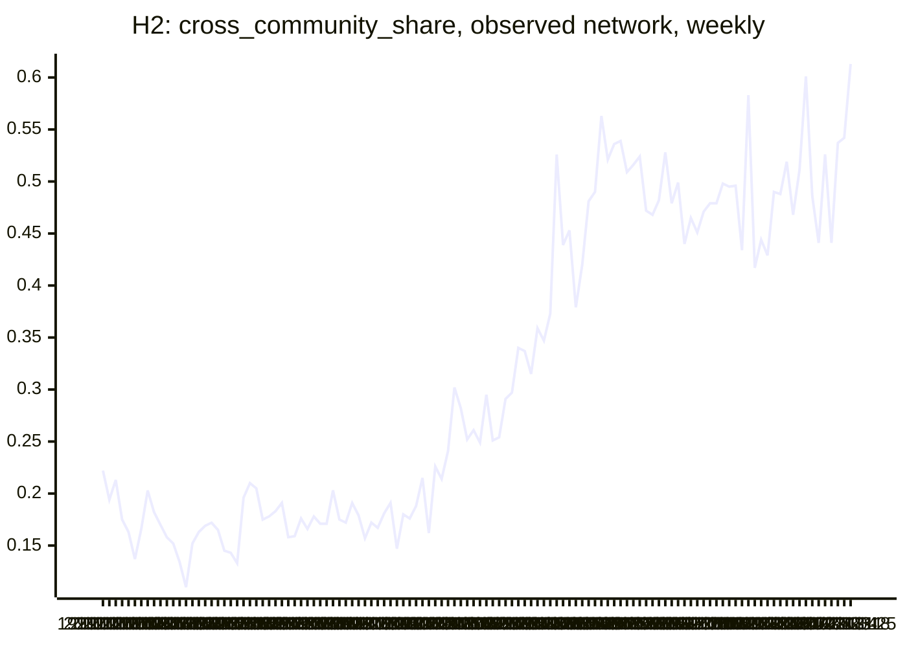

<!-- Generated by the report stage from src/enron_case/report/templates/slides.md.
     Edit the template, not this file. Every number is injected from release tables. -->

# What did the network know before the organization did?

A headers-only, privacy-first analysis of the public Enron email corpus

- Question: how did the communication network change in the crisis year, seen from headers alone?
- Constraint: never read message content, and publish nothing that identifies a person
- One command from the raw corpus to the report; every number on these slides comes from the run

---

## The rule, and where the line is

- The parser stops at the first blank line: bodies are never decoded, held or stored
- **Content, never stored**: Subject, X-Folder
- **Identifiers, ingest zone only**: Bcc, Cc, From, To, X-FileName, X-From, X-Origin, X-To, X-bcc, X-cc
- **Usable metadata**: Date
- `Subject` counts as content: it is a summary of the body. Cost: no threads, no reply times

---

## What we found in the data

| Step | In | Out | Removed | Rule | Precision | Recall | Precision low | Precision high |
|---|---|---|---|---|---|---|---|---|
| files parsed | 517401 | 517364 | 37 | — | — | — | — | — |
| deduplicate | 517364 | 250537 | 266827 | exact+subset | — | — | — | — |
| resolve identities | 85388 | 84759 | 629 | N1-N4 | — | — | — | — |
| manual merge check | 50 | 50 | 0 | seeded sample, judged by a person | 1 | — | 0.929 | 1 |
| rejected files: no header end | 517401 | 517371 | 30 | file not parsed: no clean end of the header, or outside a mailbox folder | — | — | — | — |
| rejected files: outside maildir | 517401 | 517394 | 7 | file not parsed: no clean end of the header, or outside a mailbox folder | — | — | — | — |
| deduplicate: exact copies | 517364 | 251503 | 265861 | copies merged by the exact key alone (sender, second, recipient set) | — | — | — | — |
| deduplicate: subset copies | 251503 | 250537 | 966 | copies of messages that needed a subset merge, with any exact copies they had | — | — | — | — |
| flag: bad address | 250537 | 243854 | 6683 | messages flagged; kept in the network | — | — | — | — |
| flag: date out of range | 250537 | 250167 | 370 | messages flagged; kept, but left out of the network | — | — | — | — |
| flag: mass mailing | 250537 | 245771 | 4766 | messages flagged; kept, but left out of the network | — | — | — | — |
| flag: no recipients | 250537 | 242493 | 8044 | messages flagged; kept, but left out of the network | — | — | — | — |
| flag: self-only | 250537 | 246720 | 3817 | messages flagged; kept, but left out of the network | — | — | — | — |
| messages without a timestamp | 250537 | 250537 | 0 | kept in messages; no events are built from them | — | — | — | — |
| events in the network | 1328123 | 823488 | 504635 | sender-recipient events of messages without an exclusion flag | — | — | — | — |

Duplicates are found without content (sender, second, recipients); precision and recall are
measured on a synthetic corpus with known answers.

---

## Pseudonymization

- Keyed HMAC per resolved entity: stable for one key, not confirmable by hashing guessed addresses
- Identifiers live only in the ingest zone, which is purged after every run
- Downstream code sees pseudonyms only; the release holds aggregates meeting k = 5
- Pseudonymized is not anonymous: the next slides attack our own output

---

## The finding

No finding about the crisis year is claimed. H2, H3 passed the pre-registered statistical tests but failed its check against a known artifact of the data (release/artifact_checks.csv): the apparent change is explained by how the data was collected and analysed, not by a detectable change in how people communicated. Every outcome is listed in the report.

---

## Every hypothesis, fixed before the results

| Hypothesis | Claim | Effect | Interval | Holm p | Supported | Confidence |
|---|---|---|---|---|---|---|
| H1 | communication concentrated on fewer people as the crisis approached | 0.171 | -0.2 to 0.581 | 1 | no | low |
| H2 | communication increasingly crossed established group boundaries | 13.8 | 12.2 to 19.7 | 0.004 | yes | low |
| H3 | the organization turned inward | -1.46 | -2.65 to -0.944 | 0.004 | yes | low |
| H4 | working relationships were rewired faster | -0.195 | -0.938 to 0.335 | 1 | no | low |

Among H5–H24, no hypothesis reached the standard to be held true. H16 (share of sent-to contacts who also wrote to the custodian) met its stated rule (median change 0.267, interval 0.144 to 0.386) but fails the retention check: among custodian-to-custodian contacts, whose messages are visible whatever an inbox kept, the change is not established: there the change is 0.111 (interval -0.111 to 0.3). It remains the strongest lead, largely explained by how much inbox mail was kept.

---

## The strongest signal, over time

The jump comes right after the baseline year used to fit the groups ends.

---

## Why we do not believe it

| Hypothesis | Check | Statistic | Interval | Units | Result | Reading |
|---|---|---|---|---|---|---|
| H2 | baseline placebo | 10.8 | 8.2 to 17.4 | 52 | fails | a calm half-year out of sample already jumps: the test effect is baseline drift |
| H3 | within custodian | -0.00987 | -0.0874 to 0.0675 | 42 | fails | no within-custodian change: the aggregate shift is a change in who is in the data |

- A calm half-year, out of sample, already jumps: groups fixed on a baseline go stale
- Custodians did not change their own external share: the aggregate moved with who is in the data
- Checks added after the first real run, and labelled as such

---

## The attack, before and after mitigation

| Release | Attacker | Unique share | Re-identified | Interval | Survives |
|---|---|---|---|---|---|
| R0 | A1 | 0.639 | 0.251 | 0.244 to 0.259 | — |
| R0 | A2 | 0.639 | 0.591 | 0.583 to 0.599 | — |
| R1 | A1 | 0 | 0 | 0 to 0 | — |
| R1 | A2 | 0 | 0 | 0 to 0 | — |
| R2 | A1 | 0 | 0 | 0 to 0 | — |
| R2 | A2 | 0 | 0 | 0 to 0 | — |

- R1 against A1: re-identified share 0.251 on R0, 0 on R1 (at least halved); finding survives: —.
- R1 against A2: re-identified share 0.591 on R0, 0 on R1 (at least halved); finding survives: —.
- R2 against A1: re-identified share 0.251 on R0, 0 on R2 (at least halved); finding survives: —.
- R2 against A2: re-identified share 0.591 on R0, 0 on R2 (at least halved); finding survives: —.

"Survives" needs a headline to recompute; with no finding claimed it does not apply.

---

## Limits

- Coverage: the corpus holds a limited set of mailboxes, mostly senior staff. A tie is visible only when one end is a collected mailbox, so results describe this sample, not the whole organization.
- Retention and selection: what people kept and what was collected differ by person and period, and the collection was shaped by an investigation.
- Headers only: subjects are content and are excluded, so there are no threads and no reply times. Deduplication cannot use content and merges distinct messages from one sender to the same recipients in the same second.
- Identity resolution is rule-based and favours precision; aliases it misses split one person into several nodes.
- Pseudonymization is not anonymization: person-level pseudonymized data must be treated as re-identifiable (see the attack on R0), so only aggregates are published; the noise variant is a sketch, not a formal privacy budget.
- Observational design: a structural change near public events does not show what people knew. Hypotheses fixed in advance limit hindsight bias but do not remove it.
- No group-level attack on the community graph was run: an attacker who knows some group members could try to infer ties or membership from group-to-group weights, and that risk is bounded only by the minimum of k distinct senders per published tie, not measured.
- The effect interval is computed at a change week chosen from the same data (the week that maximises the change statistic), so it is optimistic: it ignores the uncertainty of where the change happened.
- For H5–H24, the pre-crisis placebos run on fewer custodians than the crisis comparison (fewer meet the minimum message count in the January-to-April windows; see the placebo custodians column), so they have less power: a passing placebo does not exclude a pre-existing trend.
- The artifact checks were added after the first real-data run, because two hypotheses passed every pre-registered check yet looked implausibly strong. They are documented as a post-hoc amendment; a reader should weigh them as diagnostics, not as pre-registered tests.
- Rule N2 merges addresses with the same local part under one registered domain, so it can merge two different people who share a local part across an ISP's regional subdomains; a manual check of 50 sampled real merges found 0 wrong merges (precision 1, exact binomial interval 0.929 to 1).

---

## What changes with real customer data

- Metadata-only connectors: content never leaves the source
- Key and entity registry held by the customer; pseudonyms re-keyed per release
- Retention schedule, works council review, data residency
- A formal privacy budget across every published output

---

## How it was built with agents

- Spec, plan and contracts first; then parallel agents, one work package each
- Synthetic corpus with ground truth, so tests check answers no agent produced
- Gates on every package: lint, strict types, tests, privacy canary, import boundary
- Independent review before each merge; a person decided every judgment call
- Details: `docs/ai-workflow.md`
