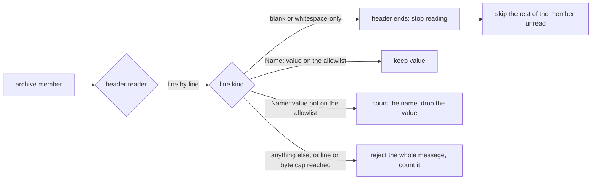
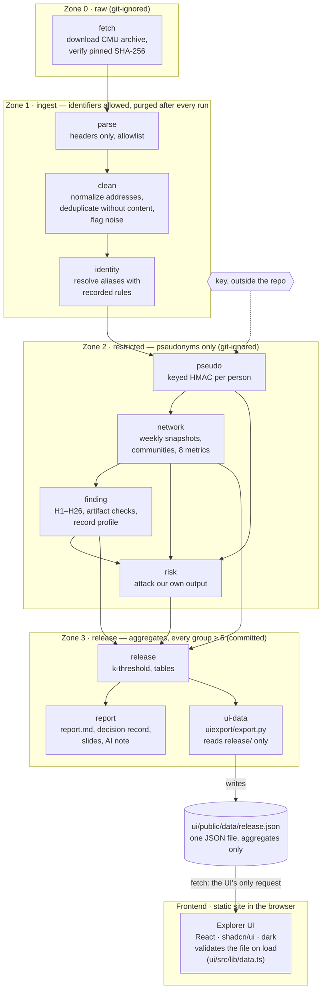
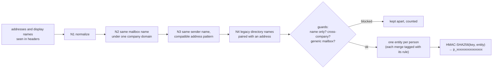
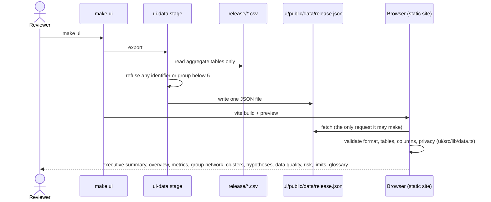
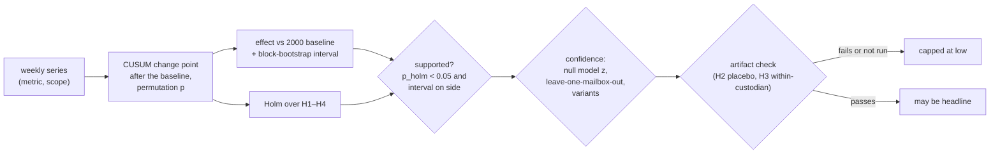
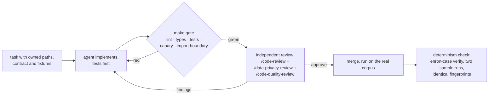
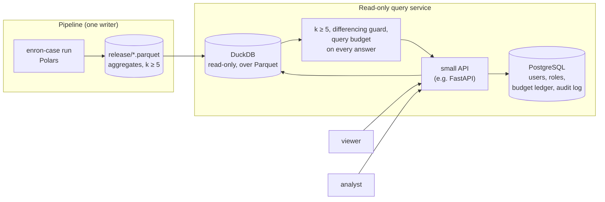
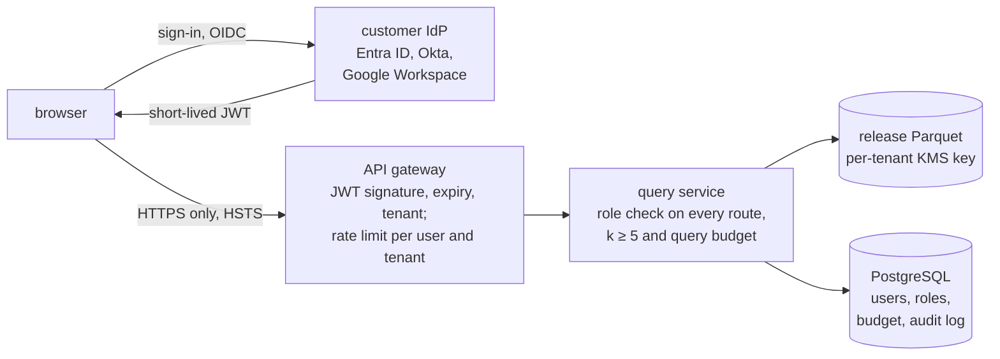

# Technical overview

The detailed companion to the one-page [README](../README.md).

An engineering case study: a privacy-first pipeline that reads **only the headers** of the public
Enron email corpus. It cleans and pseudonymizes them, tests pre-stated hypotheses about how the
organization's communication network changed in 2001, attacks its own output to measure
re-identification risk, and publishes only aggregates. A dark-themed explorer UI shows the
published results, opening on a plain-language executive summary for non-specialists. The one
command builds and serves it, so Node 20+ is a prerequisite; `make gate` and `enron-case run`
work without Node.

The corpus is public; the pipeline is built as if it were not.

**Results in brief.** One list of 26 hypotheses (H1–H26), each committed before it was computed,
and one descriptive profile of the record. Three timing labels say how to read each: H1–H4 are
"pre-registered" (before any real data), H5–H24 "stated before computed, after earlier results",
and H25 and H26 "post hoc".

- **The finding: the record changed** (high confidence that it changed; cause not established).
  No behavioural finding about the crisis year is claimed. Within the same custodians, the share
  of weekday sent mail stamped outside working hours falls from roughly half (every month up to
  April 2001) to a few percent (from August 2001 on; the fall starts in May), and the received
  mail kept per month grows up to about 3.5 times the largest reference month (about five times
  October on October). Working days do not move by hours: the `Date` convention changed, most
  likely with a change of mail system (not verified: folder names would show it, and a folder
  name is reduced at once to one of four classes and never kept). Every within-custodian
  comparison sets a crisis window after that change against a reference window before it. It is
  a finding about the record, not about behaviour, and we present it as such.
- **Behaviour: no hypothesis among H1–H25 is held true.** H2 and H3 passed their planned tests
  and then failed checks against known artifacts (stale baseline groups; a change in which
  mailboxes hold mail). H16 (ego reciprocity) is not established once inbox retention is
  accounted for; H20 is inconclusive (its placebo fails); H14, H21 and H22 changed the other
  way. H25, a post hoc replication test of the "denser network in the crisis" reported by
  Diesner & Carley (2005), is "Not established" within custodians (median +0.008, interval 0 to
  0.033): the data cannot tell a small rise from none.
- **Also found:** every Bcc line repeats the Cc line; content-free deduplication lands within
  1 % of published content-based dedupes; the public corpus names every custodian, so the
  realistic insider (attacker A3) knows all of them.

Numbers and limits are in [release/report.md](../release/report.md); every number there is produced
by the run.

---

## Contents

- [Quick start](#quick-start)
- [Content never enters the system](#content-never-enters-the-system)
- [From the download to the UI](#from-the-download-to-the-ui)
  - [The whole flow](#the-whole-flow)
  - [Stages](#stages)
  - [How a person becomes a pseudonym](#how-a-person-becomes-a-pseudonym)
  - [How the UI gets its data](#how-the-ui-gets-its-data): one JSON file, `ui/public/data/release.json`
- [Network science methods](#network-science-methods)
- [Related work and how this compares](#related-work-and-how-this-compares)
- [Libraries and why each is here](#libraries-and-why-each-is-here)
- [How correctness is kept](#how-correctness-is-kept)
- [Next steps](#next-steps)
  - [Toward real customer data](#toward-real-customer-data)
  - [Serving the explorer: Polars writes, DuckDB reads](#serving-the-explorer-polars-writes-duckdb-reads)
  - [Securing the explorer as a product](#securing-the-explorer-as-a-product)
  - [Load and penetration tests](#load-and-penetration-tests)
  - [Multi-tenant SaaS: database constraints and scale](#multi-tenant-saas-database-constraints-and-scale)
  - [Analysis follow-ups](#analysis-follow-ups)
- [Reading order](#reading-order)
- [What is and is not committed](#what-is-and-is-not-committed)
- [Layout](#layout)

---

## Quick start

Prerequisites: [uv](https://docs.astral.sh/uv/) (it fetches Python 3.12), Node 20+, about 3 GB
free disk, internet access for the first run (about 440 MB, checked against a pinned SHA-256).

```bash
make                     # macOS and Linux
uv run enron-case all    # Windows, no make or bash needed (or .\run.cmd)
```

The one command installs locked dependencies, creates a key outside the repository
(`~/.config/enron-case/key`) if none exists and says so, downloads and verifies the corpus, runs
every stage, runs every test (Python and UI), builds the explorer on the real results, serves it
at http://localhost:4173, and prints where the report and the UI are. On a fresh clone it took
about 25 minutes (about 20 the download, on that connection); the pipeline itself runs the full
corpus (about 517,000 files) in about two and a half minutes on a laptop (the one command
prints each step's time; each run writes the seconds per stage to
`data/logs/stage_timings.json`, which is not committed). `make check` (`uv run enron-case check`) does the same without
serving the explorer. The steps are written in Python (`src/enron_case/onecommand.py`), so
macOS, Linux and Windows run the same ones; `make` and `run.cmd` only call them, and CI runs both
gates on all three.

Finer-grained targets. On Windows, `check`, `gate`, `ui-gate` and `key` are
`uv run enron-case <target>`; the others have no subcommand of the same name and are listed in
the last column:

| Command | Does | Windows |
|---------|------|---------|
| `make check` | everything `make` does except serving the explorer | `uv run enron-case check` |
| `make sample` | the whole pipeline on a bundled synthetic corpus, in seconds, into `release-sample/` | `uv run enron-case run --sample` |
| `make gate` | lint, strict type checks, all tests, the privacy canary, the import-boundary test | `uv run enron-case gate` |
| `make ui` | builds and serves the explorer over `release/` | `uv run enron-case ui-deps`, `uv run enron-case stage ui-data`, then `npm run build` and `npm run preview` in `ui/` |
| `make ui-sample` | the explorer over the synthetic release | the same with `stage ui-data --sample` |
| `make ui-gate` | UI lint, type check, tests, build, and a check that the build has no external URL | `uv run enron-case ui-gate` |
| `make clean` | removes `data/ingest`, `data/restricted`, `data/sample`, `data/logs`, `release-sample/` and `tests/fixtures/` (the downloaded archive in `data/raw` stays) | delete those folders by hand |

Underneath is a CLI (`enron-case all | check | gate | ui-gate | ui-deps | key | run | stage |
verify | check-key | summary | review-merges`), documented in
[contracts/cli.md](../specs/001-enron-network-analysis/contracts/cli.md).

---

## Content never enters the system

> **The rule of the brief:** *Content never enters your system. Read headers only. You decide
> which header fields still count as content or as direct identifiers. Draw that line
> deliberately and explain it.*

### Where the line is drawn

Every header field in the corpus gets one of five rulings (`usable`, `identifier`, `content`,
`technical`, `dropped`; published per field in `release/header_fields.csv`). The single source is
[contracts/header-allowlist.md](../specs/001-enron-network-analysis/contracts/header-allowlist.md);
the parser enforces it and a test compares the two. Ten fields are ruled identifiers: eight are
kept in the ingest zone, two are not retained at all.

| Ruling | Fields | Where the value can go | Why |
|--------|--------|------------------------|-----|
| **Usable metadata** | `Date` | pseudonymized events, truncated to the hour; published weekly | *When* is the only fact needed beyond *who*. Second-level timestamps fingerprint people, so they are coarsened at the boundary. |
| **Direct identifier, ingest zone only** | `From`, `To`, `Cc`, `Bcc`, `X-From`, `X-To`, `X-cc`, `X-bcc` | ingest zone only; replaced by keyed pseudonyms, then purged | Needed to know who talked to whom and to link one person's several addresses. Display names are used to resolve identities and then discarded. |
| **Direct identifier, not retained** | `X-Origin`, `X-FileName` | nowhere; dropped by the parser | Both repeat the mailbox owner, which the archive path already gives. Ruled `identifier` in `header_fields.csv`, but never kept, not even in the ingest zone. |
| **Content, never stored** | `Subject`, `X-Folder` (and folder names in the archive path) | nowhere; the value is discarded as the header is scanned | A subject line is a one-line summary of the body written by its author. Folder names are topic labels written by the mailbox owner. Both are content in everything but position. The top-level folder name in the archive path is reduced at once to one of four classes (sent, inbox, deleted, other) and never kept. |
| **Technical** | `Message-ID` | ingest zone only, for dedupe diagnostics, then purged | Assigned per stored copy (measured: no group of duplicate copies shares one), so it cannot deduplicate. |
| **Dropped** | MIME fields, anything unknown | nowhere | No analytical use. Unknown fields are denied by default; only their *names* are counted, folded into `(other)`. |

The hardest call is **`Subject`**. Keeping a keyed hash of it would have improved deduplication and
allowed thread and reply-time analysis. We rejected it: a hash of a short, guessable string is a
content fingerprint. The cost is named in the report: no threads, no reply times, and duplicates
found from sender, second and recipients alone.

### How the line is enforced



- **The reader cannot reach a body.** It reads line by line and stops at the first blank line. It
  never calls the standard email parser, which loads the body as payload. A message without a
  clean header end is rejected rather than parsed, so body lines can never pass for header fields.
  An independent review found exactly this weakness before the fix.
- **Default deny.** A field not on the allowlist is dropped as its line is read. Its value is never
  bound to a variable that outlives that line.
- **Only known field names are published.** Stray names, which can be fragments of text, are
  folded into one `(other)` count.
- **A canary test** plants markers in bodies, subjects, folder names and file names of a
  synthetic corpus, runs the whole pipeline and fails if any of them appears in any zone (the
  ingest zone included), log, manifest or document. It also fails if an `@`, a display name or
  a mailbox owner's folder name appears anywhere past the pseudonymization boundary.
- **An import-boundary test** fails if any package after the pseudonymization boundary imports
  ingest-side code. A **path guard** refuses any read or write outside a package's zones.

**Honest limit.** "Never enters" means our code never decodes, parses, holds, stores or logs
content. Body bytes still pass through the gzip decompressor on the way to being skipped, and the
downloaded archive on disk contains them. With real customer data the equivalent control is a
connector that requests metadata fields only where the provider offers such a scope (Gmail,
Outlook), so bodies and attachments never leave the source; `Subject` still arrives and is
discarded at the allowlist. Teams and Slack offer none: their text reaches our connector and is
dropped in memory, a weaker guarantee (see [Toward real customer data](#toward-real-customer-data)).

---

## From the download to the UI

### The whole flow



The frontend never touches the pipeline, the restricted zone or the key. Its single input is
`ui/public/data/release.json`, which the `ui-data` stage writes from the release tables alone;
there is no API, no database and no other request.

Each arrow is a **versioned table contract**
([data-contracts.md](../specs/001-enron-network-analysis/contracts/data-contracts.md)). Every write
is validated against its schema and leak-checked: no `@` in the restricted zone, and no `@`,
`p_…` or `o_…` pattern in the release (a pattern check: it would not catch a bare name, which
the canary test covers on synthetic data). Every write is also fingerprinted in `release/run_manifest.json`, so
two runs with one key can be compared byte for byte.

### Stages

| Stage | Package | Reads | Writes |
|-------|---------|-------|--------|
| fetch | `ingest` | CMU URL | archive in `data/raw` |
| parse | `ingest` | archive (headers only) | `header_records` |
| clean | `clean` | `header_records` | `messages` |
| identity | `identity` | `messages`, `header_records` | `entities`, `address_map` |
| pseudo | `pseudo` | the three above, the key | `events`, `entities_p` |
| network | `network` | `events`, `entities_p` | `snapshots`, `communities`, `metric_series` |
| finding | `finding` | `events`, `entities_p`, `communities`, `metric_series` | `hypothesis_results`, `artifact_results`, `exploratory_results`, `profile_results`, `departure_results`, `departure_test_results` |
| risk | `risk` | `snapshots`, `metric_series`, `entities_p`, `communities` (to build the releases it attacks), `hypothesis_results` (utility); the public archive, as the attacker would; the ingest zone, for scoring only | `risk_results` |
| release | `release` | restricted aggregates and counts | `release/*.csv` |
| report | `report` | `release/` only | `release/report.md`, `docs/*.md` |
| ui-data | `uiexport` | `release/` only | `ui/public/data/release.json` |

### How a person becomes a pseudonym



The same key and the same input always give the same pseudonym. Without the key a pseudonym
cannot be reversed, and it cannot be confirmed by hashing a guessed address. It is still
pseudonymization, not anonymization: the risk stage shows that person-level pseudonymized edges
are re-identifiable. That is why only aggregates are published.

### How the UI gets its data



The UI is a static site with no API and no database. Its only input is
`ui/public/data/release.json`, written by the `ui-data` stage
([src/enron_case/uiexport/export.py](../src/enron_case/uiexport/export.py)) from `release/`
alone (the aggregate tables and the run manifest's parameters). The export refuses any identifier-shaped value or group below five; the browser checks the
file again on load ([ui/src/lib/data.ts](../ui/src/lib/data.ts)): format version, every table and
column, and the privacy guard. A malformed file is shown as an error, never replaced. Only when no
`release.json` exists does it fall back to the committed synthetic sample of the same shape,
`ui/public/data/release.sample.json` (`make ui-sample` instead writes the synthetic release to
`release.json`). The UI reads nothing but the release tables; the report can say more than the
UI, since `release.json` leaves out `record_profile`. Its ten views (`ui/src/lib/views.ts`):

| View | Shows |
|------|-------|
| Executive summary | the landing view, for readers who do not read statistics: six cards (what was studied, what we found, the main finding, how sure we are, privacy, data quality), each linking to its evidence view; it names the record change through H5 and the two comparison windows, not by month |
| Overview | an "In short" answer in plain words for non-specialists (how many hypotheses held up, why the rest did not, the re-identification result), then why H1–H4 give no behavioural finding (the artifact checks that ruled out H2 and H3), any hypothesis held true (none in this release) and key numbers. The UI has no view of `record_profile`; the month-by-month profile is in the report only |
| Metrics | each weekly metric by scope, with the change point, public events and baseline marked |
| Network | a "How to read this" guide and a one-sentence summary of the selected week, then a **graph of groups** and their ties, week by week, drawn with Sigma.js (WebGL) and laid out once with ForceAtlas2: zoom, fullscreen, search by group label, hover highlighting; the group-size dots mode fills each group with as many unlabelled dots as it has people (the dots only show how many people a group has, not real individuals or ties); an Overlap mode draws the week's six heaviest pairs as intersecting outlined contours (`@sigma/layer-webgl`) (mail between groups, not shared members); SVG fallback without WebGL (no Overlap mode) |
| Clusters | a **chord diagram** of mail between and within groups for the baseline year, the crisis weeks or all weeks; each group's size, within-group share and top partner groups; and the group whose cross-group share changed most, with the stale-baseline caveat |
| Hypotheses | every hypothesis in one plain sentence with a verdict (Held up, Explained by an artifact, Not robust, Unclear, Could not be tested, Changed the other way, Not established, Withheld) and a glossary of the terms; then, for analysts, H1–H4 with their artifact checks, H5–H25, and H26 (post hoc: custodian departures), whose statement, windows, counts (suppressed cells read "fewer than 5"), tests, robustness variants and power open under its plain sentence |
| Data quality, Privacy and risk, Limits | the cleaning funnel, header rulings, the attacks on the person-level data R0 next to the aggregate releases (0 by construction, not a measurement), and the limits |
| Glossary | every technical term the other views explain behind a "?", in plain words |

Every node, arc and segment is a **group of at least five people**, except the hatched outside
arc and its box (people with no 2000 group: not a group); nothing drawn is a real individual.
Each grouped person is in exactly one group; group membership is not published. A Content-Security-Policy blocks other origins, and a build check
fails on any external URL: no CDN, no web fonts, no analytics.

---

## Network science methods

What the code computes, for a reader who knows network science. Full definitions:
[docs/metrics.md](metrics.md), [docs/hypotheses.md](hypotheses.md),
[docs/hypotheses-exploratory.md](hypotheses-exploratory.md). Parameters are `Config` fields
in `src/enron_case/config.py`.

### The network (`network/snapshots.py`)

- **Nodes** are resolved persons (pseudonyms). Lists, role and system addresses are not nodes.
- **Ties** are directed and weighted, aggregated per ISO week (Monday, UTC) over 2000-01-01 to
  2002-03-31; every week gets a row, also empty ones. A message to n distinct resolved
  recipients gives each recipient weight **1/n**, so one message adds 1 in total and a
  mass mailing does not dominate. Self-ties are dropped; messages flagged as noise (for example
  more than 50 recipients) are not in the network.
- **Two scopes.** The corpus is about 150 collected mailboxes, and a tie is visible only if one
  end is one of them. The **observed** network (internal person → internal person) is therefore
  a union of ego networks around the custodians, and its size follows what was collected. The
  **core** keeps only ties whose two ends are both custodians: the one subgraph seen from both
  sides (the sender's sent mail and the recipient's inbox).
- A week with fewer than 5 active persons (`k_min`) has every metric null, not zero.

### Communities (`network/communities.py`)

Louvain modularity optimisation (`networkx.community.louvain_communities`, `weight="weight"`,
`seed=config.seed`) on the **undirected** weighted observed network of the baseline year 2000
(w(u→v) + w(v→u) per pair; nodes and edges inserted in sorted order so the result is
reproducible). Communities are numbered by size; a person with no baseline tie gets −1 and is left
out of the cross-community share.

The partition is then **frozen**: every week and every variant uses it. Re-fitting each week
would make "crossing established groups" meaningless, since each week's partition is fitted to
minimise its own crossing weight. Freezing has a cost that produced the H2 artifact: a partition
fits its training period best, so out of sample the crossing share rises as groups drift, with or
without any event. The planned H1–H4 checks could not see this (the null model randomises ties
in every week alike, so it tests degree, not staleness). The **baseline placebo** did: fitted on
the first half of 2000 and measured on the calm second half, the share already jumps far beyond
the 2.0 standard-deviation threshold ([release/artifact_checks.csv](../release/artifact_checks.csv)).

### The eight metrics (`network/metrics.py`)

Per scope and week: A = active persons (an end of at least one tie), n = |A|, E = directed ties,
w = tie weight, c(·) = frozen community.

| Metric | Formula |
|--------|---------|
| `volume` | number of distinct messages with at least one tie in the scope |
| `active_persons` | n |
| `density` | \|E\| / (n (n − 1)) |
| `reciprocity` | \|{(u, v) ∈ E : (v, u) ∈ E}\| / \|E\| (unweighted) |
| `indegree_gini` | Gini of s(v) = Σ_u w(u, v) over A, zeros included: 2 Σᵢ i·s₍ᵢ₎ / (n Σ s) − (n + 1)/n |
| `cross_community_share` | Σ w over ties with c(u) ≠ c(v), divided by Σ w over ties with both c ≥ 0 |
| `external_share` | Σ w to external persons / Σ w to all persons, over all mail of the scope's senders (internal persons, or custodians for the core) |
| `tie_turnover` | 1 − \|E_t ∩ E_{t−1}\| / \|E_t ∪ E_{t−1}\| (1 − Jaccard of directed tie sets; null after an undefined week) |

### Testing H1–H4 (`finding/stats.py`, `nullmodel.py`, `hypotheses.py`, `select.py`, `artifacts.py`)



- **Change point.** Weighted directional CUSUM: with S_τ = Σ_{i<τ} (x_i − x̄),
  T = max_τ −d · S_τ · √(n / (τ (n − τ))), τ over the weeks after the baseline that leave at
  least 4 weeks after them (d = +1 up, −1 down). p = (1 + #{T_perm ≥ T}) / (1 + 1000), permuting
  the order of the weeks.
- **Effect.** (mean after the change week − mean of 2000) / sample sd of 2000.
- **Interval.** Moving-block bootstrap, blocks of 4 weeks, 1000 replicates; baseline and after
  period resampled separately with the change week fixed; 95 % percentile interval.
- **Null model (degree-preserving).** Within each week, recipients are permuted among events of
  equal weight, equal `in_network` flag and the same kind of sender (type, internal flag). Each
  sender keeps its out-weight and each recipient its in-weight from each kind of sender; only
  who is tied to whom changes. The series is recomputed on 20 rewired copies, each replicate's
  effect taken at its own CUSUM-searched change week (as the observed effect is), and
  z = (effect − mean null) / sd null. Passes when d · z > 1.645 (one-sided): the change is not a
  volume or degree change.
- **Leave-one-mailbox-out.** Each custodian in turn: drop every event touching them, recompute,
  take the effect at the same change week. Passes when every effect has the hypothesised sign.
- **Variants.** Recipient cap 20 and monthly window, each re-estimated from scratch (own change
  point, own interval).
- **Holm** step-down correction of the four permutation p-values.
- **Artifact checks** (added after the first real run, labelled as such). *Baseline placebo*
  (H2): refit Louvain on the first half of 2000, effect of the second half; fails when
  |effect| > 2.0. *Within-custodian* (H3): for custodians with at least 30 sent events in both
  periods, the change in each one's own weighted external share from 2000 to after the change
  point; median with a bootstrap interval over custodians; passes only if the interval lies
  below zero. A failed check, or one that could not run, caps confidence at low.

### Within-custodian hypotheses H5–H25 (`finding/exploratory.py`)

- **Unit and comparison.** Each custodian against themselves: d_i = m_i(crisis) − m_i(reference),
  with windows fixed by public dates (2001-08-14 to 2001-12-02 against the same weeks of 2000).
  Measures are ratios or per-active-week rates over all of a custodian's sent or received
  messages (not only network ties); a custodian needs at least 20 messages in each window. H16
  is ego-level reciprocity: the share of a custodian's sent-to contacts who also wrote to the
  custodian in the same window (any message, not necessarily a reply).
- **H25 (post hoc, replication of Diesner & Carley, 2005).** Each custodian's share of the other
  custodians they exchanged at least one message with, either direction; its retention check
  counts only the custodians written to.
- **Test.** Wilcoxon signed-rank (two-sided) on d; median of d with a percentile bootstrap
  interval over custodians (2000 draws); Holm across all twenty-one.
- **Pre-crisis placebo.** The same difference for January–April 2001 against January–April 2000.
  It passes if its interval covers zero, or if its median, signed in the predicted direction, is
  below half the crisis median so signed (`_placebo_passes`). "Passes" therefore means no change
  in the predicted direction before the crisis: a placebo that moves the other way passes, even
  when it is as large as the crisis change (H21: −0.139 against −0.148), and so does one whose
  interval touches zero while its median exceeds the crisis median (H25: 0.025 against 0.008).
- **Leave-one-out.** The median recomputed without each custodian; every one must keep the sign.
- **Mail-volume equalisation** (added after seeing results). For every hypothesis not rejected
  and without a caveat, each custodian's sent and received messages in both windows are
  subsampled to the smaller window's count, the measure recomputed, the difference averaged over
  40 seeded subsamples, and the test rerun. It is reported next to the outcome, not part of the
  rule.
- **Retention check** (added after a data-science review). Ego-level reciprocity can rise simply
  because a custodian kept more inbox mail. The check recomputes H16 among custodian-to-custodian
  contacts only, whose messages can survive in the sender's own sent mail as well as in the
  receiving inbox, so the measure depends less on what one inbox kept (not on none).
  It passes only if that change lies on the hypothesised side and the same subset shows no
  comparable pre-crisis change; otherwise H16 is capped at inconclusive. On the real corpus the
  change is not established (+0.11, interval −0.11 to +0.30) and the subset already rises before
  the crisis, so H16 is not held true.

### The record profile (`finding/profile.py`, `report/record.py`)

Descriptive, added in the review. Per month and over the custodians: how many sent and received
mail, how many messages, and the share of their weekday sent mail stamped outside 07:00–19:00
Houston time (the H5 definition), published as `release/record_profile.csv` with months below k
suppressed. The report compares the reference and crisis months and names the first month from
which every later month lies beyond every month up to the end of the reference window. Read with
H5 (the same share within each custodian), it shows a change of the `Date` convention, not of
working hours.

### Re-identification attacks as graph matching (`risk/attack.py`)

The attacks target **R0**, a pseudonymised node-level weekly edge list. The attacker's auxiliary
graph is the public corpus parsed with their own naive parser, labelled by address. R0 is the
only release measured. The aggregate releases R1 and R2 hold no person-level record, so the
person-level attacks have nothing to match: their rate is 0 by construction, not a measurement.

- **A1, outsider: temporal degree fingerprint.** Each node becomes a vector of its distinct
  out-neighbours and distinct in-neighbours per week, computed by the same function on both
  sides. Each pseudonym is matched to the Euclidean-nearest address (nearest neighbour, not
  one-to-one).
- **A2, insider: seeded propagation.** Starting from 3 custodians whose addresses are known,
  every unmatched pseudonym p is scored against every unused address a by the number of
  (week, already-matched neighbour) contacts they share, divided by √(contacts of a) so busy
  addresses do not win by size. A match needs support ≥ 2 and a strict best on both sides
  (one-to-one); each round's matches seed the next until nothing changes. This is
  de-anonymisation in the spirit of seed-based graph matching (Narayanan–Shmatikov style
  propagation), on time-stamped edges.
- **A3, everyone holding the corpus: A2 with every custodian as a seed.** The mailbox folders
  of the public corpus are named after their owners, so the custodians are public knowledge.

Scoring is separate, runs in the ingest zone and emits counts only. Results are in
[release/risk.csv](../release/risk.csv): on R0, A1 re-identifies about a quarter of the targets,
A2 more than half, and A3 about as large a share of the people other than the custodians. The
R1 and R2 rows read 0 by construction, not a measurement: no person-level record remains.

### Method by hypothesis family

| Family | Compared | Method | Decision rule |
|--------|----------|--------|---------------|
| H1–H4 (pre-registered: committed before any real data) | weekly network series, after a searched change week vs 2000 | CUSUM + permutation p, standardised effect, block bootstrap, Holm over 4 | supported if p_holm < 0.05 and interval on the hypothesised side; confidence from null-model z, leave-one-mailbox-out, variants |
| Artifact checks (H2, H3) | placebo half-year in 2000; custodians against themselves | refit Louvain on half the baseline; within-custodian median change with bootstrap | failed or not run caps confidence at low; no headline |
| H5–H25 (within-custodian; H5–H24 stated before computed, after earlier results; H25 post hoc) | each custodian, fixed crisis window vs same weeks a year earlier | paired differences, Wilcoxon signed-rank, median bootstrap, Holm over 21 | confident if p_holm < 0.05, interval on side, placebo passes, leave-one-out stable, no caveat and (H16, H25) the retention check passes; volume-equalised result reported alongside |
| A1, A2, A3 (risk) | release R0 against the public corpus (R1 and R2 hold no person-level record: 0 by construction, not a measurement) | nearest-neighbour fingerprint matching; seeded propagation | share of targets re-identified (top-1), with interval |
| H26 (post hoc) | custodians at risk: departures in the crisis window vs the same weeks a year earlier | one-sided Fisher exact test, placebo, rolling earlier windows, leave-one-out, variants | the rule of O1 in [hypotheses-exploratory.md](hypotheses-exploratory.md); outcome "not established" |

---

## Related work and how this compares

We used prior work only to compare counts, methods and known results. None of its data entered
the pipeline or `data/`; no message body was downloaded. The EmailIntentDataSet labels are
derived from message text and would break the content rule, so they were only read about.

### Counts

| Quantity | Ours | Theirs | Source | Why they differ |
|----------|------|--------|--------|-----------------|
| Files in the release | 517,401 | 517,431 in the 2004 release; 30 files deleted since (1 + 6 + 23) | Zhou et al. (2007); CMU `DELETIONS.txt` | None: 517,431 − 30 = 517,401, the May 2015 release we use |
| Files parsed | 517,364 (30 without a clean header end, 7 outside a mailbox folder) | — | — | Our reader rejects a member rather than risk reading a body |
| Messages after deduplication | 250,537 | 250,484 (body MD5 within a day, 149 people); 252,830 (recipients + day + content MD5); 252,759 (ISI database, also drops blank and junk mail) | Corrada-Emmanuel, cited in Diesner, Frantz & Carley (2005); Zhou et al. (2007); Shetty & Adibi (2004), secondary | We use no content: copies merge on sender, second and recipient set (+ subset merges). That merges distinct messages sent in the same second to the same people (over-merge) and keeps copies whose recipient lists were rewritten (under-merge). Net: within 0.03 % of the body-hash count and 0.9 % of the content+recipients count |
| Messages after folder cleaning | — | 200,399 of 619,446 (158 users, an earlier release) | Klimt & Yang (2004) | They drop computer-generated folders (`all_documents`, `discussion_threads`) instead of deduplicating; we never read folder names beyond four classes |
| Custodians | 147 custodian entities, 122 of them internal persons (restricted counts, not published) | 150 folders; 149 people after two pairs of duplicate mailboxes were found; 151, 156, 158 and 184 in other counts | CALO / EnronData; Zhou et al. (2007); Priebe et al. (2005) | A custodian is the most frequent sender of a mailbox's sent copies; three mailboxes yield no custodian or share one. We did not investigate why 25 resolve to an external or non-person entity |
| Addresses → persons | 85,388 → 84,759 (629 merges: N2 532, N4 97, N3 0) | 1,234 addresses → 557 Enron people (2.2 per person) | Diesner, Frantz & Carley (2005) | Theirs is a manual mapping of employees; ours is rule-based over all addresses and favours precision. It is **clearly weaker for employees**: the name rule N3 made no merge on real data (193 candidates blocked as name-only), so aliases split people. That lowers degree and density alike in every period, unless alias use changed over time (see the record change) |
| Invalid dates | 370 messages outside 1998–2002 | 327 in the ISI database (e.g. 2044, 0001) | Diesner & Carley (2005) | Different windows and database; same order of magnitude |
| Bcc | `Bcc` and `Cc` occur exactly as often (127,881); every Bcc line repeats Cc | "X-bcc not provided" | Zhou et al. (2007) | Consistent: the release carries no independent Bcc information, so H7 is untestable |
| Timestamp convention | changes from May 2001, complete by August (record profile) | not documented in what we found; ISI dates lack a time zone, CALO "canonicalised" dates | Tsipenyuk & Crowcroft (2017); EnronData | To our knowledge not described before; worth checking against the folder names by someone allowed to read them |

### Findings about 2001

| Prior result | Source | Our test | Our result | Why the difference |
|--------------|--------|----------|------------|--------------------|
| Density 0.018 → 0.031 and 96 → 39 strong components, October 2000 against October 2001; executives form a tight-knit clique (no significance test) | Diesner & Carley (2005) | H25: each custodian's share of the other custodians they exchanged mail with, crisis weeks against the same weeks a year earlier, paired, with a placebo | +0.008 (interval 0 to 0.033), Holm p 0.24, placebo larger (+0.025): **not supported** in the release, shown as "Not established" | Their comparison is two single months of the whole record. Mail received by custodians in October 2001 is about five times October 2000's (record profile), so any network density computed from the record rises with retention. Comparing each custodian with themselves removes who-is-in-the-data, and the change is no larger than before the crisis |
| Employee-level density does not track the scandal; communication becomes "more diverse", previously disconnected people start to talk; betweenness centralisation peaks in December 2001 | Diesner, Frantz & Carley (2005) | H2 (crossing frozen groups), H1 (in-degree concentration in the core) | H2 passes its tests (+13.8 sd) but a calm half-year out of sample already jumps 10.8 sd: groups fitted on a baseline go stale. H1 not supported | "Previously disconnected people start to talk" is what stale groups produce mechanically. Our frozen communities make the artifact visible; a refitted or descriptive analysis cannot see it |
| Scan-statistic anomalies in late April 2001 and mid-August 2001 | Priebe et al. (2005); Wang et al. (2014) | change points of H2 and H3 | H2 changes in the week of 2001-04-16, H3 on 2001-05-21; the timestamp convention starts changing in May 2001 | Not tested, but the coincidence suggests at least the spring anomaly is a change of the record, not of behaviour |

**Why our design does not reproduce published effects.** Three choices, each deliberate: (1) a
custodian-only core and within-custodian comparisons, so a change in which mailboxes hold mail
cannot pose as behaviour; (2) communities frozen on the baseline and tested with an out-of-sample
placebo, so group drift cannot pose as boundary crossing; (3) retention checks and volume
equalisation, so mail kept cannot pose as mail sent. Published analyses of this corpus use none
of the three and no significance tests. Our null results are therefore not a contradiction: the
effects they describe are in the record, and we do not find them in behaviour. What our design
cannot exclude is the record change itself: it falls between our reference and crisis windows.
It may also defeat our deduplication in the months around it: copies of one message stored
under two timestamp conventions do not share a second and would not merge (received mail spikes
in April 2001). That is a check for someone with access to the restricted zone, not yet run.

### Re-identification

Hay et al. (2008) show on a small Enron graph that knowing a node's degree narrows about 15 % of
nodes to fewer than five candidates, and its neighbours' degrees narrow almost all.
Narayanan & Shmatikov (2009) re-identify a third of users across two social networks by seeded
propagation. Our A1 (degree fingerprints) and A2 (seeded propagation) on the node-level release
R0 are in that range. Published extracts give an attacker more than the corpus does only in
labels: the ISI employee table maps people to positions, and the SNAP `email-Enron` graph is a
ready address-level graph (36,692 nodes) that anyone can rebuild from the corpus. They do not
make person-level re-identification easier than the corpus itself, which is the attacker's full
auxiliary knowledge in A1. Two consequences, both acted on or named: the corpus names every
mailbox owner, so the insider should know every custodian (**A3**, added: it matches about as
large a share of the remaining people as A2, because A2's propagation from three seeds already
reaches the custodians); and position labels
make a **group-level** attack meaningful (which published group is the trading desk), which we
still have not run.

### Sources

- Klimt, B. & Yang, Y. (2004). The Enron Corpus: A New Dataset for Email Classification
  Research. ECML.
- Shetty, J. & Adibi, J. (2004). The Enron Email Dataset Database Schema and Brief Statistical
  Report. ISI/USC (report offline; figures as cited by others).
- Diesner, J. & Carley, K. M. (2005). Exploration of Communication Networks from the Enron Email
  Corpus. SIAM Workshop on Link Analysis, Counterterrorism and Security
  ([PDF](http://jdiesnerlab.ischool.illinois.edu/publications/diesner_carley_siam_enron_03_05.pdf)).
  The source of the "denser network in the crisis" result that H25 tests: density 0.018 in
  October 2000 against 0.031 in October 2001.
- Diesner, J., Frantz, T. L. & Carley, K. M. (2005). Communication Networks from the Enron Email
  Corpus: "It's Always About the People. Enron is no Different". Computational & Mathematical
  Organization Theory 11(3), 201–228 ([doi:10.1007/s10588-005-5377-0](https://doi.org/10.1007/s10588-005-5377-0)).
  Monthly networks: employee-level density does not follow the scandal there. The attribution of
  the two results was re-checked against both papers on 2026-11-14.
- Priebe, C. E., Conroy, J. M., Marchette, D. J. & Park, Y. (2005). Scan Statistics on Enron
  Graphs. CMOT 11, 229–247; Wang, H., Tang, M., Park, Y. & Priebe, C. E. (2014). Locality
  statistics for anomaly detection in time series of graphs. IEEE Trans. Signal Processing.
- Zhou, Y., Goldberg, M., Magdon-Ismail, M. & Wallace, W. A. (2007). Strategies for Cleaning
  Organizational Emails with an Application to Enron Email Dataset. NAACSOS.
- Tsipenyuk, G. & Crowcroft, J. (2017). An email attachment is worth a thousand words.
  arXiv:1709.00362 (dataset comparison).
- Hay, M., Miklau, G., Jensen, D., Towsley, D. & Weis, P. (2008). Resisting Structural
  Re-identification in Anonymized Social Networks. PVLDB 1.
- Narayanan, A. & Shmatikov, V. (2009). De-anonymizing Social Networks. IEEE S&P.
- CMU Enron page and `DELETIONS.txt` (https://www.cs.cmu.edu/~enron/); EnronData / CALO notes
  (https://enrondata.readthedocs.io); SNAP `email-Enron`.
- Nakamura, K. (2026). Two preprints on the corpus's authenticity, Zenodo 19425640 and 19447717:
  no extracted data or counts; they question whether `From` can be trusted, which our identity
  resolution also assumes.
- ParakweetLabs EmailIntentDataSet (GitHub): sentence-level intent labels from message text;
  not used, because using them would break the content rule.

---

## Libraries and why each is here

### Pipeline (Python 3.12)

| Library | Role here | Why this one |
|---------|-----------|--------------|
| **Polars** | every stage table; Parquet in and out | Fast, typed columnar frames with list and struct columns, which recipients need. Lazy group-bys fit 1.3 M events comfortably on a laptop. |
| **NetworkX** | baseline communities (Louvain); the only graph algorithm the pipeline calls a library for | The network is tens of thousands of nodes, well within reach. Readable, seeded algorithms matter more here than raw speed. Snapshots, metrics and the null model are Polars table operations. |
| **NumPy** | bootstrap, permutation and attack arithmetic | Vectorised resampling with seeded generators. |
| **SciPy** | the normal quantile behind the one-sided null-model threshold; the Wilcoxon signed-rank test of H5–H25 | Standard, tested implementations instead of a hand-typed critical value or a home-made rank test. |
| `tarfile`, `email.utils`, `hmac`, `hashlib` (standard library) | streaming the archive, parsing dates, keyed pseudonyms, fingerprints | No dependency needed, and easy to audit: the code that touches raw data stays small and standard. |
| **uv** | environment and lockfile | Pinned, reproducible installs in seconds (`uv sync --locked`). |
| **pytest** + **Hypothesis** | unit, contract, privacy and property tests | Property tests check that dedupe ignores input order, that the header reader never reads past the header, and that k-suppression never leaks. |
| **Ruff** + **mypy** (strict) | lint, formatting, types | `mypy --strict` checks `src/` and `tests/`; no `Any` in a signature (untyped JSON is `object`, narrowed); the gate fails on any finding. |

### Explorer UI (`ui/`)

| Library | Role here | Why this one |
|---------|-----------|--------------|
| **React 18** + **TypeScript** (strict) | the application | Typed components; the data file is validated at runtime against TypeScript types. |
| **Vite** | dev server and build | Fast builds, a static output that is easy to host and to scan for external URLs. |
| **Tailwind CSS** | styling and the dark theme tokens | One set of design tokens, no runtime CSS. |
| **shadcn/ui** on **Radix UI** | cards, tabs, tables, badges, slider, select, tooltip | Accessible primitives copied into the repo rather than imported from a registry, so there is no external fetch. |
| **Recharts** (via shadcn charts) | metrics over time, change-point and event markers | Declarative charts that match the shadcn theme. |
| **Sigma.js** + **@react-sigma/core** | the group network (WebGL), with zoom, fullscreen, search and hover | Draws thousands of points smoothly; React bindings for the controls. Loaded as a separate chunk only when the Network view opens; bundled, so no external request. |
| **@sigma/layer-webgl** (3.0.0, matches sigma 3) | the Overlap mode's group contours, one WebGL layer under the ties | Sigma's own layer API; one layer draws every group, since a layer per group would pass the browsers' cap of 16 WebGL contexts. Bundled; no worker, blob or eval. |
| **graphology** + **graphology-layout-forceatlas2** | the graph Sigma draws and its layout | ForceAtlas2 runs once over all weeks with fixed settings and no randomness, so groups stay put while the week slider moves. |
| **d3-force** | the SVG group network, the fallback without WebGL | One force layout computed once and kept stable while the week slider moves. |
| **d3-chord** + **d3-shape** | the Clusters chord diagram, drawn as plain SVG | About 3 kB with one dependency already in the bundle; plain SVG lets the privacy test check every arc. |
| **lucide-react**, **@fontsource-variable/inter** | icons, bundled font | Bundled assets, so no external request. |
| `class-variance-authority`, `clsx`, `tailwind-merge` | component variants and class composition | The standard shadcn helpers. |
| **Vitest** + **Testing Library** + **jsdom** | UI tests, including a privacy test | Checks the data contains no `@`, no pseudonym and no group below five, and that no view renders per person. |
| **ESLint** (+ React hooks rules) | lint | Part of `make ui-gate`. |

---

## How correctness is kept



- **Ground truth no agent produced.** A synthetic corpus in the same layout as the real one, with
  known duplicates, aliases, noise, a planted change and canary markers. It has a reference answer
  for every table.
- **Hypotheses before results.** H1–H4 are pre-registered: committed before any real data was
  analysed. H5–H24 were stated before computed, after earlier results (H5–H14 after the H1–H4
  results, H15–H24 after the H5–H14 results). H25 (a replication test of prior work) and H26
  (custodian departures) are post hoc: stated after every earlier result and before being
  computed. Holm's correction runs across H5–H25, so adding hypotheses makes each one harder to
  pass. All outcomes are published. Checks added after seeing a result (the artifact checks, mail-volume
  equalisation, the H16 retention check) are labelled as such.
- **Identity checked by a person.** A seeded sample of real identity merges was judged in a
  terminal by a person (`enron-case review-merges`); only counts are kept (merges checked and
  judged correct), committed in `checks/identity_manual.json` and published in
  `data_quality.csv`, so real identifiers never entered an AI conversation. Precision and recall
  are measured on the synthetic corpus only; on the real corpus this check of 50 merges gives a
  precision interval of 0.929–1 and no recall.
- **Typed and reviewed.** `mypy --strict` checks `src/` and `tests/`, with no `Any` in a
  signature. Every change is reviewed with three skills: `/code-review` (correctness),
  `/data-privacy-review` (the content and identifier promises) and the project's own
  `/code-quality-review` (AGENTS.md rules, typing, and a gate whose exit code was checked);
  changes to the analysis, cleaning or hypotheses also with `/data-scientist-review` (methodology).
- **Reproducibility.** One command, a pinned lockfile and corpus checksum, and seeded randomness.
  `enron-case verify` runs the synthetic sample twice and compares every fingerprint. On the
  real corpus the comparison was made once and recorded: two full runs with one key gave
  identical fingerprints for all 25 outputs that existed then (commit `ec749a3`, T084). It was
  not recorded again after the later changes; the committed manifest holds no durations or
  wall-clock time, so a rerun on the same commit and key can be compared byte for byte.
- **Numbers are never typed.** The report, decision record and slides are rendered from release
  tables; a test fails on any number it cannot trace to a table cell.

The full story, including what was rejected and why, is in
[docs/ai-workflow.md](ai-workflow.md) and [docs/ai-workflow-log.md](ai-workflow-log.md).

---

## Next steps

*Proposal; none of this is implemented.* The order is the README's roadmap; each step is a gate
for the next:

1. **Connectors instead of a file:** Gmail / Google Workspace (`gmail.metadata` scope, enforced
   by the provider), Microsoft 365 Outlook (Graph `Mail.ReadBasic.All`, Graph Data Connect),
   Teams and Slack (no metadata-only scope: text dropped in memory, a weaker promise stated as
   such). See [Toward real customer data](#toward-real-customer-data).
2. **An API to serve the explorer**, replacing the static `release.json`: Polars stays the
   processing engine and writes Parquet, DuckDB serves it read-only, and every answer passes
   k ≥ 5, a differencing guard and a query budget. See
   [Serving the explorer: Polars writes, DuckDB reads](#serving-the-explorer-polars-writes-duckdb-reads).
3. **Security on the API:** JWT through the customer's identity provider via OIDC (for example
   Microsoft Entra ID, Okta or Google Workspace), roles viewer / analyst / admin, rate limits and
   a query budget per user and tenant, HTTPS only, encryption with per-tenant keys, an audit log.
   See [Securing the explorer as a product](#securing-the-explorer-as-a-product).
4. **Load and penetration tests:** k6 or Locust, an external penetration test, and
   re-identification abuse tests through the API, extending `risk/`. See
   [Load and penetration tests](#load-and-penetration-tests).
5. **Deploy on AWS:** CloudFront + WAF, API Gateway, a DuckDB query service and PostgreSQL for
   users, roles, budget and audit; the pipeline on Step Functions + Fargate (Polars) in a private
   tenant workload account with egress to provider APIs only; zone buckets with a KMS key each and the
   HMAC key in the customer's KMS (`GenerateMac`); CloudWatch, Prometheus and Grafana inside the
   tenant account with counts-only telemetry; infrastructure as code with Pulumi in Python; a
   workload and a serving account per tenant, with the HMAC key in the customer's own account. The README draws it; [docs/deployment-aws.md](deployment-aws.md) has the
   detail. The tenant model is under
   [Multi-tenant SaaS](#multi-tenant-saas-database-constraints-and-scale).
6. **Analysis follow-ups:** a record-profile view in the explorer, differential privacy for
   releases, a group-level attack. See [Analysis follow-ups](#analysis-follow-ups).

The subsections below add what the README and the AWS document do not say; they name an AWS
service only where the choice matters to the argument.

### Toward real customer data

Step 1. Each connector is a new ingest-side package: addresses and names stay behind the
pseudonymization boundary, and the header allowlist runs on connector output as it does on the
archive today.

| Source | Scope | What reaches our code |
|--------|-------|-----------------------|
| Gmail / Google Workspace | `gmail.metadata`, granted by admin consent | Headers only, enforced by Google: the scope cannot return bodies or attachments. `Subject` still arrives and is discarded at the allowlist |
| Microsoft 365 (Outlook) | Graph `Mail.ReadBasic.All`, granted by admin consent; Graph Data Connect for bulk export inside the customer's tenant | Mail without body or attachments, enforced by Microsoft. `Subject` discarded as above |
| Microsoft Teams, Slack | none metadata-only: the message APIs return text, and Slack event payloads carry text too | Sender, recipients or channel, time and thread IDs; the text is dropped in memory before anything is written. The promise rests on our code, not on the provider, and is stated to the customer as weaker. The privacy canary is extended to feed known text through each connector and fail if any of it is written |

Common to all connectors: OAuth admin consent for the narrowest scope the provider offers,
tokens in a secrets manager (never in configuration or logs), and incremental sync from webhooks
or delta queries instead of full re-downloads.

| Step | What changes |
|------|--------------|
| Key custody and an entity registry | The key lives in the customer's KMS. A persisted registry of surrogate IDs keeps pseudonyms stable when identity rules change. |
| Retention, residency, works council | Restricted data expires on a schedule, processing stays in the customer's region, and the questions and thresholds are reviewed before the first run. |
| Better identity resolution | A public-suffix list instead of the short table; an evaluated probabilistic model alongside the explainable rules. |

**Orchestration: Step Functions, not Kafka.** The batch pipeline runs on Step Functions because it
is a fixed stage order (`cli.STAGES`) with one rule that must hold on every failure: the ingest
purge sits in a catch branch every state routes to, as the `finally` in `cli.run_pipeline` does
today. A streaming log adds nothing to a fixed-order batch and would keep whatever it carries for
its retention period. Kafka or SQS is used only for connector change notifications, and those
carry resource IDs, not headers, so identifiers never sit on a topic; the connector fetches the
headers itself. The run manifest stays the lineage record.

### Serving the explorer: Polars writes, DuckDB reads

Step 2. Today the UI is a static site over one pre-aggregated JSON file. For that, many users
need no database: any static host or CDN serves the same file to everyone, and nothing
person-level can leak because nothing person-level is in it. The API replaces the file because a
product needs what one file cannot give:

- several releases, tenants or customers;
- filters and drill-downs that cannot all be pre-computed;
- re-aggregation on demand (other windows, departments as groups);
- an audit trail of who asked what.

Polars stays the pipeline's processing engine; the release stage writes the release tables as
Parquet (it writes CSV today, so this is a small addition). DuckDB runs in-process in the query
service with no database server to operate, reads Parquet in place with no load step, and opens
it read-only: the pipeline writes once per run, many viewers read. PostgreSQL holds only users,
roles, the budget ledger and the audit log, which are small, transactional and not
person-level. No analytical table goes into PostgreSQL.



The condition that matters is in the middle box. Once users ask their own questions,
**suppression has to run on every query result, not only on pre-built tables**. A minimum group
size alone is not enough: two answers that each pass k ≥ 5 can differ by fewer than five people.
The differencing guard refuses an answer whose difference from what the same user or tenant has
already received falls below k, and the query budget caps how many overlapping answers anyone can
combine. Neither is differential privacy, which step 6 adds for releases. The person-level
restricted zone stays out of reach of the service entirely: its role can read the release only.

### Securing the explorer as a product

Step 3. Today the explorer is a static site over public aggregates: it has a
Content-Security-Policy and a build check against external URLs, but no login, roles or server.
Before it serves real customer data:



| Control | What changes |
|---------|--------------|
| Transport | HTTPS only: TLS termination at the edge, HSTS, TLS between internal services too. The existing CSP stays. |
| Authentication | JWT through the customer's own identity provider via OIDC, for example Microsoft Entra ID, Okta or Google Workspace (on AWS, Cognito federated with it). Short-lived signed tokens (minutes), refresh through the provider, signing-key rotation, revocation on offboarding or suspected theft, and the tenant claim checked on every request. |
| Authorisation | Three roles, checked server-side on every route, never only in the UI: viewer (published aggregates), analyst (re-aggregation within the thresholds and the budget), admin (users and roles of the tenant and the audit log, no data access beyond viewer). Roles are mapped from IdP groups; least privilege by default; the role definitions are agreed with the works council before go-live. |
| Rate limits and budgets | Per user and per tenant. Besides protecting the service, the query budget is a privacy control: it limits differencing attacks that combine many overlapping aggregates. |
| Encryption | At rest for every store (Parquet, PostgreSQL, backups, logs) with a KMS key per tenant; the pseudonymisation key held by the customer, in their KMS. In transit everywhere. |
| Audit | Append-only log of who asked which query, with which role, and how much budget it used; readable by the tenant's admins and the customer. |
| Supply chain | Dependency and container image scanning in CI, pinned versions (as today), signed images. |

### Load and penetration tests

Step 4, against the API before it serves customer data:

- **Load**: k6 or Locust with realistic query mixes, tenant counts and corpus sizes; latency per
  role and the effect of one heavy tenant on the others (the noisy-neighbour limits below).
- **Penetration**: an external test before go-live and periodically after, including a token of
  one tenant used against another and role escalation from viewer to analyst.
- **Re-identification abuse**: the attacks in `risk/` move from releases to queries. An attacker
  with the analyst role issues overlapping queries to isolate a person, alone or across several
  users of one tenant; the test passes only if the differencing guard and the budget refuse the
  query that would reveal a group below k. As today, the attacks run on the synthetic corpus,
  whose ground truth says who was exposed.

### Multi-tenant SaaS: database constraints and scale

Step 5 deploys this on AWS with a workload account and a serving account per tenant, next to
the customer's own account that holds the key
([deployment-aws.md, Multi-tenant isolation](deployment-aws.md#multi-tenant-isolation)); the
reasoning below holds on any platform.

**Tenant isolation.** Three options:

| Option | Isolation | Cost | Fit here |
|--------|-----------|------|----------|
| Database (and storage) per tenant | strongest: separate files, keys, region and deletion | more instances to run and migrate | **chosen for analytical data** |
| Schema per tenant | medium: one engine, separate namespaces | one shared failure and resource domain | possible for small tenants |
| Shared tables with a tenant key and row-level security | weakest: one missing predicate leaks across tenants | cheapest to run | only for non-sensitive control data |

Communication metadata is sensitive, every tenant needs its own pseudonymisation key and often its
own region, and deleting a tenant must be provable. A separate workload account per tenant gives
all three (small tenants may share a serving account, never a workload account): its zone buckets each have their own KMS key in the tenant's residency region, and deletion is
deleting the buckets and destroying the keys.

**Stores.**

- **Analytical data**: Parquet per tenant, read-only by DuckDB in the query service. Laid out as
  `zone/table/week=…/` in the tenant's own buckets, each encrypted with its own KMS key.
- **Transactional data** (users, roles, the budget ledger, the audit log): PostgreSQL, small and
  not person-level. One database per serving account; where small tenants share a serving
  account, shared tables with a tenant key and row-level security are acceptable here, with the
  policy tested in CI.

**Scale.**

- The pipeline runs as **per-tenant executions** (one Step Functions execution per tenant, in
  that tenant's account; AWS Batch for queued work); one tenant's run never shares a process or a
  task role with another's.
- **Incremental processing by week**: a new week of headers updates that week's snapshots and
  metrics instead of recomputing the whole history. Frozen baseline communities and fixed
  windows make this natural; change-point tests over the whole series are cheap to rerun.
- **Partitioned Parquet** by week, so queries read only the weeks they need.
- The query service reads **release Parquet only**, never the pipeline's working files.
- **Noisy-neighbour limits**: per-tenant worker quotas, query timeouts and memory caps.

**Constraints from privacy.** No cross-tenant joins and no shared identity resolution: one
person in two customers' data stays two unrelated pseudonyms. Query budgets are tracked per user
and tenant, and, once differential privacy is added, privacy budgets per tenant and release; a
query that would exceed its budget is refused.

**What to measure.** Query latency (p50, p95) per role; pipeline run time against tenant size
(mailboxes, messages per week); cost per tenant (compute, storage, KMS calls); budget
consumption per tenant.

### Analysis follow-ups

Step 6.

- **Record-profile view**: the explorer shows `record_profile` (see
  [The record profile](#the-record-profile-findingprofilepy-reportrecordpy)), so a reader sees
  the change of the `Date` convention before reading any within-custodian comparison.
- **Differential privacy for releases**: replace the noise sketch (release R2) with differential
  privacy accounted across every published output.
- **Group-level attack**: attack the published group graph itself (communities matched to the
  public corpus), not only person-level releases.

Communities fitted per period and tracked over time are not a follow-up: they were considered for
H26 and rejected, because their shape follows which mailboxes hold mail, not the organization
([hypotheses-exploratory.md](hypotheses-exploratory.md)).

---

## Reading order

1. [release/report.md](../release/report.md): the data, the finding and its artifact checks, every
   hypothesis, the re-identification risk, the limits.
2. [docs/decision-record.md](decision-record.md): one page on architecture, trade-offs and what
   would change with real customer data.
3. [docs/slides.md](slides.md): the 15-minute presentation (Marp-compatible).
4. [docs/ai-workflow.md](ai-workflow.md): how AI agents built this and what kept them correct.
5. [docs/hypotheses.md](hypotheses.md), [docs/hypotheses-exploratory.md](hypotheses-exploratory.md)
   and [docs/metrics.md](metrics.md): hypotheses H1–H4, H5–H25 and H26 (the second file is the
   dated record of when each was stated and keeps their original numbers E1–E21 = H5–H25 and
   O1 = H26), the metric definitions and the decision rules.
6. [docs/architecture.md](architecture.md): every architecture diagram.
7. [specs/001-enron-network-analysis/](../specs/001-enron-network-analysis/): the specification, plan,
   research decisions, data contracts and task list the code was built from.

## What is and is not committed

| Committed | Never committed |
|-----------|-----------------|
| source code, tests, specs, contracts | the raw corpus (`data/raw`) |
| `release/`: aggregate tables, `report.md`, `run_manifest.json`; `checks/`: counts of the manual merge check | the ingest zone (addresses, names; purged after each run) |
| `docs/`: decision record, slides, AI-workflow note, all numbers injected | the restricted zone (pseudonymized person-level data) |
| the synthetic corpus generator and a synthetic UI sample | the key, or anything derived from it except an 8-character fingerprint |

## Layout

```text
src/enron_case/   one package per stage: ingest, clean, identity, pseudo, network, finding,
                  risk, release, report, uiexport; contracts/ holds the table schemas;
                  synth/ generates the synthetic corpus and fixtures
tests/            unit, contract and privacy tests, all on synthetic data
ui/               the explorer (React, TypeScript, Vite, Tailwind, shadcn/ui, Sigma.js)
release/          the published aggregate tables, report.md and run_manifest.json
checks/           committed counts of checks a person made (identity_manual.json)
run.cmd           the one command on Windows (calls `enron-case all`, like `make`)
docs/             architecture, hypotheses, metrics, decision record, slides, AI-workflow note
specs/            Spec Kit specification, plan, research, contracts and tasks
.claude/skills/   Spec Kit skills and the project's data-privacy-review, code-quality-review and
                  data-scientist-review skills
```
