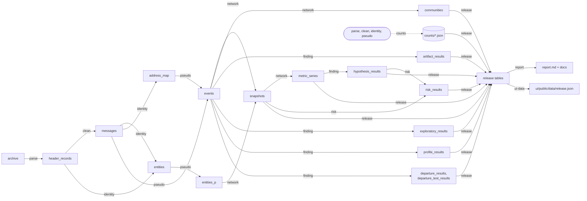

# Contract: Stage Tables (v1.7)

These schemas are the interfaces between stages. They are implemented once in
`src/enron_case/contracts/schemas.py` (`TABLES`, `conform`, `validate`, `CONTRACT_VERSION`), the
counts side outputs in `contracts/counts.py`, and enums and patterns in `contracts/vocab.py`.
The synthetic generator (`src/enron_case/synth/`) emits a conforming fixture for every table, so
each package can be built and tested without the others. Where this page and `schemas.py`
disagree, the code is right and this page is out of date.

**Change rule**: a schema changes only through the lead, with a version bump of
`CONTRACT_VERSION` and a note in `docs/ai-workflow-log.md`. Adding a nullable column is minor;
anything else stops the affected packages until fixtures are regenerated.

**Version history**

| Version | Change | Why |
|---------|--------|-----|
| 1.0 | The planned contract (this file before implementation) | — |
| 1.1 | `communities` (restricted); `data_quality.order` as sort key; counts side outputs (`ingest_counts`, `clean_counts`, `identity_counts`, `pseudo_counts`) with `ingest_counts.header_rulings`; release tables `community_graph`, `community_groups` | Foundation (WP0): the release stage must not import ingest code; the UI needs group ties |
| 1.2 | `artifact_results` (restricted) and `artifact_checks` (release) | In the first real run H2 and H3 passed every pre-registered check with effects that known artifacts could produce |
| 1.3 | `exploratory_results` (restricted) and `exploratory` (release): hypotheses H5–H24 with volume-equalised columns; in the release, outcome and placebo and leave-one-out flags are nullable and suppressed with their comparison | The exploratory families (`docs/hypotheses-exploratory.md`) became pipeline output |
| 1.4 | `retention_median`, `retention_ci_low`, `retention_ci_high`, `retention_passes` on both exploratory tables | The data-science review showed H16 could be produced by inbox retention |
| 1.5 | `data_quality.precision_ci_low` / `precision_ci_high`, funnel detail rows (rejected reasons, dedupe split, message flags, messages without a timestamp, events in the network), per-rule manual-check rows; `exploratory.equalised_p_holm` | Data-science review findings F3, F7, F10 |
| 1.6 | `exploratory_results` / `exploratory` gain row H25 and family `post hoc`; `profile_results` (restricted) and `record_profile` (release): the custodians' mail by month and the after-hours share of their weekday sent mail; attacker `A3` in `risk_results` / `risk` | Final review against prior work: a replication test (H25), evidence for the change of the timestamp convention in 2001, and the realistic insider who knows every custodian (A3) |
| 1.7 | `departure_results` / `departure_test_results` (restricted) and `departures` / `departure_tests` (release): H26, custodian departures in the crisis window | The brief asks for one finding about how the organization changed; every behavioural hypothesis had failed, so a structural question was stated post hoc (O1 in `docs/hypotheses-exploratory.md`) |

Two release changes came from reviews without a version bump, because they narrowed what is
published rather than changing a schema: `weekly_metrics` publishes only the default variant,
and `header_fields` publishes unknown names only as `(other)`.

**Common rules**: tables are written sorted by the stated sort key (nulls last); lists are
sorted; timestamps are UTC; strings are lower-case where they are addresses or domains; a table
has exactly the contract columns, in contract order. Every write goes through
`StageContext.write`, which conforms, validates, leak-checks (no `@` in the restricted zone; no
`@`, `p_…` or `o_…` pattern in the release zone) and fingerprints the table for the run manifest.

`identity` reads `messages` and `header_records` (display names); `finding` reads `events`,
`entities_p`, `communities` and `metric_series`; `risk` reads `snapshots`, `metric_series`,
`entities_p` and `communities` (to build the releases it attacks) and `hypothesis_results` (to
measure utility against the headline).

## Zone 1 · ingest (identifiers present; purged at end of run)

### `header_records` — written by `parse` (WP-A). Sort: `file_id`

| Column | Type | Notes |
|--------|------|-------|
| `file_id` | str | SHA-256 of archive member path, hex, first 16 chars |
| `mailbox_owner` | str | from the archive path (`X-Origin` is dropped) |
| `folder_class` | enum | sent, inbox, deleted, other; from the archive path's top-level folder |
| `date_raw_ok` | bool | date header parsed |
| `ts_utc` | datetime (µs, UTC) nullable | |
| `from_addr` | str nullable | raw address string as found |
| `to_addrs`, `cc_addrs`, `bcc_addrs` | list[str] | raw address strings, split on commas |
| `x_from`, `x_to`, `x_cc`, `x_bcc` | str nullable | display-name fields, raw |
| `message_id` | str nullable | diagnostics only |
| `parse_flags` | list[str] | `bad_date`, `folded` |

Members whose header block does not end cleanly are rejected, not written (see
[header-allowlist.md](header-allowlist.md)).

### `messages` — written by `clean` (WP-B). Sort: `msg_key`

| Column | Type | Notes |
|--------|------|-------|
| `msg_key` | str | SHA-256 over (sender, ts second, sorted recipients), first 20 hex |
| `ts_utc` | datetime nullable | |
| `sender_addr` | str nullable | normalized (rule N1) |
| `recipients` | list[struct{addr: str, role: enum(to,cc,bcc)}] | unique by addr, strongest role |
| `n_recipients` | int | |
| `n_copies` | int | files merged into this message |
| `dedupe_rule` | enum | none, exact, subset |
| `owner_copies` | list[str] | mailbox owners holding a copy |
| `sent_copy_owner` | str nullable | owner whose sent folder held a copy |
| `flags` | list[str] | `date_out_of_range`, `no_recipients`, `self_only`, `mass_mailing`, `bad_address` |

### `entities` — written by `identity` (WP-C). Sort: `entity_id`

| Column | Type | Notes |
|--------|------|-------|
| `entity_id` | str | canonical id = smallest normalized address in cluster |
| `type` | enum | person, list, system, role, unknown |
| `org_domain` | str | registered domain (multi-label public suffixes such as `co.uk` take three labels) |
| `is_internal` | bool | |
| `is_custodian` | bool | rule N5 |
| `n_addresses` | int | |

### `address_map` — written by `identity` (WP-C). Sort: `addr`

| Column | Type | Notes |
|--------|------|-------|
| `addr` | str | normalized address or legacy form |
| `entity_id` | str | FK → entities |
| `rule` | enum nullable | N1…N4 that attached this address; null for the canonical one |
| `support` | int | observations behind the rule |

## Zone 2 · restricted (pseudonyms only; git-ignored)

### `events` — written by `pseudo` (WP-D). Sort: `ts_hour, sender_pid, recipient_pid, event_id`

One row per (message, recipient entity): aliases of one recipient collapse into one event.

| Column | Type | Notes |
|--------|------|-------|
| `event_id` | str | `e_` + HMAC(event-v1, msg_key ‖ recipient), 16 base32 chars |
| `msg_pid` | str | `m_` + HMAC(event-v1, msg_key); groups recipients of one message |
| `ts_hour` | datetime (h) | truncated |
| `sender_pid` | str | `^p_[a-z2-7]{16}$` |
| `recipient_pid` | str | same pattern |
| `role` | enum | to, cc, bcc |
| `n_recipients` | int | |
| `weight` | float | 1 / n_recipients |
| `sender_type`, `recipient_type` | enum | entity type |
| `sender_internal`, `recipient_internal` | bool | |
| `sender_org_pid`, `recipient_org_pid` | str | `^o_[a-z2-7]{16}$` |
| `in_network` | bool | false if any exclusion flag applied |

### `entities_p` — written by `pseudo` (WP-D). Sort: `pid`

| Column | Type |
|--------|------|
| `pid` | str |
| `type` | enum |
| `org_pid` | str |
| `is_internal` | bool |
| `is_custodian` | bool |

### `snapshots` — written by `network` (WP-E). Sort: `scope, week, src_pid, dst_pid`

| Column | Type | Notes |
|--------|------|-------|
| `scope` | enum | core, observed |
| `week` | date | Monday of ISO week |
| `src_pid`, `dst_pid` | str | persons only |
| `weight` | float | sum of event weights |
| `n_messages` | int | |

The observed-scope snapshots of the analysis window are release R0: the node-level edges every
release table is built from and that the risk stage attacks. R0 is never written to `release/`.

### `metric_series` — written by `network` (WP-E). Sort: `scope, metric, variant, week`

| Column | Type | Notes |
|--------|------|-------|
| `scope` | enum | core, observed |
| `week` | date | |
| `metric` | enum | volume, active_persons, density, reciprocity, indegree_gini, cross_community_share, external_share, tie_turnover |
| `value` | float nullable | null when undefined for the window |
| `n_active` | int | persons active in the window |
| `variant` | str | `default` or a sensitivity label from `Config.sensitivity_variants` (`cap=20`, `window=month`) |

### `communities` — written by `network` (WP-E). Sort: `pid`

| Column | Type | Notes |
|--------|------|-------|
| `pid` | str | every internal person in `entities_p`, whether or not active in the baseline period |
| `community` | int | baseline community, frozen; `-1` (`vocab.UNASSIGNED_COMMUNITY`) for a person with no tie in the baseline period |

Used for `cross_community_share`, the H2 artifact check and, aggregated, for the release tables
`community_graph` and `community_groups`.

### `hypothesis_results` — written by `finding` (WP-F). Sort: `hypothesis`

| Column | Type | Notes |
|--------|------|-------|
| `hypothesis` | enum | H1…H4 (pre-registered, `docs/hypotheses.md`) |
| `metric`, `scope` | enum | |
| `change_week` | date nullable | estimated change point |
| `p_perm`, `p_holm` | float | |
| `effect` | float | standardized difference vs baseline |
| `ci_low`, `ci_high` | float | block bootstrap, 95% |
| `null_z` | float | deviation from rewiring null |
| `loo_min_effect`, `loo_max_effect` | float | leave-one-mailbox-out range |
| `robust_variants_passed`, `robust_variants_total` | int | |
| `supported` | enum | yes, no, inconclusive (the pre-registered rule) |
| `confidence` | enum | high, moderate, low; capped at low when an artifact check fails or cannot run |
| `is_headline` | bool | at most one true; never true for a hypothesis capped by an artifact check |

### `artifact_results` — written by `finding` (WP-F). Sort: `hypothesis`

Checks against known artifacts, added after the first real run (`finding/artifacts.py`,
`docs/hypotheses.md` "Artifact checks"; post hoc).

| Column | Type | Notes |
|--------|------|-------|
| `hypothesis` | enum | H2 or H3 |
| `check` | str | `baseline_placebo` (H2: communities fitted on the first half of the baseline, jump into the calm second half) or `within_custodian` (H3: median change of each custodian's own external share) |
| `statistic`, `ci_low`, `ci_high` | float | |
| `n_units` | int | units behind the statistic (custodians for `within_custodian`) |
| `passes` | bool nullable | null when the check could not run |
| `note` | str | one-line reading of the result |

### `exploratory_results` — written by `finding` (WP-F). Sort: `order`

Hypotheses H5–H25 (recorded as E1–E21 in `docs/hypotheses-exploratory.md`, each stated before
it was computed; H25 post hoc, after every other result), `finding/exploratory.py`. One row per hypothesis. Each is a paired,
within-custodian difference of a ratio between fixed windows (`config.CRISIS_WINDOW` against
`config.REFERENCE_WINDOW`, the same weeks a year earlier), with a pre-crisis placebo comparison
(`PLACEBO_AFTER_WINDOW` against `PLACEBO_BEFORE_WINDOW`).

| Column | Type | Notes |
|--------|------|-------|
| `order` | int | 5…25 |
| `hypothesis` | str | `H5`…`H25` |
| `family` | enum | first (H5–H14), second (H15–H24), post hoc (H25) |
| `measure`, `direction` | str, enum(up, down) | what is compared and the hypothesised sign |
| `custodians` | int | custodians in the crisis comparison |
| `median_change`, `ci_low`, `ci_high`, `p`, `p_holm` | float nullable | median paired difference, bootstrap interval, Wilcoxon p, Holm across the twenty-one |
| `placebo_custodians`, `placebo_median`, `placebo_ci_low`, `placebo_ci_high` | int, float nullable | the pre-crisis comparison |
| `placebo_passes`, `loo_stable` | bool | placebo shows no comparable change; leave-one-custodian-out keeps the sign |
| `outcome` | enum | confident, inconclusive, not supported |
| `caveat` | str | `""`, or why the hypothesis cannot be confident (`schemas.EXPLORATORY_CAVEATS`: H5 invalid, H6 timestamp-sensitive (post hoc), H7 untestable, H19 retention-sensitive; or `schemas.RETENTION_FAILED`) |
| `equalised_median`, `equalised_ci_low`, `equalised_ci_high`, `equalised_p` | float nullable | volume-equalised check (each custodian's mail subsampled to the same count in both windows); null unless computed: only for outcomes other than not supported, without a caveat, and not for look-back measures (H19) |
| `retention_median`, `retention_ci_low`, `retention_ci_high`, `retention_passes` | float, bool nullable | retention check: the hypothesis on a measure inbox retention moves less (not one it cannot move); null where none applies and when the outcome is not supported. H16 has one (reciprocity counted between custodians only, whose messages to each other can survive in either mailbox) and H25 has one (only the custodians written to). A failed retention check caps the outcome at inconclusive with that hypothesis's caveat from `RETENTION_FAILED` |

`confident` needs Holm-adjusted p below `alpha`, an interval on the hypothesised side, a passing
placebo, a stable leave-one-out and no caveat.

### `profile_results` — written by `finding` (WP-F). Sort: `month` (1.6)

Descriptive, `finding/profile.py`: one row per month of the analysis window (Houston local time),
over the custodians who are internal persons.

| Column | Type | Notes |
|--------|------|-------|
| `month` | date | first day of the month |
| `custodians_sending`, `sent_messages` | int | custodians with a sent message that month, and their sent messages |
| `after_hours_share` | float nullable | share of their weekday sent messages stamped outside 07:00–19:00 local (the H5 definition); null without weekday mail |
| `custodians_receiving`, `received_messages` | int | custodians who received a message that month, and the messages |

### `departure_results` — written by `finding` (WP-F). Sort: `order` (1.7)

H26 (`finding/departures.py`; O1 in `docs/hypotheses-exploratory.md`), primary definition. One
row per period: the four windows `crisis`, `reference`, `placebo after`, `placebo before`, then
the crisis window cut at `config.CRISIS_SPLIT` (`crisis before the split`, `crisis from the
split`; a week belongs to the part holding its Monday).

| Column | Type | Notes |
|--------|------|-------|
| `order` | int | sort key |
| `period` | enum | `schemas.DEPARTURE_PERIODS` |
| `period_start`, `period_end` | date | the window |
| `at_risk` | int | custodians sending and receiving mailbox-only mail in at least `departure_active_weeks` of the `departure_lookback_weeks` weeks before the window, and not already silent |
| `departures` | int | of them, custodians whose silence of `departure_silence_weeks` weeks starts in the window while their mailbox receives mailbox-only mail in at least `departure_live_weeks` of its weeks |
| `record_ends` | int nullable | silences starting in the window without that mail (the mailbox stops too); null on the two split rows |
| `hazard` | float nullable | `departures / at_risk`; null without custodians at risk |

### `departure_test_results` — written by `finding` (WP-F). Sort: `order` (1.7)

One row per variant (`primary`, then the robustness variants of O1).

| Column | Type | Notes |
|--------|------|-------|
| `order`, `variant`, `in_rule` | int, str, bool | `in_rule` is false for `any silence`, which is reported only |
| `crisis_above_reference` | bool nullable | crisis share above the reference share |
| `p`, `p_band` | float nullable, enum | one-sided Fisher exact p, crisis against reference; band `schemas.P_BANDS` (below `alpha / HYPOTHESES_STATED`, below `alpha`, at or above, not computable) |
| `placebo_p`, `placebo_p_band` | float nullable, enum | the same, placebo after against placebo before |
| `rolling_windows` | int | earlier windows of the crisis length with at least `departure_rolling_min_at_risk` custodians at risk (a count of windows, not persons) |
| `above_rolling` | bool nullable | crisis share above every one of them |
| `loo_stable` | bool nullable | primary only: p below `alpha` and above every rolling window with each custodian left out in turn |
| `outcome` | enum nullable | primary only: `high`, `moderate`, `low`, `not established` (the decision rule of O1) |
| `detectable_departures`, `placebo_detectable_departures` | int nullable | power at these sizes (post hoc, after the data-science review): the fewest crisis (placebo after) departures that reach p below `alpha` with none in the earlier window; null if none can |
| `smallest_at_risk`, `smallest_cell`, `placebo_smallest_cell` | int | restricted only: the counts the release needs to decide what it may publish |

### `risk_results` — written by `risk` (WP-G). Sort: `release_variant, attacker`

| Column | Type | Notes |
|--------|------|-------|
| `release_variant` | enum | R0 (node-level edges), R1 (the published aggregates), R2 (R1 + seeded Laplace noise) |
| `attacker` | enum | A1 (features from the public raw corpus), A2 (A1 plus a few known custodians as seeds), A3 (1.6: the A2 propagation seeded with every custodian, since the corpus names them) |
| `n_targets` | int | persons in R0 that are scored |
| `unique_share` | float | share unique on observable features |
| `median_anonymity_set` | float | |
| `reid_top1` | float | share correctly re-identified |
| `reid_ci_low`, `reid_ci_high` | float | |
| `utility_effect_ratio` | float nullable | headline effect under this release ÷ under restricted data; null without a headline |
| `finding_survives` | bool nullable | null without a headline |

R1 and R2 contain no person-level records, so the attackers have nothing to match there; their
re-identification rate is zero by construction, not by a measured attack on group-level data.

### Counts side outputs — `data/restricted/counts/*.json` (counts only)

Written with `ctx.write_counts`, which refuses any text containing `@`. Shapes in
`src/enron_case/contracts/counts.py`.

| File | Written by | Content |
|------|------------|---------|
| `ingest_counts` | parse | `files_seen`, `files_parsed`, `rejected` by reason, `header_fields` (name → occurrences; names outside `vocab.KNOWN_HEADER_FIELDS` counted as `(other)`), `header_rulings` (name → ruling), `parse_flags` |
| `clean_counts` | clean | `records_in`, `messages_out`, `removed_exact`, `removed_subset`, `flags`, `message_id_shared_share` (research R3), dedupe precision and recall (sample only) |
| `identity_counts` | identity | addresses, entities, entities by type, merges by rule, blocked merges by guard, cluster sizes, precision and recall (sample only) |
| `pseudo_counts` | pseudo | entities, events, messages without time, events in network |
| `identity_manual` | `enron-case review-merges` | `manual_checked`, `manual_correct` and `manual_by_rule` (the same two counts per identity rule): the only output of the manual merge check (a person judges a seeded sample in a terminal; nothing else is stored). The committed `checks/identity_manual.json` holds the two totals only |

`header_rulings` lets the release stage publish rulings without importing ingest code.

## Zone 3 · release (committed)

Written only by the `release` stage (WP-H): every table passes through `release/kanon.py`
(`enforce`/`write`), and `StageContext.write` refuses a release table from any other package.

**Minimum group size** (`Config.k_min`, default 5). The person-count columns are listed once in
`schemas.PERSON_COUNT_COLUMNS`; a published value there is either null or at least k, and so is
every value of the person-count metric `active_persons`. `kanon.check` aborts the run
(`PrivacyViolation`, exit 6) otherwise.

| Table | Person-count columns |
|-------|----------------------|
| `weekly_metrics` | `n_active` (and `value` where `metric = active_persons`) |
| `degree_distribution` | `persons` |
| `community_groups` | `n_persons` |
| `risk` | `n_targets` |
| `exploratory` | `custodians`, `placebo_custodians` |
| `record_profile` | `custodians_sending`, `custodians_receiving` |
| `departures` | `at_risk`, `departures`, `record_ends` |

| File | Content |
|------|---------|
| `release/data_quality.csv` | `order`, step, count_in, count_out, removed, rule, precision, recall, `precision_ci_low`, `precision_ci_high` (1.5: exact binomial interval where precision is estimated from a sample, i.e. the manual merge check). Rows: files parsed; deduplicate (`exact+subset`); resolve identities (`N1-N4`); the manual merge check when `identity_manual` exists, with one row per rule only when the file carries `manual_by_rule` (the committed file does not, so the committed release has the one total row); then rejected files by reason, the exact/subset dedupe split, the five message flags, messages without a timestamp and events in the network, each reconciled with its parent count. Counts of files, messages, events and judged merges, not persons: no k-suppression. Precision and recall are null on the real corpus except for the manual check |
| `release/header_fields.csv` | field, occurrences, ruling. Only names in `vocab.KNOWN_HEADER_FIELDS`; every other name summed into `(other)`, ruling `dropped` |
| `release/weekly_metrics.csv` | scope, week, metric, value, n_active, variant. Only `variant = default` is published: a sensitivity variant next to it would let default minus variant `n_active` reveal groups below k (the variants stay restricted and feed `robust_variants_*`). `n_active` below k is suppressed with its `value`; a value whose `n_active` is suppressed is refused. The core network is nested in the observed one, so where observed minus core `n_active` is between 1 and k − 1 the core row is suppressed too (`kanon.suppress_nested_scopes`), and `kanon.check` refuses a table that still has such a pair |
| `release/hypotheses.csv` | `hypothesis_results` (H1–H4) |
| `release/artifact_checks.csv` | `artifact_results`; `n_units` of `within_custodian` is suppressed when below k |
| `release/record_profile.csv` | `profile_results` (1.6). A month whose sending side has fewer than k custodians is published without its sending columns (`custodians_sending`, `sent_messages`, `after_hours_share`); the same for the receiving side |
| `release/exploratory.csv` | `exploratory_results` (H5–H25). Where `custodians` is below k, the crisis comparison is suppressed with everything derived from it: its statistics, the equalised and retention columns, `outcome` and `loo_stable`. Where `placebo_custodians` is below k, the placebo statistics and `placebo_passes` are suppressed. These columns are therefore nullable in the release only. `equalised_p_holm` (1.5) is the equalised p times the family size, capped at 1 (a Bonferroni bound) |
| `release/departures.csv` | `departure_results` (1.7). `at_risk` below k takes every count of its row; `departures` is suppressed with `hazard` below k and where at risk minus departures is below k; `record_ends` is suppressed below k, where at risk minus record ends is below k, and where at risk minus departures minus record ends (the custodians who stayed) is below k (zero included). `kanon.check` refuses any published complement below k. The two split rows are published only if both reach k, so the crisis total minus one part cannot reveal the other. Only the primary definition is published |
| `release/departure_tests.csv` | `departure_test_results` (1.7) without its three restricted columns. `p` and `placebo_p` are published only on the primary row and only when every cell of their two-by-two table reaches k; otherwise the band alone. Variants publish no counts and no p-values (their counts are nested in the primary's). The direction, the bands and the rolling comparison are published even when a cell is below k, as stated before computing: they are inequalities over at least k custodians at risk, not counts (unlike `exploratory`, where a comparison over fewer than k custodians is hidden whole). A variant with a window of fewer than k custodians at risk publishes none of its comparisons; the power columns are published for the primary only |
| `release/risk.csv` | `risk_results` |
| `release/degree_distribution.csv` | period (half-year, `2000H1`), degree bucket (`1`, `2-4`, `5-9`, `10+` from `Config.degree_bucket_floors`; degree = number of distinct contacts in either direction), persons (≥ k or suppressed). When a period hides only one cell with a true value above zero, or only one cell at all, its smallest published cell is suppressed too: a hidden true zero does not protect a small count |
| `release/community_graph.csv` | week, src_group, dst_group, weight, n_messages; plus `community_groups.csv`: group, n_persons. Groups are baseline communities with ≥ k persons, labelled `G01…` by decreasing size; groups of equal size keep the order of their community numbers, which the smallest pseudonym in each decides, so the order among equal-size groups is not independent of the pseudonyms (the labels reveal no pseudonym); smaller communities, and internal persons with no tie in the baseline period (people first seen in 2001–2002; the large majority of the bucket), are merged into `other`, which is published only if it reaches k. `other` is a leftover bucket, not a community. A weekly tie is dropped when it has fewer than k distinct senders in `src_group` (the number of distinct recipients is not limited). `weight` and `n_messages` sum the person-pair edges between the two groups, so `n_messages` counts per-pair messages: one message from a sender to three members of the other group counts three |
| `release/report.md` | the report: quality, the record profile, H26 custodian departures, finding, hypotheses H1–H26, risk, limits (stage `report`) |
| `release/run_manifest.json` | code version, sample flag, seed, every `Config` parameter, key fingerprint, `corpus_sha256` (the archive checksum verified by `fetch`; the synthetic archive's on sample runs), fingerprint per table and counts file, stages run with the code version that ran each; no wall-clock time and no durations, so two identical runs write identical bytes. Durations go to the git-ignored run log `data/logs/stage_timings.json` (`data/sample/logs/` on sample runs; `{"stages": [{"stage", "seconds"}]}`; a partial run replaces the stages it ran and keeps the others, which come first) |
| `ui/public/data/release.json` | written by stage `ui-data` from the release tables above and the manifest's run block, and nothing else: the tables in `uiexport.export.RELEASE_TABLES` (every CSV above, `record_profile` included), the public event dates and the crisis and reference windows, in one file for the explorer UI (format in `uiexport/export.py`) |

`checks/identity_manual.json` (committed) holds the result of the person's manual merge review
(`enron-case review-merges`): counts only (`manual_checked`, `manual_correct`, per-rule counts
when recorded). The release reads it on real runs when the run's counts zone has none, so a fresh
clone publishes the same `data_quality` rows; sample runs never use it.

No release file contains a `pid`, `org_pid`, address, name, or any count describing fewer than
k persons.
