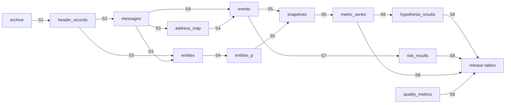

# Contract: Stage Tables (v1)

These schemas are the interfaces between work packages. They are implemented once in
`src/enron_case/contracts/schemas.py` (WP0) with a `validate(table, name)` function, and the
synthetic generator emits a conforming fixture for every table, so each package can be built and
tested without the others.

**Change rule**: during the parallel phase a schema changes only through the lead, with a version
bump and a note in `docs/ai-workflow-log.md`. Adding a nullable column is minor; anything else
stops the affected packages until fixtures are regenerated.

**Version**: 1.1 (adds `communities`, `data_quality.order`, counts side outputs).

**Common rules**: tables are written sorted by the stated sort key; lists are sorted; timestamps
are UTC; strings are lower-case where they are addresses or domains; no column may be added to a
restricted or release table if it is not listed here.

## Zone 1 · ingest (identifiers present; purged at end of run)

### `header_records` — written by S1 (WP-A). Sort: `file_id`

| Column | Type | Notes |
|--------|------|-------|
| `file_id` | str | SHA-256 of archive member path, hex, first 16 chars |
| `mailbox_owner` | str | from archive path / `X-Origin` |
| `folder_class` | enum | sent, inbox, deleted, other |
| `date_raw_ok` | bool | date header parsed |
| `ts_utc` | datetime (s) nullable | |
| `from_addr` | str nullable | raw address string as found |
| `to_addrs`, `cc_addrs`, `bcc_addrs` | list[str] | raw address strings |
| `x_from`, `x_to`, `x_cc`, `x_bcc` | str nullable | display-name fields, raw |
| `message_id` | str nullable | diagnostics only |
| `parse_flags` | list[str] | e.g. `no_header_end`, `bad_date`, `folded` |

Side output: `ingest_counts.json` — files seen, parsed, rejected by reason, header field names
encountered with counts (names only).

### `messages` — written by S2 (WP-B). Sort: `msg_key`

| Column | Type | Notes |
|--------|------|-------|
| `msg_key` | str | SHA-256 over (sender, ts second, sorted recipients), first 20 hex |
| `ts_utc` | datetime (s) nullable | |
| `sender_addr` | str nullable | normalized (rule N1) |
| `recipients` | list[struct{addr: str, role: enum(to,cc,bcc)}] | unique by addr, strongest role |
| `n_recipients` | int | |
| `n_copies` | int | files merged into this message |
| `dedupe_rule` | enum | none, exact, subset |
| `owner_copies` | list[str] | mailbox owners holding a copy |
| `sent_copy_owner` | str nullable | owner whose sent folder held a copy |
| `flags` | list[str] | `date_out_of_range`, `no_recipients`, `self_only`, `mass_mailing`, `bad_address` |

Side output: `clean_counts.json` — per rule and per flag counts; share of exact-duplicate groups
sharing one `message_id` (research R3 check).

### `entities` — written by S3 (WP-C). Sort: `entity_id`

| Column | Type | Notes |
|--------|------|-------|
| `entity_id` | str | canonical id = smallest normalized address in cluster |
| `type` | enum | person, list, system, role, unknown |
| `org_domain` | str | registered domain |
| `is_internal` | bool | |
| `is_custodian` | bool | rule N5 |
| `n_addresses` | int | |

### `address_map` — written by S3 (WP-C). Sort: `addr`

| Column | Type | Notes |
|--------|------|-------|
| `addr` | str | normalized address or legacy form |
| `entity_id` | str | FK → entities |
| `rule` | enum nullable | N1…N4 that attached this address; null for the canonical one |
| `support` | int | observations behind the rule |

Side output: `identity_counts.json` — clusters by size, merges by rule, blocked merges by guard,
precision/recall when ground truth is available.

## Zone 2 · restricted (pseudonyms only; git-ignored)

### `events` — written by S4 (WP-D). Sort: `ts_hour, sender_pid, recipient_pid, event_id`

| Column | Type | Notes |
|--------|------|-------|
| `event_id` | str | `e_` + HMAC(event-v1, msg_key ‖ recipient), 16 base32 chars |
| `msg_pid` | str | `m_` + HMAC(event-v1, msg_key); groups recipients of one message |
| `ts_hour` | datetime (h) | truncated |
| `sender_pid` | str | `^p_[a-z2-7]{16}$` |
| `recipient_pid` | str | same pattern |
| `role` | enum | to, cc, bcc |
| `n_recipients` | int | |
| `weight` | float | 1 / n_recipients |
| `sender_type`, `recipient_type` | enum | entity type |
| `sender_internal`, `recipient_internal` | bool | |
| `sender_org_pid`, `recipient_org_pid` | str | `^o_[a-z2-7]{16}$` |
| `in_network` | bool | false if any exclusion flag applied |

### `entities_p` — written by S4 (WP-D). Sort: `pid`

| Column | Type |
|--------|------|
| `pid` | str |
| `type` | enum |
| `org_pid` | str |
| `is_internal` | bool |
| `is_custodian` | bool |

### `snapshots` — written by S5 (WP-E). Sort: `scope, week, src_pid, dst_pid`

| Column | Type | Notes |
|--------|------|-------|
| `scope` | enum | core, observed |
| `week` | date | Monday of ISO week |
| `src_pid`, `dst_pid` | str | persons only |
| `weight` | float | sum of event weights |
| `n_messages` | int | |

### `metric_series` — written by S5 (WP-E). Sort: `scope, metric, variant, week`

| Column | Type | Notes |
|--------|------|-------|
| `scope` | enum | core, observed |
| `week` | date | |
| `metric` | enum | volume, active_persons, density, reciprocity, indegree_gini, cross_community_share, external_share, tie_turnover |
| `value` | float nullable | null when undefined for the window |
| `n_active` | int | persons active in the window |
| `variant` | str | `default` or a sensitivity label (`cap=20`, `window=month`) |

### `communities` — written by S5 (WP-E). Sort: `pid`

| Column | Type | Notes |
|--------|------|-------|
| `pid` | str | persons active in `baseline_period` |
| `community` | int | baseline community, frozen; -1 if not assigned |

Stays in the restricted zone. Used for `cross_community_share` and, aggregated, for the release
table `community_graph.csv`.

### `hypothesis_results` — written by S6 (WP-F). Sort: `hypothesis`

| Column | Type | Notes |
|--------|------|-------|
| `hypothesis` | enum | H1…H4 |
| `metric`, `scope` | str | |
| `change_week` | date nullable | estimated change point |
| `p_perm`, `p_holm` | float | |
| `effect` | float | standardized difference vs baseline |
| `ci_low`, `ci_high` | float | block bootstrap, 95% |
| `null_z` | float | deviation from rewiring null |
| `loo_min_effect`, `loo_max_effect` | float | leave-one-mailbox-out range |
| `robust_variants_passed`, `robust_variants_total` | int | |
| `supported` | enum | yes, no, inconclusive |
| `confidence` | enum | high, moderate, low |
| `is_headline` | bool | at most one true |

### `risk_results` — written by S7 (WP-G). Sort: `release_variant, attacker`

| Column | Type | Notes |
|--------|------|-------|
| `release_variant` | enum | R0, R1, R2 |
| `attacker` | enum | A1, A2 |
| `n_targets` | int | persons in scope |
| `unique_share` | float | share unique on observable features |
| `median_anonymity_set` | float | |
| `reid_top1` | float | share correctly re-identified |
| `reid_ci_low`, `reid_ci_high` | float | |
| `utility_effect_ratio` | float nullable | headline effect under this release ÷ under restricted data |
| `finding_survives` | bool nullable | |

### Counts side outputs — `data/restricted/counts/*.json` (counts only)

`ingest_counts`, `clean_counts`, `identity_counts`, `pseudo_counts`; shapes in
`src/enron_case/contracts/counts.py`. `ingest_counts.header_rulings` carries the ruling of each
header field name so the release stage never imports ingest code. S8 assembles
`quality_metrics` from them.

## Zone 3 · release (committed)

Written only by S8 (WP-H) through `release/kanon.py`; rendered by S9 (WP-I).

| File | Content |
|------|---------|
| `release/data_quality.csv` | order, step, count_in, count_out, removed, rule, precision, recall |
| `release/header_fields.csv` | field name, occurrences, ruling |
| `release/weekly_metrics.csv` | scope, week, metric, value, n_active (suppressed if < k) |
| `release/hypotheses.csv` | `hypothesis_results` without per-mailbox detail |
| `release/risk.csv` | `risk_results` |
| `release/degree_distribution.csv` | period (half-year), degree bucket (`1`, `2-4`, `5-9`, `10+`; degree = number of distinct contacts in either direction), persons (≥ k or suppressed; a lone suppressed cell per period forces a second suppression) |
| `release/community_graph.csv` | week, src_group, dst_group, weight, n_messages; plus `community_groups.csv`: group, n_persons. Groups are baseline communities with ≥ k persons, labelled `G01…` in an order unrelated to pseudonyms; smaller communities are merged into `other`; ties with fewer than k distinct senders are suppressed |
| `ui/public/data/release.json` | written by S10 (WP-J) from the files above and nothing else; same content, one file, for the explorer UI |
| `release/report.md` | the report: quality, finding, risk, limits |
| `release/run_manifest.json` | parameters, seed, code version, fingerprints per table |

No release file contains a `pid`, `org_pid`, address, name, or any row describing fewer than k
persons.
