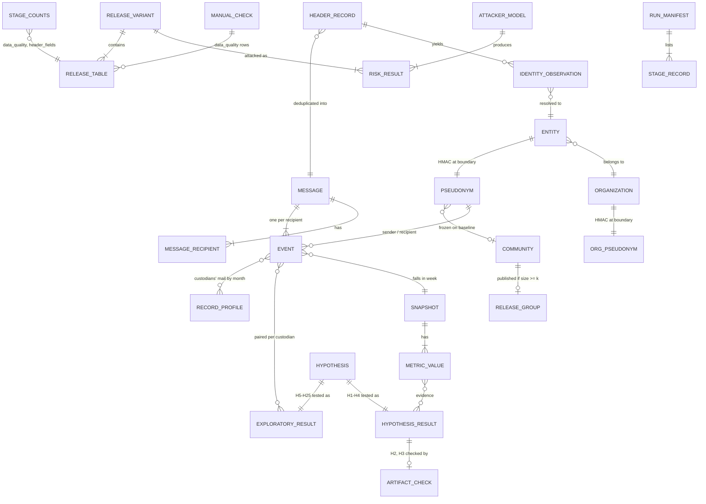
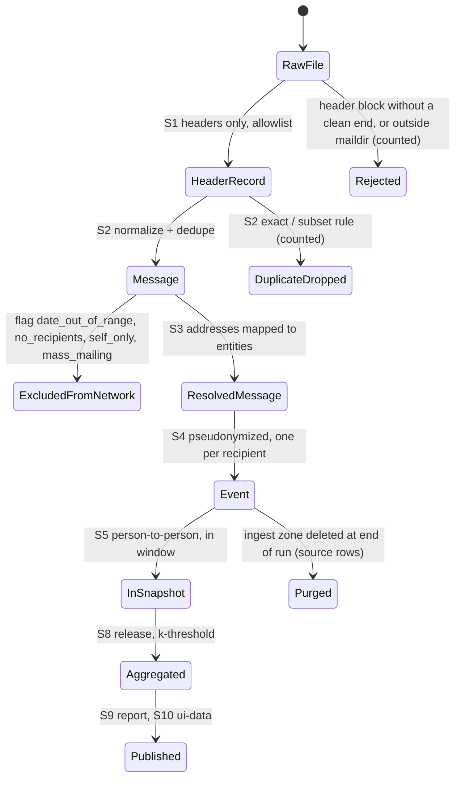
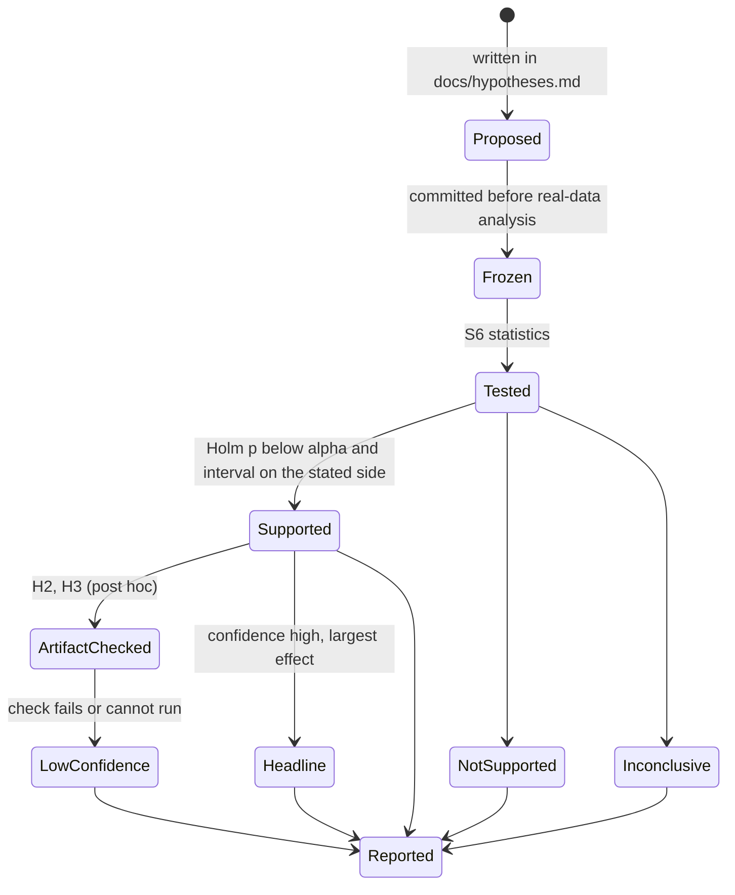

# Data Model: Enron Headers-Only Network Analysis Case

Column-level schemas are in [contracts/data-contracts.md](contracts/data-contracts.md) (contract
version 1.6, `src/enron_case/contracts/schemas.py`). This file gives the entities, their
relationships, the zone each lives in, and the rules they must satisfy, as implemented.

## Entities by zone

| Entity | Zone | Stored as | Notes |
|--------|------|-----------|-------|
| Header record | ingest | `header_records` | one per raw file; allowlisted fields only |
| Identity observation | ingest | derived in memory from `header_records` | address/name + where seen |
| Message | ingest | `messages` | one per deduplicated message |
| Entity, Organization | ingest | `entities`, `address_map` | resolved clusters with merge rule |
| Pseudonym, Event | restricted | `events`, `entities_p` | no identifier, hour-resolution time |
| Snapshot, Metric value | restricted | `snapshots`, `metric_series` | weekly; per-node rows stay here; observed-scope snapshots are release R0 |
| Community | restricted | `communities` | baseline communities, frozen; published only as groups of at least k (`community_groups`, `community_graph`) |
| Hypothesis result (H1–H4) | restricted → release | `hypothesis_results` → `hypotheses.csv` | pre-registered; aggregate |
| Artifact check | restricted → release | `artifact_results` → `artifact_checks.csv` | post-hoc checks of H2 and H3; custodian count suppressed below k |
| Exploratory result (H5–H25) | restricted → release | `exploratory_results` → `exploratory.csv` | within-custodian comparisons; a comparison over fewer than k custodians is suppressed with everything derived from it |
| Record profile | restricted → release | `profile_results` → `record_profile.csv` | descriptive, per month: custodians sending and receiving, their messages, the after-hours share of weekday sent mail; a side with fewer than k custodians is suppressed |
| Risk result | restricted → release | `risk_results` → `risk.csv` | counts and rates only; attackers A1, A2, A3 against R0, R1, R2 |
| Stage counts | counts (restricted) | `counts/*.json` | counts only, no identifier; feed `data_quality` and `header_fields` |
| Manual merge check | counts (restricted), checks (committed) | `counts/identity_manual.json`, `checks/identity_manual.json` | counts only (checked, correct, per rule when recorded) from a person's judgement in a terminal; identifiers are shown on screen only. The committed copy is used when a real run has none, so a fresh clone publishes the same rows |
| Release table | release | CSV + `report.md` | every person count ≥ k or suppressed |
| UI data | ui | `ui/public/data/release.json` | built from release tables and the manifest's run block only |
| Run manifest | release | `run_manifest.json` | fingerprints, parameters, seed, key fingerprint, stage durations; no key, no paths with names, no wall-clock time |

## Validation rules

**Header record**
- Contains only fields ruled "usable" or "identifier, ingest only" in the allowlist contract.
- `folder_class` ∈ {sent, inbox, deleted, other}; the raw folder name is never stored.
- Unparseable date → `ts_utc` null with flag `bad_date`; never guessed.

**Message**
- Key is unique. `n_copies ≥ 1`. `dedupe_rule` ∈ {none, exact, subset}.
- Recipients are unique per message; a recipient in several fields keeps the strongest role
  (to > cc > bcc).
- `ts_utc` within the plausible window (configurable, default 1998-01-01 to 2002-12-31),
  otherwise the message is kept in counts and excluded from the network with flag `date_out_of_range`.
- Flags: `no_recipients`, `self_only`, `mass_mailing` (recipients > cap), `bad_address`.

**Entity**
- Every normalized address maps to exactly one entity (FR-012).
- `type` ∈ {person, list, system, role, unknown}. Only `person` enters the person network.
- Every merge edge in `address_map` carries `rule` ∈ {N1…N4}; an entity with one address has none.
- `is_custodian` true only via rule N5.

**Pseudonym / Event**
- `pid` matches `^p_[a-z2-7]{16}$`; `org_pid` matches `^o_[a-z2-7]{16}$`. No `@` anywhere in the
  restricted zone (checked by the canary).
- Bijective with entities in one run: count(distinct pid) = count(entities); collision aborts.
- Same key + same canonical id ⇒ same pid across runs (FR-010).
- `ts_hour` is truncated to the hour.
- `weight = 1 / n_recipients`.

**Snapshot / Metric value**
- One snapshot per ISO week and scope ∈ {core, observed}.
- Metrics undefined on a window (fewer than k active persons) are null, not zero.

**Hypothesis result (H1–H4)**
- One row per hypothesis H1–H4, always present, with `supported` ∈ {yes, no, inconclusive}.
- `confidence` ∈ {high, moderate, low} derived by the rule in `docs/hypotheses.md`
  (`finding/select.py`), not free text. A hypothesis whose artifact check fails or cannot run is
  capped at low confidence and cannot be headline. A headline needs `supported = yes` and
  confidence high; there is at most one.

**Artifact check**
- One row per checked hypothesis: H2 `baseline_placebo`, H3 `within_custodian`.
- `passes` is null when the check could not run; that also caps confidence.

**Exploratory result (H5–H25)**
- One row per hypothesis, `order` 5–25; `family` first (H5–H14), second (H15–H24) or post hoc
  (H25). Holm's correction runs across all twenty-one.
- `outcome` ∈ {confident, inconclusive, not supported}. Confident needs Holm-adjusted p below
  `alpha`, an interval on the hypothesised side, a passing pre-crisis placebo, a stable
  leave-one-custodian-out and no caveat. A caveat (H5 invalid timestamps, H7 untestable, H19
  retention-sensitive) or a failed retention check (H16, H25) caps the outcome at inconclusive.
- Equalised and retention columns are null where the check does not apply.

**Release table**
- Any count of persons < k (default 5) in a column of `schemas.PERSON_COUNT_COLUMNS` is
  suppressed, together with the values derived from it, or its row is dropped. Enforced
  centrally in `release/kanon.py`; a violation aborts the run (exit 6).
- `weekly_metrics` carries the default variant only; `degree_distribution` is protected against
  differencing within each half-year; `header_fields` names only known fields.
- No pseudonym from the restricted zone appears in `release/`. The node-level release R0 that
  the risk stage attacks is built in memory from `snapshots` and never written to `release/`.

## State transitions

In the real-corpus run H2 and H3 are supported by the pre-registered rule but fail their
artifact checks, so they are capped at low confidence; H1 and H4 are not supported. There is no
headline. Of H5–H25, none is confident; H16 and H20 are inconclusive (H16 after failing its
retention check), the rest not supported, H25 among them. No hypothesis is held true. What the
headers do establish is a change of the record: the record profile shows the custodians'
after-hours share of weekday sent mail falling from about half (up to April 2001) to a few
percent (from August 2001; the fall starts in May), between the reference and crisis windows of
every within-custodian comparison.

## Parameters (single source: `config.py`, echoed in the run manifest)

| Parameter | Default | Affects |
|-----------|---------|---------|
| `seed` | 20011202 | all randomness |
| `k_min` | 5 | release suppression |
| `window` | ISO week (sensitivity: month) | snapshots |
| `recipient_cap` | 50 | mass-mailing exclusion |
| `plausible_dates` | 1998-01-01 … 2002-12-31 | date noise |
| `analysis_period` | 2000-01-01 … 2002-03-31 | series |
| `baseline_period` | 2000-01-01 … 2000-12-31 | communities for H2, effect sizes |
| `name_link_support` | 3 | identity rules N3, N4 |
| `bootstrap_reps` / `permutations` | 1000 / 1000 | intervals, p-values |
| `ts_resolution` | hour | restricted zone |
| `sensitivity_variants` | `cap=20`, `window=month` | robustness of H1–H4 (restricted only) |
| `alpha` / `ci_level` / `block_weeks` | 0.05 / 0.95 / 4 | H1–H4 decision rule |
| `null_replicates` | 20 | rewiring null model |
| `placebo_max_effect` / `min_unit_events` | 2.0 / 30 | artifact checks of H2 / H3 |
| `exploratory_min_messages` / `exploratory_bootstrap_reps` / `exploratory_equalise_reps` | 20 / 2000 / 40 | H5–H25 |
| `manual_sample_size` | 50 | manual merge check |
| `degree_bucket_floors` / `r2_noise_scale` | 1, 2, 5, 10 / 1.0 | release buckets, R2 noise |
| `a2_seeds` / `a2_min_support` | 3 / 2 | attacker A2 (seeds); A2 and A3 (support) |

Fixed windows that are not run parameters (they are stated in `docs/hypotheses-exploratory.md`)
live as constants in `config.py`: `CRISIS_WINDOW`, `REFERENCE_WINDOW`, `PLACEBO_AFTER_WINDOW`,
`PLACEBO_BEFORE_WINDOW`, and `PUBLIC_EVENTS` (annotation only).
