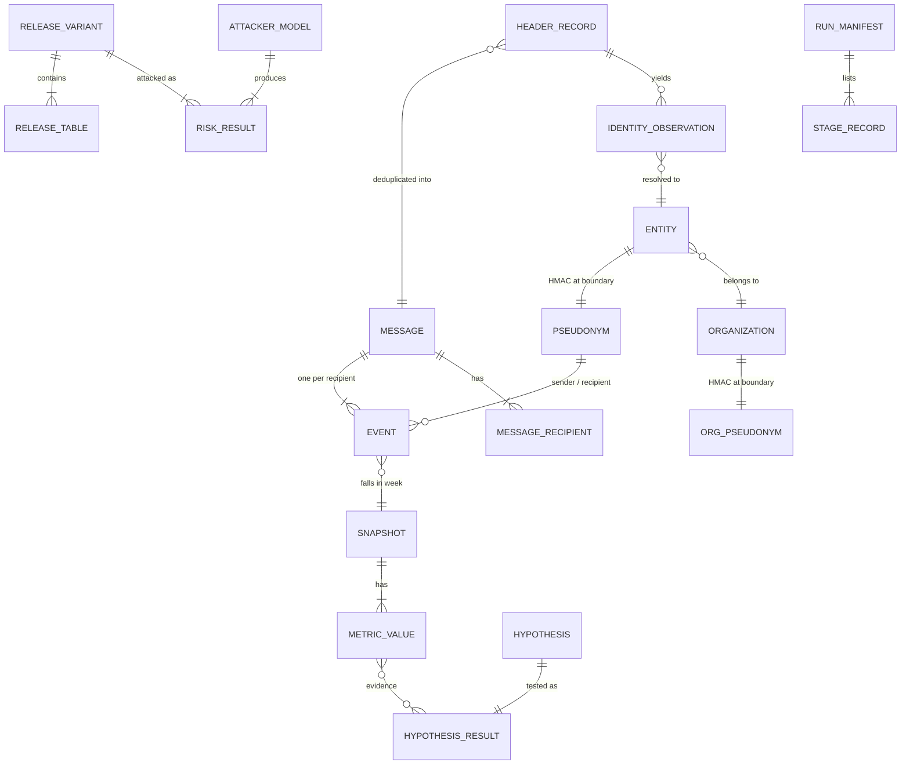
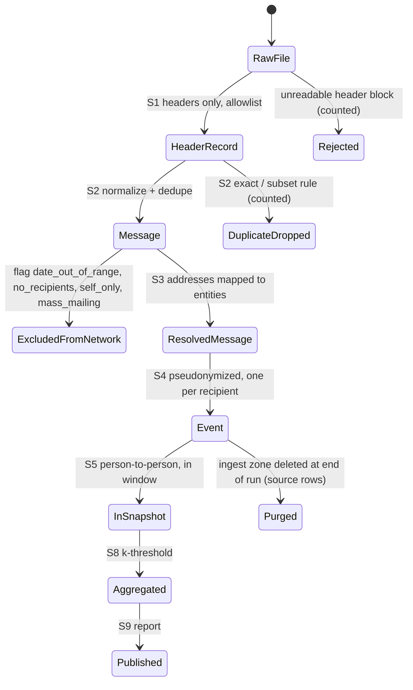
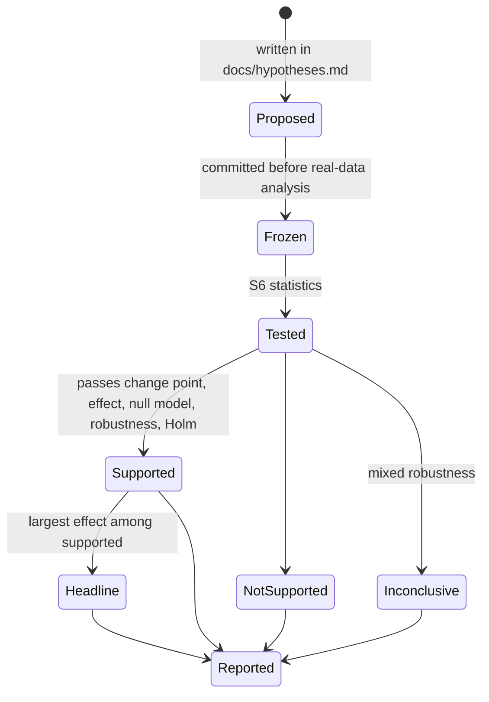

# Data Model: Enron Headers-Only Network Analysis Case

Column-level schemas are in [contracts/data-contracts.md](contracts/data-contracts.md). This file
gives the entities, their relationships, the zone each lives in, and the rules they must satisfy.

## Entities by zone

| Entity | Zone | Stored as | Notes |
|--------|------|-----------|-------|
| Header record | ingest | `header_records` | one per raw file; allowlisted fields only |
| Identity observation | ingest | derived in memory from `header_records` | address/name + where seen |
| Message | ingest | `messages` | one per deduplicated message |
| Entity, Organization | ingest | `entities`, `address_map` | resolved clusters with merge rule |
| Pseudonym, Event | restricted | `events`, `entities_p` | no identifier, hour-resolution time |
| Snapshot, Metric value | restricted | `snapshots`, `metric_series` | weekly; per-node rows stay here |
| Hypothesis result | restricted → release | `hypothesis_results` | aggregate; passes k-check trivially |
| Risk result | restricted → release | `risk_results` | counts and rates only |
| Release table | release | CSV + `report.md` | every cell ≥ k or suppressed |
| Run manifest | release | `run_manifest.json` | fingerprints, parameters, seed; no key, no paths with names |

## Validation rules

**Header record**
- Contains only fields ruled "usable" or "identifier, ingest only" in the allowlist contract.
- `folder_class` ∈ {sent, inbox, deleted, other}; the raw folder name is never stored.
- Unparseable date → `ts_utc` null with flag `bad_date`; never guessed.

**Message**
- Key is unique. `n_copies ≥ 1`. `dedupe_rule` ∈ {none, exact, subset}.
- Recipients are unique per message; a recipient in several fields keeps the strongest role
  (to > cc > bcc).
- `ts_utc` within the plausible window (configurable, default 1998-01-01 to 2002-12-31),
  otherwise the message is kept in counts and excluded from the network with flag `date_out_of_range`.
- Flags: `no_recipients`, `self_only`, `mass_mailing` (recipients > cap), `bad_address`.

**Entity**
- Every normalized address maps to exactly one entity (FR-012).
- `type` ∈ {person, list, system, role, unknown}. Only `person` enters the person network.
- Every merge edge in `address_map` carries `rule` ∈ {N1…N4}; an entity with one address has none.
- `is_custodian` true only via rule N5.

**Pseudonym / Event**
- `pid` matches `^p_[a-z2-7]{16}$`; `org_pid` matches `^o_[a-z2-7]{16}$`. No `@` anywhere in the
  restricted zone (checked by the canary).
- Bijective with entities in one run: count(distinct pid) = count(entities); collision aborts.
- Same key + same canonical id ⇒ same pid across runs (FR-010).
- `ts_hour` is truncated to the hour.
- `weight = 1 / n_recipients`.

**Snapshot / Metric value**
- One snapshot per ISO week and scope ∈ {core, observed}.
- Metrics undefined on a window (fewer than k active persons) are null, not zero.

**Hypothesis result**
- One row per hypothesis H1–H4, always present, with `supported` ∈ {yes, no, inconclusive}.
- `confidence` ∈ {high, moderate, low} derived by the rule in `docs/metrics.md`, not free text.

**Release table**
- Any count of persons < k (default 5) is suppressed; a row derived from such a group is dropped
  or coarsened. Enforced centrally in `release/kanon.py`; a violation aborts the run.
- No pseudonym from the restricted zone appears in `release/`; where node-level variants are
  produced for the attack (R0), they are written to the restricted zone, never to `release/`.

## State transitions

## Parameters (single source: `config.py`, echoed in the run manifest)

| Parameter | Default | Affects |
|-----------|---------|---------|
| `seed` | 20011202 | all randomness |
| `k_min` | 5 | release suppression |
| `window` | ISO week (sensitivity: month) | snapshots |
| `recipient_cap` | 50 | mass-mailing exclusion |
| `plausible_dates` | 1998-01-01 … 2002-12-31 | date noise |
| `analysis_period` | 2000-01-01 … 2002-03-31 | series |
| `baseline_period` | 2000-01-01 … 2000-12-31 | communities for H2, effect sizes |
| `name_link_support` | 3 | identity rules N3, N4 |
| `bootstrap_reps` / `permutations` | 1000 / 1000 | intervals, p-values (raise if runtime allows) |
| `ts_resolution` | hour | restricted zone |
