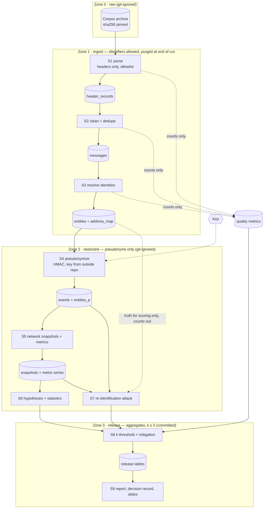
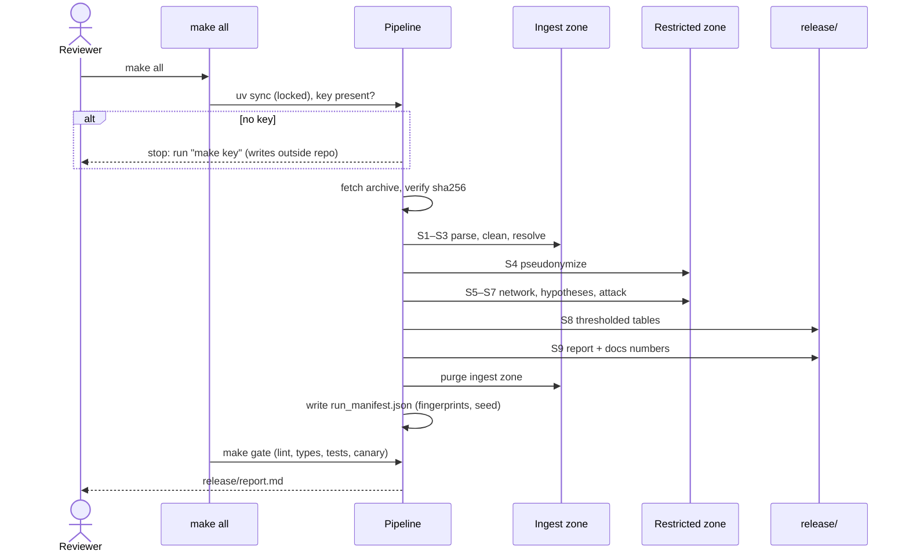
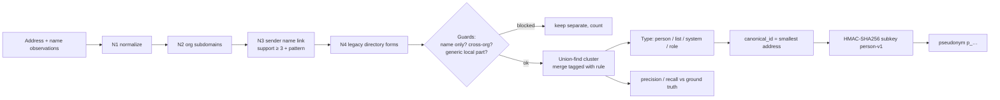
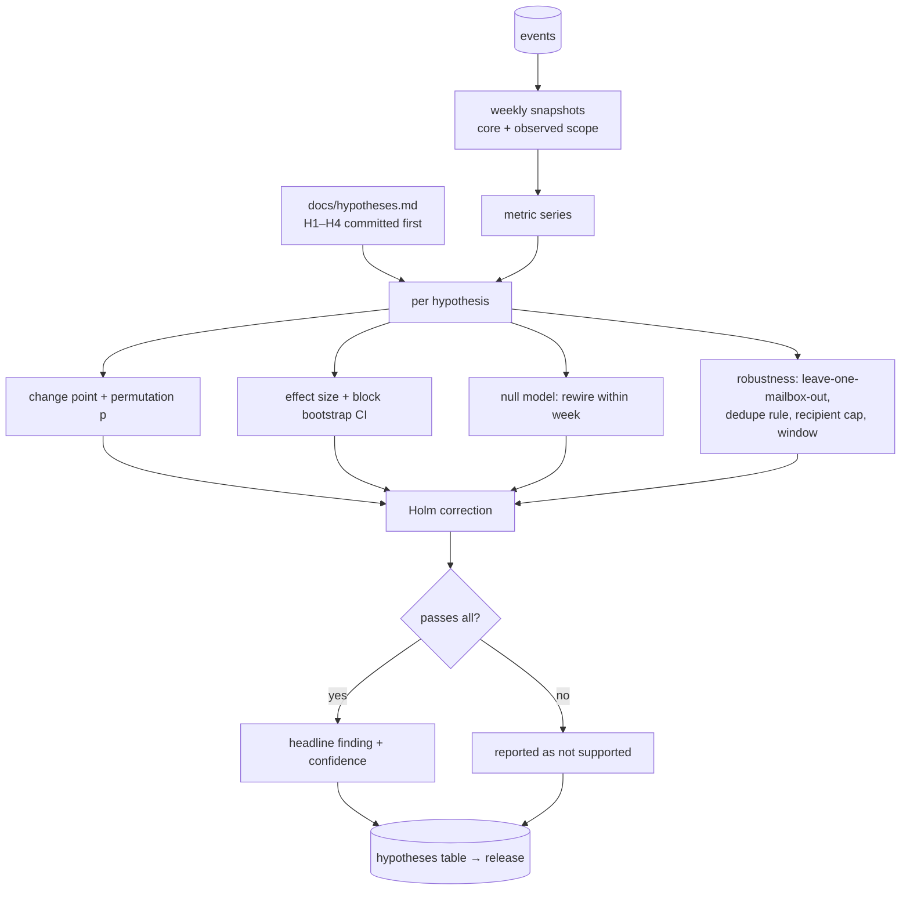
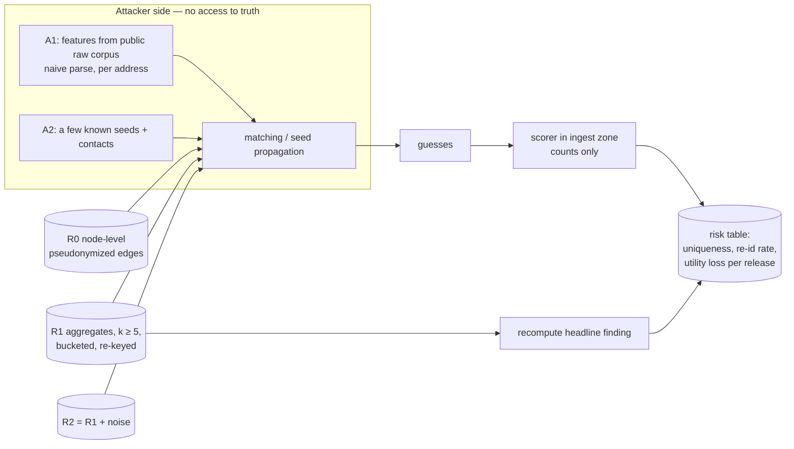
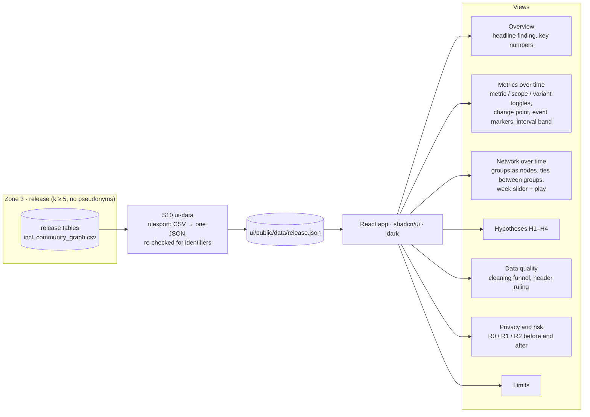
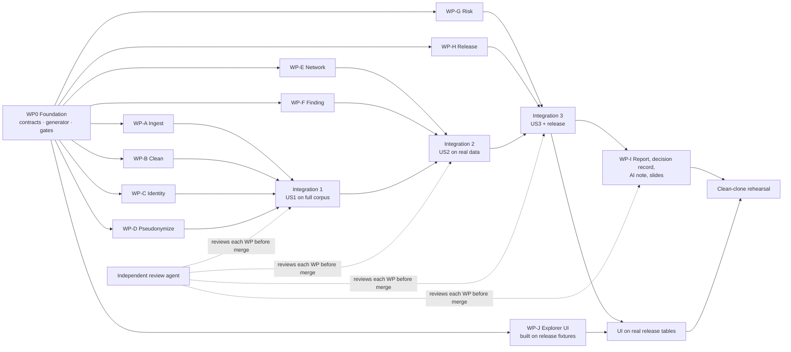
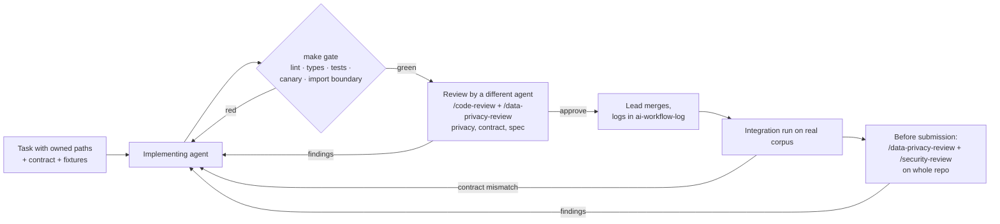

# Implementation Plan: Enron Headers-Only Network Analysis Case

**Branch**: `001-enron-network-analysis` | **Date**: 2026-11-14 | **Spec**: [spec.md](spec.md)

**Input**: Feature specification from `/specs/001-enron-network-analysis/spec.md`

## Summary

A single-command, file-based Python pipeline that streams the public Enron archive, reads headers
only, cleans and deduplicates without content, resolves identities by recorded rules, replaces
people and organizations with keyed pseudonyms at a hard boundary, builds weekly communication
networks, tests four pre-stated hypotheses about 2001, attacks its own output to measure
re-identification risk, and publishes only aggregates that meet a minimum group size. The
repository carries the decision record, AI-workflow note and slides, all fed by pipeline output.

The design is organised around **three data zones** and **versioned table contracts**. The zones
make the privacy rule checkable; the contracts let eleven work packages be built in parallel by
separate AI agents against synthetic ground truth.

## Technical Context

**Language/Version**: Python 3.12

**Primary Dependencies**: Polars (tables), NetworkX + NumPy + SciPy (networks, statistics);
standard library for parsing, hashing and CLI (`tarfile`, `hmac`, `hashlib`, `argparse`)

**Explorer UI (optional)**: React 18 + TypeScript + Vite; shadcn/ui components on Tailwind CSS,
dark theme only; shadcn charts (Recharts) for series; `d3-force` for the group-level network;
Vitest + Testing Library; Node 20+ needed only for `make ui`

**Storage**: Parquet files per stage under `data/` (git-ignored); CSV/Markdown/JSON under
`release/` (committed); no database or service

**Testing**: pytest + hypothesis; synthetic corpus generator with ground truth; privacy canary;
import-boundary test; contract (schema) tests

**Target Platform**: macOS/Linux laptop; GitHub Actions (Ubuntu) for the gates on the sample

**Project Type**: single-project CLI data pipeline

**Performance Goals**: full corpus (about 500k files) end to end in under 30 minutes on a laptop;
synthetic sample in under 2 minutes

**Constraints**: content never read past headers; identifiers confined to the ingest zone; key
outside the repository; deterministic outputs; 12-hour working budget inside the brief's 24-hour window; no paid services

**Scale/Scope**: about 500k raw messages, about 150 mailboxes, tens of thousands of addresses;
about 2.5–3.5k lines of code; 10 work packages; 4 written deliverables

## Constitution Check

*GATE: Must pass before Phase 0 research. Re-check after Phase 1 design.*

| Principle | How the design meets it | Verified by |
|-----------|-------------------------|-------------|
| I. Content never enters | Header reader stops at first blank line; allowlist in one module; `Subject` value never retained | canary test; allowlist contract test |
| II. Privacy by design | Three zones; HMAC pseudonyms at the boundary; k=5 on every release table; attack harness | import-boundary test; k-check on every release table; risk table |
| III. Reproducible | `make all`; `uv.lock`; seeded; content fingerprints in run manifest | double-run fingerprint comparison test |
| IV. Specified and tested | `docs/metrics.md` and contracts precede code; synthetic ground truth for dedupe, identity, change detection, attack | unit + property tests |
| V. Honest limits | Hypotheses fixed before results; all outcomes published; limits section in report, decision record, slides | review checklist |
| VI. Spec-driven, agent-built | Work packages with owned paths and contracts; `make gate`; independent review with `/code-review` and `/data-privacy-review`; `/security-review` before submission; workflow log | CI; log |
| VII. Simplicity | One process, files, three third-party runtime libraries; no UI | complexity table below |

**Initial gate**: PASS. **Post-design re-check**: PASS — the design artifacts
([research.md](research.md), [data-model.md](data-model.md), [contracts/](contracts/)) add no
service, store or dependency beyond the above. One justified item is in Complexity Tracking.

## Architecture

### Data zones and stages



Three rules make the picture enforceable:

1. A package may open files only in its allowed zones (`zones.py` path guard).
2. Packages right of the boundary may not import packages left of it (AST test).
3. Only S8 writes to `release/`, and it refuses any table with a group below k.

### One-command run



### Identity resolution and pseudonymization



### Analysis and evidence



### Re-identification test



### Explorer UI



Rules for the UI:

1. It is a static site. Its only input is `release.json`, produced from `release/` alone, so it
   cannot show anything the report could not.
2. The network view draws **groups** (baseline communities with at least k members) and the
   weekly tie weight between them. There is no person-level node, tooltip or table anywhere.
3. No outside requests: fonts and assets are bundled; no analytics, no CDN. A test scans the
   build for external URLs.
4. `make all` does not need Node. `make ui` builds and serves the interface after a run.

## Project Structure

### Documentation (this feature)

```text
specs/001-enron-network-analysis/
├── plan.md              # this file
├── research.md          # decisions R1–R13
├── data-model.md        # tables, ER diagram, state transitions
├── quickstart.md        # how to run and validate
├── contracts/
│   ├── header-allowlist.md   # field-by-field content/identifier ruling
│   ├── data-contracts.md     # stage table schemas (v1)
│   └── cli.md                # commands, exit codes, parameters
├── checklists/requirements.md
└── tasks.md             # from /speckit-tasks
```

### Source Code (repository root)

```text
Makefile                     # all, sample, gate, key, clean
pyproject.toml  uv.lock
.github/workflows/gate.yml
src/enron_case/
├── cli.py                   # enron-case run | stage <name>
├── config.py                # parameters, seed, event dates for annotation
├── zones.py                 # zone path guard
├── manifest.py              # fingerprints, run manifest, stage skipping
├── contracts/schemas.py     # table schemas v1 + validate()
├── synth/generator.py       # synthetic corpus + ground truth + fixtures per contract
├── ingest/                  # fetch.py, headers.py, allowlist.py, parse.py      (S1)
├── clean/                   # addresses.py, dates.py, dedupe.py, noise.py        (S2)
├── identity/                # rules.py, resolve.py, classify.py, evaluate.py     (S3)
├── pseudo/                  # keys.py, pseudonymize.py                           (S4)
├── network/                 # snapshots.py, metrics.py                           (S5)
├── finding/                 # hypotheses.py, stats.py, select.py                 (S6)
├── risk/                    # features.py, attack.py, score.py, uniqueness.py    (S7)
├── release/                 # kanon.py, mitigate.py, tables.py                   (S8)
├── report/                  # quality.py, render.py                              (S9)
└── uiexport/                # export.py: release tables → ui/public/data/release.json (S10)
tests/
├── unit/<package>/          # one folder per package, owned with it
├── contract/                # schema conformance per stage
├── privacy/                 # canary, import boundary, zone guard, key handling
└── integration/             # end to end on sample, double-run determinism
docs/
├── architecture.md          # diagrams above, kept current
├── metrics.md               # metric + confidence definitions
├── hypotheses.md            # H1–H4, committed before analysis
├── decision-record.md       # one page
├── ai-workflow.md  ai-workflow-log.md
└── slides.md                # ≤ 12 slides, numbers injected
data/                        # raw/ ingest/ restricted/  — git-ignored
release/                     # report.md + tables      — committed
ui/                          # optional explorer (React + shadcn/ui, dark)
├── package.json  vite.config.ts  components.json  tailwind config
├── public/data/release.json # generated by S10 from release/ only
└── src/
    ├── lib/                 # data.ts (types, loader, validation)
    ├── components/ui/       # shadcn components
    ├── components/          # FindingCard, MetricChart, CommunityGraph, TimeSlider,
    │                        # HypothesesTable, RiskPanel, QualityPanel, Limits
    └── App.tsx  index.css   # shell, navigation, dark theme tokens
```

**Structure Decision**: single project. One package per pipeline stage, so that a stage, its
tests and its contract form a unit one agent can own. Shared code (`config`, `zones`, `manifest`,
`contracts`, `synth`) is written first and then frozen for the parallel phase.

## Work breakdown for parallel agents

Each work package (WP) owns the listed paths exclusively. Agents develop against the fixtures the
generator emits for each contract, so no package waits for another's code.

| WP | Scope | Owns | Reads contract | Writes contract |
|----|-------|------|----------------|-----------------|
| WP0 Foundation | scaffold, config, zones, manifest, schemas, generator, gates, CI | repo root, `contracts/`, `synth/`, `zones.py`, `manifest.py`, `config.py`, `cli.py`, `tests/privacy`, `tests/contract` | — | all (schemas) |
| WP-A Ingest | fetch, header reader, allowlist, parse | `ingest/`, `tests/unit/ingest` | archive | `header_records` |
| WP-B Clean | addresses, dates, dedupe, noise | `clean/`, `tests/unit/clean` | `header_records` | `messages` |
| WP-C Identity | rules, resolve, classify, evaluate | `identity/`, `tests/unit/identity` | `messages`, `header_records` | `entities`, `address_map` |
| WP-D Pseudonymize | keys, pseudonymize, boundary | `pseudo/`, `tests/unit/pseudo` | `messages`, `entities`, `address_map` | `events`, `entities_p` |
| WP-E Network | snapshots, metrics, `docs/metrics.md` | `network/`, `tests/unit/network`, `docs/metrics.md` | `events`, `entities_p` | `snapshots`, `metric_series` |
| WP-F Finding | hypotheses, statistics, selection, `docs/hypotheses.md` | `finding/`, `tests/unit/finding`, `docs/hypotheses.md` | `metric_series`, `snapshots` | `hypothesis_results` |
| WP-G Risk | attacker features, attacks, scorer, uniqueness | `risk/`, `tests/unit/risk` | `events`, release variants | `risk_results` |
| WP-H Release | k-threshold, mitigation, release tables | `release/` (package), `tests/unit/release` | all restricted outputs, quality metrics | release tables |
| WP-I Report & docs | quality report, render, decision record, AI note, slides | `report/`, `tests/unit/report`, `docs/*` except the two above | release tables | `release/report.md` |
| WP-J Explorer UI | export of release tables to JSON; React + shadcn/ui dark interface | `uiexport/`, `tests/unit/uiexport`, `ui/` | release tables | `ui/public/data/release.json` |
| Review | independent review of every WP with the `/code-review` and `/data-privacy-review` skills; `/data-privacy-review` and `/security-review` on the whole repository before submission | review notes in `docs/ai-workflow-log.md` | — | — |
| Lead | integration, full-corpus run, judgment calls on the finding | `tests/integration`, merges | — | — |



### Gate for agent output



### 12-hour schedule

The brief allows 24 hours. The plan finishes in 12 and keeps the other 12 as reserve, not as
planned work. The time comes from running agents in parallel from T+1:30 and from the Lead doing
only what agents cannot: integration on the real corpus and the judgment calls.

```mermaid
gantt
    dateFormat HH:mm
    axisFormat %H:%M
    title Hours from start (T+0)
    section Foundation (Lead)
    WP0 scaffold, contracts, generator, gates    :f0, 00:00, 90m
    section Parallel build (10 agents)
    WP-A to WP-D (US1)                           :p1, after f0, 150m
    WP-E, WP-F (US2)                             :p2, after f0, 180m
    WP-G, WP-H (US3)                             :p3, after f0, 195m
    WP-I report code, draft docs with placeholders :p5, after f0, 390m
    WP-J Explorer UI (US5, stretch)              :p4, after f0, 300m
    section Integration on real corpus (Lead)
    US1 full-corpus run, quality numbers         :i1, 04:00, 75m
    US2 hypotheses on real data, headline        :i2, 05:15, 90m
    US3 attack and release                       :i3, 06:45, 75m
    section Deliverables
    Report, decision record, AI note, slides     :d1, 08:00, 120m
    UI on real release, screenshots (stretch)    :d3, 08:00, 30m
    section Close
    Code, privacy and security reviews (agents)  :d2, 10:00, 60m
    Clean-clone rehearsal, talk dry run          :d4, 10:30, 60m
    Buffer                                       :b1, 11:30, 30m
```



**Core scope (must ship)**: US1 complete; US2 with weekly windows, leave-one-mailbox-out and the
recipient-cap and dedupe variants; US3 with attacker A1, releases R0 and R1, and uniqueness; US4
complete; the three reviews; the 50-merge manual check (20 minutes, time-boxed).

**Stretch (started only if the checkpoint before it is met on time)**: the explorer UI on real
data; attacker A2; the R2 noise release; the monthly-window variant.

| Checkpoint | Must be true | If not |
|------------|--------------|--------|
| T+1:30 | foundation frozen, `make gate` green, fixtures for every table | if more than 30 minutes late, drop the explorer UI (Agent J is not started) |
| T+5:15 | US1 runs on the full corpus, canary clean, quality numbers measured | drop A2, R2 and the monthly variant; Lead helps close US1 |
| T+6:45 | hypotheses tested on real data, headline decided or "none supported" | report what is established and name the rest as not done; do not extend |
| T+8:00 | attack and release run on real data | report uniqueness and A1 on R0 and R1 only; drop UI integration |
| T+10:00 | report and written deliverables complete | freeze content; remaining time goes to reviews and the clean-clone rehearsal only |

**What makes 12 hours tight**: 30 minutes of buffer; the full-corpus run is estimated, not
measured, at up to 30 minutes, so it is run in full once and otherwise by stage range with
unchanged stages skipped; the Lead is the bottleneck from T+4:00 to T+8:00. If a checkpoint slips
by more than 30 minutes, apply its row; the reserve half of the brief's window is for failures,
not for stretch items.

**Never cut**: canary, key handling, k-threshold, pre-stated hypotheses, the limits sections.

## Complexity Tracking

| Violation | Why Needed | Simpler Alternative Rejected Because |
|-----------|------------|-------------------------------------|
| A React explorer UI (second toolchain, not asked for by the brief, against Principle VII's "table over dashboard") | Requested for exploring and presenting the finding; the group-level network over time is hard to convey in a table | A generated static HTML page with charts would be simpler and was the first proposal; a richer interface was chosen. Contained by: optional target, release-only input, own work package, first to cut |
| A synthetic corpus generator with ground truth (extra code not asked for by the brief) | It is the only way to measure dedupe, identity resolution, change detection and attack success, and it is what lets agents work in parallel and CI run without the corpus | Testing only on the real corpus gives counts but no correctness, and makes every test need a 400 MB download |
