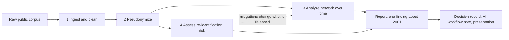

# Feature Specification: Enron Headers-Only Network Analysis Case

**Feature Branch**: `001-enron-network-analysis`

**Created**: 2026-11-14

**Status**: Draft

**Input**: Engineering case brief, "What did Enron's network know before Enron did?". Build a headers-only pipeline over the public Enron email corpus that ingests and cleans, pseudonymizes, analyzes the communication network over time, and assesses re-identification risk; deliver a one-command repository with tests, a one-page decision record, an AI-workflow note and a 15-minute presentation.

## Context

The brief is a small version of a real job: reading communication metadata that customers
consider among their most sensitive data. The brief states what counts: how the data is handled, how privacy shapes the design,
whether results can be reproduced, and how honestly limits are named. Visual polish matters little.

The case therefore has two audiences in one: a **reviewer** who clones the repository and runs it,
and a **data subject** whose identity the pipeline must protect even though this corpus is public.

## User Scenarios & Testing *(mandatory)*

### User Story 1 - Content-free, clean, pseudonymized message record (Priority: P1)

A reviewer points the pipeline at the raw corpus and gets a cleaned record of who communicated
with whom and when, in which no message content and no direct identifier exists, together with a
data-quality report that says what was found in the raw data and what was done about it.

**Why this priority**: Everything else depends on it, and it is where the brief's one hard rule
and three of the four review criteria (data handling, privacy, reproducibility) are decided.
Delivered alone, it already answers tasks 1 and 2 of the brief.

**Independent Test**: Run ingestion on a synthetic corpus with planted duplicates, aliases, noise
and content markers; verify the output against the known ground truth and verify no marker or
identifier appears anywhere downstream.

**Acceptance Scenarios**:

1. **Given** messages whose bodies and subjects contain planted marker strings, **When** the
   pipeline runs, **Then** no marker string appears in any stored artifact, log line or report.
2. **Given** the same message stored in several folders and mailboxes, **When** the pipeline runs,
   **Then** it is counted once, and the report states how many duplicates were removed and by
   which rule.
3. **Given** one person appearing under several addresses and name spellings, **When** identities
   are resolved, **Then** those appearances map to one entity, and the report states measured
   precision and recall of the resolution against known ground truth.
4. **Given** the same corpus and the same key, **When** the pipeline runs twice, **Then** every
   person and organization receives the same pseudonym both times.
5. **Given** the pseudonymized record without the key, **When** a reviewer inspects it, **Then**
   no address, name, mailbox owner or organization name can be read from it or computed back.
6. **Given** malformed dates, malformed addresses, system senders and mass mailings, **When** the
   pipeline runs, **Then** each class of noise is counted, handled by a documented rule, and
   listed in the data-quality report.

---

### User Story 2 - One evidenced finding about how the organization changed in 2001 (Priority: P2)

A reviewer reads one clearly stated finding about how Enron's communication network changed
during 2001, sees the evidence behind it in a table, and sees how confident we are and why.

**Why this priority**: It is the analytical answer to the brief's title question and shows the
ability to turn network analysis into a tested, bounded result. It needs Story 1 but not Story 3.

**Independent Test**: Run the analysis on a synthetic network with a planted structural change at
a known date; verify the change is detected at the right time and that no change is reported on a
synthetic network without one.

**Acceptance Scenarios**:

1. **Given** the pseudonymized record, **When** the analysis runs, **Then** it produces the network
   in regular time windows across the corpus period, with each metric defined in writing.
2. **Given** a set of hypotheses written down before looking at results, **When** the analysis
   runs, **Then** the report shows the outcome for every hypothesis, including those not supported.
3. **Given** the chosen finding, **When** a reviewer reads it, **Then** it states the effect size,
   an uncertainty range, the comparison against a chance baseline, the alternative explanations
   considered, and a confidence level in plain words.
4. **Given** the known sampling bias (about 150 mailboxes, mostly senior staff), **When** the
   finding is stated, **Then** it is shown whether it survives removing any single mailbox and
   changing the cleaning thresholds.

---

### User Story 3 - Measured re-identification risk and a safer release (Priority: P3)

A reviewer sees whether individuals can be re-identified from the pseudonymized output by someone
who knows Enron's public history, sees the result of an actual attack rather than an argument, and
sees what was changed to reduce the risk and what that change cost in analytical value.

**Why this priority**: It is the part that distinguishes a privacy-aware design from a hashed
column. It needs Story 1; it informs what Story 2 is allowed to publish.

**Independent Test**: Run the attack on a synthetic network where true identities are known;
verify the reported re-identification rate matches the rate computed from ground truth.

**Acceptance Scenarios**:

1. **Given** the pseudonymized record and only publicly known facts about Enron, **When** the
   attack runs, **Then** the report states how many individuals were correctly re-identified, and
   how unique individuals are on the features an attacker can observe.
2. **Given** the mitigated release, **When** the same attack runs again, **Then** the report shows
   the re-identification rate before and after, next to what the mitigation cost the analysis.
3. **Given** the mitigated release, **When** the Story 2 finding is recomputed from it, **Then**
   the report states whether the finding still holds.
4. **Given** any published table, **When** it is inspected, **Then** no cell describes a group
   smaller than the stated minimum size.

---

### User Story 4 - A reviewer can reproduce and judge the work in minutes (Priority: P4)

A reviewer clones the repository, runs one command, and gets the report; then reads a one-page
decision record, a short note on how AI agents were used and kept correct, and follows a
15-minute presentation whose numbers come from the run.

**Why this priority**: These are the brief's stated deliverables. They wrap Stories 1–3 and are
written last, but the scaffolding (one command, tests, automated checks) is needed first.

**Independent Test**: On a clean machine with only the documented prerequisites, run the single
command on the bundled synthetic sample and on the full corpus; both finish and produce the report.

**Acceptance Scenarios**:

1. **Given** a clean checkout, **When** the reviewer runs the single documented command, **Then**
   the corpus is fetched, the pipeline runs end to end, tests run, and the report is produced.
2. **Given** two runs with the same inputs and key, **When** their analytical outputs are
   compared, **Then** they are identical.
3. **Given** the decision record, **When** a reviewer reads it, **Then** it fits one page and
   covers the architecture, the trade-offs, and what would differ with real customer data.
4. **Given** the AI-workflow note, **When** a reviewer reads it, **Then** it says what agents did,
   what was rejected, and which checks kept their output correct.
5. **Given** the documentation, **When** a reviewer looks for how data flows and where the privacy
   boundary sits, **Then** a diagram in the repository shows it.

---

### User Story 5 - Explore the results in a visual interface (Priority: P5)

A reviewer opens a dark, modern web interface and explores what the pipeline produced: the
headline finding, the metric series over time with the public events marked, the network drawn as
groups and the ties between them week by week, the hypotheses table, the data-quality numbers and
the re-identification risk before and after mitigation.

**Why this priority**: It makes the finding easier to grasp and to present, but the brief says a
clear table is enough. It is an addition on top of Stories 1–4 and the first thing to cut.

**Independent Test**: Build the interface against the bundled sample release; every view renders,
and an automated check confirms the interface holds no individual-level data and loads nothing
from outside.

**Acceptance Scenarios**:

1. **Given** a finished run, **When** the reviewer starts the interface with one command, **Then**
   it shows the headline finding with its effect, uncertainty range and confidence.
2. **Given** the metrics view, **When** the reviewer switches metric, scope or sensitivity variant,
   **Then** the chart updates and marks the estimated change point and the public event dates.
3. **Given** the network view, **When** the reviewer moves through time, **Then** the picture
   shows groups of people and the strength of ties between groups, never an individual.
4. **Given** the risk view, **When** it is opened, **Then** it shows the re-identification rate
   and the analytical cost for each release variant side by side.
5. **Given** the interface's data, **When** it is inspected, **Then** it contains only what is in
   the published release, and the interface makes no request to any outside service.

---

### Edge Cases

- A message with no recipients, or whose only recipient is the sender.
- A message with hundreds of recipients, or addressed to a distribution list rather than people.
- Dates far outside the company's lifetime, or with missing or contradictory time zones.
- Addresses that are malformed, empty placeholders, or in a legacy internal directory format
  rather than a normal email address.
- Two different people sharing a name; one person whose name changed; shared or role mailboxes.
- The same recipient appearing in more than one recipient field of the same message.
- Copies of one message that differ only in which mailbox or folder kept them.
- A header that spans several lines, uses an unexpected encoding, or is missing entirely.
- A missing, empty or rotated pseudonymization key.
- A person who is unique on a published feature (the single most active sender in a period).
- An interrupted download or a corpus archive whose checksum does not match.

## Requirements *(mandatory)*

### Functional Requirements

**Content rule**

- **FR-001**: The system MUST read only the header section of each message; message bodies and
  attachments MUST never be parsed, stored or logged.
- **FR-002**: The system MUST admit header fields only through an explicit allowlist and MUST
  document, for every header field present in the corpus, whether it is treated as content, as a
  direct identifier, or as usable metadata, with the reason.
- **FR-003**: The subject line and any other free-text header MUST be treated as content and
  excluded.
- **FR-004**: The system MUST include an automated check that fails if planted content markers or
  direct identifiers appear in any artifact past the pseudonymization boundary, or in any log.

**Ingest and clean**

- **FR-005**: The system MUST identify and remove duplicate copies of the same message without
  using message content, and MUST report the number removed.
- **FR-006**: The system MUST resolve multiple addresses and name spellings of one person to one
  entity using documented, deterministic rules, and MUST record which rule produced each merge.
- **FR-007**: The system MUST distinguish individual people from non-person senders and recipients
  (distribution lists, system and role mailboxes) and treat them by a documented rule.
- **FR-008**: The system MUST detect and handle, by documented rules, at least: implausible dates,
  malformed addresses, recipients repeated across fields, self-addressed messages and mass
  mailings.
- **FR-009**: The system MUST produce a data-quality report giving counts before and after each
  cleaning step and the measured precision and recall of duplicate removal and identity
  resolution against ground truth.

**Pseudonymize**

- **FR-010**: The system MUST replace every person and every organization with a pseudonym that
  is identical across runs for the same key and different for a different key.
- **FR-011**: Pseudonyms MUST NOT be reversible, and MUST NOT be confirmable by guessing
  candidate identities, without the key.
- **FR-012**: One resolved entity MUST map to exactly one pseudonym, and two distinct entities
  MUST NOT share one.
- **FR-013**: The key MUST be supplied from outside the repository and MUST NOT appear in any
  artifact, log or report. No table linking pseudonyms to real identities may be kept past the
  pseudonymization boundary.
- **FR-014**: Analysis, risk assessment and reporting MUST operate only on pseudonymized data.

**Analyze**

- **FR-015**: The system MUST build the communication network in regular time windows and compute
  a written-down set of network metrics per window.
- **FR-016**: Hypotheses about organizational change in 2001 MUST be written down before results
  are examined, and the outcome of each MUST be reported.
- **FR-017**: The reported finding MUST include effect size, uncertainty range, comparison against
  a chance baseline, robustness to single-mailbox removal and to cleaning thresholds, alternative
  explanations and a plain-language confidence statement.
- **FR-018**: Every analysis method MUST be validated on synthetic data with a known answer.

**Assess the risk**

- **FR-019**: The system MUST define the attacker considered (what they know and what they can
  see) and MUST run a re-identification attack consistent with that definition against its own
  pseudonymized output.
- **FR-020**: The system MUST report the re-identification rate and how unique individuals are on
  attacker-observable features.
- **FR-021**: The system MUST apply at least one mitigation, re-run the attack, and report the
  change in risk together with the change in analytical value.
- **FR-022**: Every published table MUST enforce a stated minimum group size, suppressing or
  coarsening anything below it.

**Reproduce and deliver**

- **FR-023**: One documented command MUST run everything from fetching the corpus to the final
  report, and MUST verify the corpus against a known checksum.
- **FR-024**: Repeated runs with identical inputs and key MUST produce identical analytical
  outputs; any randomness MUST be seeded and the seed reported.
- **FR-025**: The repository MUST include automated tests that run without the full corpus, on a
  bundled synthetic sample.
- **FR-026**: The repository MUST contain a one-page decision record, a short AI-workflow note,
  and presentation material for 15 minutes, with all figures taken from pipeline output.
- **FR-027**: Data flow, privacy boundary and work breakdown MUST be documented with diagrams kept
  in the repository.
- **FR-028**: The work MUST be divided into units with stated inputs, outputs and owned files so
  that several AI agents can implement them in parallel without conflict.

**Explore**

- **FR-029**: The system MUST provide a visual interface, in a dark theme, showing the headline
  finding, metric series over time, the group-level network over time, the hypotheses, data
  quality and re-identification risk.
- **FR-030**: The interface MUST read only the published release; it MUST NOT hold or display any
  individual, pseudonym or group below the minimum size, and MUST NOT contact outside services.
- **FR-031**: The interface MUST be optional: the one-command run, the tests and the report MUST
  work without it.
  *(Superseded, as built, note of 2026-11-14: the explorer is part of the one command, which
  builds it, runs its gate and serves it, so Node 20+ is a prerequisite of `make`. `make gate`
  and `enron-case run`, and with them the Python tests and the report, work without Node.)*

### Key Entities

- **Message event**: one deduplicated communication act: a sender, its recipients with their
  recipient role, and a point in time. Carries no content.
- **Identity observation**: one raw appearance of an address or name in a header, with where it
  was seen. Exists only before the pseudonymization boundary.
- **Entity**: a resolved person or non-person (list, system, role mailbox) to which observations
  are attached, with a type and the organization it belongs to.
- **Organization**: the body an entity belongs to, with whether it is internal or external.
- **Pseudonym**: the stable keyed stand-in for an entity or organization.
- **Network snapshot**: the set of entities and weighted directed ties among them in one time
  window, with its computed metrics.
- **Hypothesis / Finding**: a claim stated in advance, and its tested outcome with evidence and
  confidence.
- **Attacker model / Risk result**: what an adversary is assumed to know, and the measured
  re-identification outcome before and after mitigation.
- **Release**: the set of tables cleared for publication under the minimum-group-size rule.
- **Run manifest**: record of inputs, parameters, seed and output fingerprints for one run.

## Success Criteria *(mandatory)*

### Measurable Outcomes

- **SC-001**: Zero planted content markers and zero direct identifiers are found in any artifact
  past the pseudonymization boundary or in any log, verified automatically on every run.
- **SC-002**: A reviewer with the documented prerequisites goes from clean checkout to final
  report with one command, in under 30 minutes on a typical laptop for the full corpus and under
  2 minutes for the bundled sample.
- **SC-003**: Two runs with the same inputs and key produce identical analytical outputs (100% of
  output fingerprints match).
- **SC-004**: On synthetic ground truth, duplicate removal and identity resolution each reach at
  least 95% precision, and their measured recall is reported; on the real corpus, precision of
  identity merges is at least 95% on a manually checked sample of 50 merges.
- **SC-005**: The report contains exactly one headline finding about 2001 with effect size,
  uncertainty range, chance baseline, robustness results and a confidence statement, plus the
  outcome of every pre-stated hypothesis.
- **SC-006**: On synthetic data, a planted change is detected within one time window of its true
  date, and no change is reported in at least 95% of runs on data without one.
- **SC-007**: The report states the re-identification rate before and after mitigation, and the
  mitigated release reduces it by at least half or the report explains why it could not.
- **SC-008**: 100% of published table cells meet the minimum group size.
- **SC-009**: The decision record fits on one page; the presentation can be delivered in 15
  minutes (at most 12 slides); each names at least three limits of the work.
- **SC-010**: Every implementation unit has a stated owner scope, and no two units scheduled in
  parallel own the same file.

- **SC-011**: The interface starts with one command after a finished run, every view renders on
  the sample and the full release, and 0 individual-level records and 0 outside requests are
  found in it by an automated check.

## Assumptions

- The corpus is the public CMU distribution referenced in the brief, in its standard
  one-file-per-message layout; it is fetched at run time and never committed.
- "Headers only" is read strictly: the subject line is content. Thread reconstruction from
  subjects is therefore out of scope, and that loss is named as a trade-off.
- Display names and mailbox owner names are direct identifiers. They may be used inside the
  ingestion step to resolve identities and are discarded before anything is stored downstream.
- Knowing that the corpus is Enron's is not a secret; the protected subjects are individuals.
  Organizations are still pseudonymized as the brief asks, while an internal/external flag is kept.
- The realistic attacker knows Enron's public history and has the public raw corpus. Results for
  this strong attacker are reported honestly even though they will be unfavourable, alongside a
  weaker attacker who knows only public facts (roles, key dates).
- "One finding" means one headline claim; other hypotheses tested are shown as a short table.
- The reviewers run the repository on a laptop with a standard developer toolchain and internet
  access. No server, account or paid service is required.
- Key custody, retention, works council review and certification are described for the real
  product in the decision record but not implemented in the case.
- The brief allows 24 hours; the work is planned to finish in 12, leaving the rest as reserve.
  Scope is split into a core that must ship and stretch items that are started only when the
  preceding checkpoint is met on time.
- The presentation is delivered live by the presenter; the repository provides the slides.
- The visual interface is an addition beyond what the brief asks. It needs an extra toolchain
  that the one-command run does not depend on, and it is the first item cut if time runs short.
  *(Superseded, as built, note of 2026-11-14: the one command depends on that toolchain; see
  FR-031.)*
