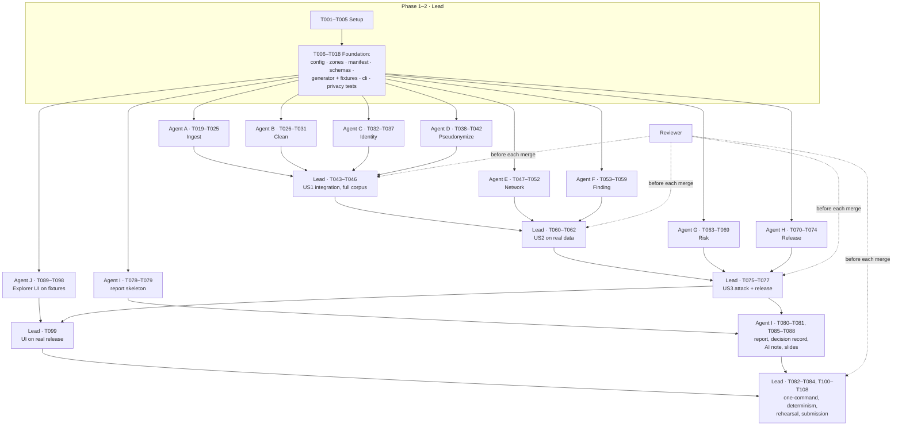

---

description: "Task list for the Enron headers-only network analysis case"
---

# Tasks: Enron Headers-Only Network Analysis Case

**Input**: Design documents from `/specs/001-enron-network-analysis/`

**Prerequisites**: [plan.md](plan.md), [spec.md](spec.md), [research.md](research.md), [data-model.md](data-model.md), [contracts/](contracts/), [quickstart.md](quickstart.md)

**Tests**: Included. Tests are a required deliverable of the brief and Principle IV of the
constitution. Within each work package, tests are written first against the synthetic fixtures
and must fail before the implementation exists.

**Organization**: Tasks are grouped by user story. Every task names the work package (WP) that
owns it. A WP owns its paths exclusively, so tasks of different WPs never touch the same file.

## Format: `[ID] [P?] [Story] Description`

- **[P]**: can run in parallel with other [P] tasks of the same phase (different files, no
  dependency on an unfinished task)
- **[Story]**: US1–US4 from [spec.md](spec.md)
- **(WP-x)**: the work package, and therefore the agent, that owns the task
- All source paths are under `src/enron_case/` unless they start with `tests/`, `docs/`,
  `release/` or the repository root

## Time budget: 12 hours

The work is planned for 12 hours inside the brief's 24-hour window; the schedule and checkpoints
are in [plan.md](plan.md#12-hour-schedule). Tasks are split into core and stretch.

| Tier | Tasks | Rule |
|------|-------|------|
| Core | everything not listed as stretch | must ship |
| Stretch: explorer UI | T089–T099, and `community_graph.csv` / `community_groups.csv` in T074 | Agent J starts only if the foundation checkpoint (T+1:30) is met within 30 minutes; T099 is time-boxed to 30 minutes and dropped if US3 is not integrated by T+8:00 |
| Stretch: attacker A2 | the A2 parts of T064, T067, T069 | only if US1 is integrated by T+5:15 |
| Stretch: R2 noise release | the R2 parts of T071, T073, T069 | only if US1 is integrated by T+5:15 |
| Stretch: monthly variant | `window=month` in T051 | only if US1 is integrated by T+5:15 |

Agents implement the core part of a task first and hand it over with a green gate before
starting any stretch part. A dropped stretch item is named in the report's limits section.

| Checkpoint | Tasks done | Latest |
|------------|-----------|--------|
| Foundation frozen | T001–T018 | T+1:30 |
| US1 on full corpus | T019–T046 | T+5:15 |
| Headline decided | T047–T062 | T+6:45 |
| Attack and release | T063–T077 | T+8:00 |
| Deliverables complete | T078–T088 (T099 if kept) | T+10:00 |
| Reviewed and rehearsed | T100–T108 | T+11:30 |

## Agent assignment

| Agent | Work package | Owns (exclusive) | Tasks | Starts after |
|-------|--------------|------------------|-------|--------------|
| Lead | WP0 Foundation, integration, judgment calls | repo root files, `config.py`, `zones.py`, `manifest.py`, `cli.py`, `contracts/`, `synth/`, `tests/contract`, `tests/privacy`, `tests/integration`, `tests/unit/synth`, `docs/agents/`, `docs/architecture.md`, `docs/ai-workflow-log.md` | T001–T018, T043–T046, T060–T062, T075–T077, T082–T084, T099–T108 | — |
| Agent A | WP-A Ingest | `ingest/`, `tests/unit/ingest` | T019–T025 | T018 |
| Agent B | WP-B Clean | `clean/`, `tests/unit/clean` | T026–T031 | T018 |
| Agent C | WP-C Identity | `identity/`, `tests/unit/identity` | T032–T037 | T018 |
| Agent D | WP-D Pseudonymize | `pseudo/`, `tests/unit/pseudo` | T038–T042 | T018 |
| Agent E | WP-E Network | `network/`, `tests/unit/network`, `docs/metrics.md` | T047–T052 | T018 |
| Agent F | WP-F Finding | `finding/`, `tests/unit/finding`, `docs/hypotheses.md` | T053–T059 | T018 |
| Agent G | WP-G Risk | `risk/`, `tests/unit/risk` | T063–T069 | T018 |
| Agent H | WP-H Release | `release/` package, `tests/unit/release` | T070–T074 | T018 |
| Agent I | WP-I Report & docs | `report/`, `tests/unit/report`, `README.md`, `docs/decision-record.md`, `docs/ai-workflow.md`, `docs/slides.md` | T078–T081, T085–T088 | T018 (templates), then each integration |
| Agent J | WP-J Explorer UI | `uiexport/`, `tests/unit/uiexport`, `ui/` | T089–T098 | T018 |
| Reviewer | independent review with the `/code-review` and `/data-privacy-review` skills; `/security-review` skill before submission | appends to `docs/ai-workflow-log.md` through the Lead | review steps in T045, T061, T076, T099, T101, T102 | each WP's green gate |

Agents A–H and J start at the same moment, as soon as the foundation checkpoint (T018) is reached. Each
builds against the fixtures emitted by the generator for its input contract, so none waits for
another agent's code.



---

## Phase 1: Setup (Shared Infrastructure)

**Purpose**: an installable, gated, empty project

- [x] T001 (WP0) Create `pyproject.toml` (Python 3.12; runtime deps polars, networkx, numpy, scipy; dev deps pytest, hypothesis, ruff, mypy; console script `enron-case = enron_case.cli:main`; ruff and strict mypy config), `.python-version`, `uv.lock`, and empty packages `src/enron_case/{contracts,synth,ingest,clean,identity,pseudo,network,finding,risk,release,report}/__init__.py`
- [x] T002 [P] (WP0) Create `.gitignore` ignoring `data/`, `release-sample/`, `*.key`, `.venv/`, caches; add `data/.gitkeep`-free note in `README.md` stub that `data/` is never committed
- [x] T003 [P] (WP0) Create `Makefile` with targets `all`, `sample`, `gate`, `key`, `clean`, `ui`, `ui-sample`, `ui-gate` exactly as specified in `specs/001-enron-network-analysis/contracts/cli.md` (`make all` stops with exit 3 if no key; `make key` writes `~/.config/enron-case/key` with mode 600 and never inside the repository)
- [x] T004 [P] (WP0) Create `.github/workflows/gate.yml` running `uv sync --locked` and `make gate` on Ubuntu with the fixed test key, plus a separate job running `make ui-gate` with Node 20
- [x] T005 [P] (WP0) Create `docs/architecture.md` containing the five architecture Mermaid diagrams from `specs/001-enron-network-analysis/plan.md`, and `docs/ai-workflow-log.md` with the log table header (time, WP, delegated, result, rejected and why, verified how)

---

## Phase 2: Foundational (Blocking Prerequisites)

**Purpose**: contracts, ground truth and gates, which is what lets agents A–I work in parallel

**⚠️ CRITICAL**: no work package starts before T018

- [x] T006 (WP0) Implement `src/enron_case/config.py`: frozen dataclass with the parameters and defaults from the table in `data-model.md` (`seed=20011202`, `k_min=5`, `window=week`, `recipient_cap=50`, `plausible_dates`, `analysis_period`, `baseline_period`, `name_link_support=3`, `bootstrap_reps=1000`, `permutations=1000`, `ts_resolution=hour`), `--set` overrides, public event dates for annotation only
- [x] T007 [P] (WP0) Implement `src/enron_case/zones.py`: zone enum (raw, ingest, restricted, release), per-package allowed zones, `path_for(package, zone, name)` that raises a privacy violation (exit 6) for a disallowed zone, `purge_ingest()`, and the two documented exceptions (`risk.aux_public` may read raw; `risk.score` may read `address_map` in ingest); `report` and `uiexport` may read only the release zone
- [x] T008 [P] (WP0) Implement `src/enron_case/manifest.py`: content fingerprint (SHA-256 over canonical sorted row serialization, not Parquet bytes), `run_manifest.json` writer (parameters, seed, code version, key fingerprint, per-table fingerprints; no key, no identifier), stage skipping when inputs and parameters are unchanged
- [x] T009 [P] (WP0) Implement `src/enron_case/contracts/schemas.py`: Polars schemas and sort keys for every table in `contracts/data-contracts.md` v1, enum values verbatim, pseudonym patterns `^p_[a-z2-7]{16}$` and `^o_[a-z2-7]{16}$`, and `validate(table, name)` raising a contract violation (exit 5)
- [x] T010 (WP0) Implement `src/enron_case/synth/generator.py`: seeded synthetic organization and mail archive in the same tar layout as the corpus, with ground truth for duplicates (cross-folder copies, Bcc-only sender copies), aliases (subdomain, name-pattern, legacy directory forms, homonyms that must not merge), noise (bad dates, malformed addresses, lists, system senders, mass mailings, self-only, no recipients), a planted structural change at a known week and a no-change variant, and unique canary markers in body, `Subject`, `X-Folder`, `X-FileName` and display names
- [x] T011 (WP0) Extend `src/enron_case/synth/generator.py` to emit a conforming fixture for every contract table (`header_records` … `risk_results`) derived from ground truth into `tests/fixtures/`, so each stage can be tested without the stages before it
- [x] T012 (WP0) Implement `src/enron_case/cli.py`: `run`, `stage`, `verify` and options per `contracts/cli.md`; stage registry that lazily imports `enron_case.<package>.stage:run` (each WP supplies its own `stage.py`); validates each stage's output with `schemas.validate`; purges the ingest zone at the end unless `--keep-ingest`; exit codes 0,2,3,4,5,6,7
- [x] T013 [P] (WP0) Write `tests/contract/test_schemas.py`: every fixture validates; a fixture with an extra column, wrong enum value or wrong sort order fails
- [x] T014 [P] (WP0) Write `tests/privacy/test_import_boundary.py`: parse imports with `ast` and fail if `network`, `finding`, `risk`, `release`, `report` or `uiexport` import `ingest`, `clean` or `identity`, or if `uiexport` imports anything but `zones`, `config` and `contracts`
- [x] T015 [P] (WP0) Write `tests/privacy/test_canary.py`: run the sample pipeline with captured logs; assert body and subject markers appear nowhere (including `data/sample/ingest`), and no marker, `@`, synthetic name or folder name appears in the restricted zone, `release-sample/`, the manifest or logs; skips stages not yet registered
- [x] T016 [P] (WP0) Write `tests/privacy/test_zones.py`: disallowed zone access raises; `purge_ingest` removes the zone; exceptions are limited to the two named modules
- [x] T017 [P] (WP0) Write `tests/unit/synth/test_generator.py`: same seed gives identical archive and ground truth; planted counts match ground truth
- [x] T018 (WP0) Write `docs/agents/README.md` (agent protocol: owned paths only, read your contract and fixtures, tests first, `make gate` green before hand-off, never log header values, report deviations to the Lead) and one brief per work package `docs/agents/WP-A.md` … `WP-I.md` listing its tasks, input and output contracts, fixtures and acceptance checks; run `make gate` green; commit as the frozen foundation

**Checkpoint**: foundation frozen — agents A–I start in parallel

---

## Phase 3: User Story 1 - Content-free, clean, pseudonymized message record (Priority: P1) 🎯 MVP

**Goal**: raw archive → pseudonymized `events` with no content and no identifier past the
boundary, plus measured data-quality numbers

**Independent Test**: `enron-case run --sample --to pseudo` then `pytest tests/privacy tests/integration/test_us1.py`: canary clean, dedupe and identity precision ≥ 0.95 against ground truth, pseudonyms stable across two runs and disjoint under a second key

### WP-A Ingest (Agent A)

- [x] T019 [P] [US1] (WP-A) Write `tests/unit/ingest/test_headers.py`: reader stops at first blank line and consumes no body bytes; unfolds continuation lines; decodes Latin-1; flags a member with no header end; property test over random header/body splits
- [x] T020 [P] [US1] (WP-A) Write `tests/unit/ingest/test_allowlist.py`: retained field names equal the *usable* and *identifier, ingest only* rows of `contracts/header-allowlist.md`; `Subject`, `X-FileName`, MIME fields never appear in any returned object; `X-Folder` is reduced to `folder_class` ∈ {sent, inbox, deleted, other}
- [x] T021 [P] [US1] (WP-A) Implement `src/enron_case/ingest/fetch.py`: download the archive to `data/raw`, resume on interruption, verify pinned SHA-256, exit 4 on mismatch
- [x] T022 [P] [US1] (WP-A) Implement `src/enron_case/ingest/headers.py`: streaming tar reader yielding (member path, unfolded header lines) and skipping the rest of each member unread
- [x] T023 [P] [US1] (WP-A) Implement `src/enron_case/ingest/allowlist.py`: the field rulings as data, the fixed folder vocabulary, and a filter that drops other fields while counting their names
- [x] T024 [US1] (WP-A) Implement `src/enron_case/ingest/parse.py`: build `header_records` (date to UTC or null with flag `bad_date`, never guessed; raw address lists; display-name fields; `file_id` as first 16 hex of SHA-256 of member path) and `ingest_counts.json`
- [x] T025 [US1] (WP-A) Implement `src/enron_case/ingest/stage.py` registering stages `fetch` and `parse`; make T019–T020 and the `header_records` contract test pass

### WP-B Clean (Agent B)

- [x] T026 [P] [US1] (WP-B) Write `tests/unit/clean/test_addresses.py` and `tests/unit/clean/test_dates.py`: normalization rule N1 cases (case, quotes, stray dots, `mailto:`, empty placeholders), malformed addresses flagged `bad_address`; dates outside `plausible_dates` flagged `date_out_of_range` and kept in counts
- [x] T027 [P] [US1] (WP-B) Write `tests/unit/clean/test_dedupe.py`: exact rule and subset rule against ground-truth duplicates (precision ≥ 0.95, recall reported); property test that dedupe is idempotent and order-independent; recipients unique per message with strongest role (to > cc > bcc)
- [x] T028 [P] [US1] (WP-B) Implement `src/enron_case/clean/addresses.py` and `src/enron_case/clean/dates.py`
- [x] T029 [P] [US1] (WP-B) Implement `src/enron_case/clean/dedupe.py`: `msg_key` as first 20 hex of SHA-256 over (sender, timestamp second, sorted recipients); exact pass then subset pass; `n_copies ≥ 1`; `dedupe_rule` ∈ {none, exact, subset}; `owner_copies`, `sent_copy_owner`
- [x] T030 [P] [US1] (WP-B) Implement `src/enron_case/clean/noise.py`: flags `no_recipients`, `self_only`, `mass_mailing` (recipients > `recipient_cap`), and the Message-ID diagnostic of research R3 (share of exact-duplicate groups sharing one Message-ID)
- [x] T031 [US1] (WP-B) Implement `src/enron_case/clean/stage.py` writing `messages` and `clean_counts.json`; make T026–T027 and the `messages` contract test pass

### WP-C Identity (Agent C)

- [x] T032 [P] [US1] (WP-C) Write `tests/unit/identity/test_rules.py`: each rule N1–N4 merges its ground-truth cases with support ≥ `name_link_support`; guards block name-only merges, cross-organization merges and generic local parts; homonyms stay separate
- [x] T033 [P] [US1] (WP-C) Write `tests/unit/identity/test_resolve.py` and `tests/unit/identity/test_classify.py`: every address maps to exactly one entity; result independent of input order; `type` ∈ {person, list, system, role, unknown}; `is_custodian` only via rule N5; precision ≥ 0.95 on ground truth
- [x] T034 [P] [US1] (WP-C) Implement `src/enron_case/identity/rules.py`: evidence extraction from `header_records` and `messages` and rules N2–N5 with guards
- [x] T035 [P] [US1] (WP-C) Implement `src/enron_case/identity/classify.py`: entity typing by documented address patterns and behaviour
- [x] T036 [US1] (WP-C) Implement `src/enron_case/identity/resolve.py` (deterministic union-find, canonical id = smallest normalized address, merge edges tagged with rule and support) and `src/enron_case/identity/evaluate.py` (pairwise precision/recall against ground truth; sampler that draws 50 merges for manual review inside the ingest zone and outputs counts only)
- [x] T037 [US1] (WP-C) Implement `src/enron_case/identity/stage.py` writing `entities`, `address_map`, `identity_counts.json`; make T032–T033 and the contract tests pass

### WP-D Pseudonymize (Agent D)

- [x] T038 [P] [US1] (WP-D) Write `tests/unit/pseudo/test_keys.py`: resolution order `ENRON_CASE_KEY` → `ENRON_CASE_KEY_FILE` → `~/.config/enron-case/key`; abort with exit 3 when missing, shorter than 32 bytes, or inside the repository; key never appears in logs or manifest; subkeys per label differ
- [x] T039 [P] [US1] (WP-D) Write `tests/unit/pseudo/test_pseudonymize.py`: same key and canonical id give the same pid; different key gives disjoint pids; count(distinct pid) = count(entities); forced collision aborts with exit 7; pids match `^p_[a-z2-7]{16}$`, org pids `^o_[a-z2-7]{16}$`; no `@` in any output column; `ts_hour` truncated to the hour; `weight = 1 / n_recipients`
- [x] T040 [P] [US1] (WP-D) Implement `src/enron_case/pseudo/keys.py`: key resolution, safety checks, labelled subkeys (`person-v1`, `org-v1`, `event-v1`), per-release salt, 8-hex key fingerprint for the manifest
- [x] T041 [US1] (WP-D) Implement `src/enron_case/pseudo/pseudonymize.py`: HMAC-SHA256 → base32 → 16 chars with prefixes `p_`, `o_`, `e_`, `m_`; build `events` (one row per recipient, `in_network` false when any exclusion flag applies) and `entities_p`; no mapping table is written
- [x] T042 [US1] (WP-D) Implement `src/enron_case/pseudo/stage.py`; make T038–T039 and the contract tests pass

### US1 integration (Lead)

- [x] T043 [US1] (WP0) Write `tests/integration/test_us1.py`: sample run to `pseudo` passes canary, reaches the precision thresholds, and gives identical `events` fingerprints across two runs
- [x] T044 [US1] (WP0) Run stages `fetch`→`pseudo` on the full corpus; record in `docs/ai-workflow-log.md` the header field names encountered, the R3 Message-ID diagnostic, counts per cleaning step and runtime; rule on any header field not in `contracts/header-allowlist.md` and update that contract and `ingest/allowlist.py` through Agent A
- [x] T045 [US1] (WP0) Independent review of WP-A…WP-D by the Reviewer agent using the `/code-review` and `/data-privacy-review` skills on each branch (checklist: content rule, zone boundary, contract conformance, test meaningfulness); log findings and fixes in `docs/ai-workflow-log.md`
- [x] T046 [US1] (WP0) Perform the 50-merge manual check (time-boxed to 20 minutes) on the real corpus inside the ingest zone using `identity/evaluate.py`; record only the counts in `data/restricted/quality_manual.json`

**Checkpoint**: tasks 1 and 2 of the brief are answered and measured

---

## Phase 4: User Story 2 - One evidenced finding about 2001 (Priority: P2)

**Goal**: weekly networks, defined metrics, four pre-stated hypotheses tested, one headline finding with confidence

**Independent Test**: on the `events` fixture with a planted change, `enron-case run --sample --from network --to finding` reports the change within one week of the true date; on the no-change variant it reports none in ≥ 95% of seeds

### WP-E Network (Agent E)

- [x] T047 [P] [US2] (WP-E) Write `docs/metrics.md`: formal definition, range and edge behaviour of volume, active_persons, density, reciprocity, indegree_gini, cross_community_share, external_share, tie_turnover; scopes core and observed; null when fewer than k active persons; the rule mapping checks (a)–(f) of research R11 to confidence ∈ {high, moderate, low}
- [x] T048 [P] [US2] (WP-E) Write `tests/unit/network/test_snapshots.py`: one snapshot per ISO week and scope; persons only; `in_network` false events excluded; weights sum to message count for persons-only messages
- [x] T049 [P] [US2] (WP-E) Write `tests/unit/network/test_metrics.py`: each metric against hand-computed toy graphs and known closed forms (empty, complete, star, two cliques); undefined windows give null not zero
- [x] T050 [P] [US2] (WP-E) Implement `src/enron_case/network/snapshots.py` writing `snapshots` for scopes core and observed
- [x] T051 [US2] (WP-E) Implement `src/enron_case/network/metrics.py`: the eight metrics, baseline communities frozen on `baseline_period` with a seeded algorithm and written as the restricted table `communities` (`community` is -1 if not assigned), sensitivity variants (`cap`, `dedupe`, `window=month`) labelled in `variant`
- [x] T052 [US2] (WP-E) Implement `src/enron_case/network/stage.py` writing `metric_series`; make T048–T049 and the contract tests pass

### WP-F Finding (Agent F)

- [x] T053 [P] [US2] (WP-F) Write `docs/hypotheses.md`: H1–H4 exactly as in research R10 with metric, scope, direction, baseline period, decision rule and what would falsify each; state that it is committed before any real-data analysis
- [x] T054 [P] [US2] (WP-F) Write `tests/unit/finding/test_stats.py`: CUSUM change point recovers a planted step within one window; permutation p-value is uniform under no change (false positive rate ≤ 5% over seeds); block bootstrap interval covers a known effect; Holm correction against a worked example
- [x] T055 [P] [US2] (WP-F) Write `tests/unit/finding/test_nullmodel.py` and `tests/unit/finding/test_select.py`: rewiring preserves every sender's out-weight and recipient's in-weight per week; exactly four result rows always; at most one `is_headline`; `supported` ∈ {yes, no, inconclusive}; `confidence` derived by the rule in `docs/metrics.md`
- [x] T056 [P] [US2] (WP-F) Implement `src/enron_case/finding/stats.py`: CUSUM with permutation p-value, standardized effect versus baseline, moving-block bootstrap interval, Holm correction; all seeded
- [x] T057 [P] [US2] (WP-F) Implement `src/enron_case/finding/nullmodel.py`: within-week recipient rewiring and the `null_z` deviation of a metric from it
- [x] T058 [US2] (WP-F) Implement `src/enron_case/finding/hypotheses.py` (H1–H4 as data bound to metric and scope; leave-one-mailbox-out and variant robustness loops) and `src/enron_case/finding/select.py` (support and confidence rules, headline choice, "none supported" path)
- [x] T059 [US2] (WP-F) Implement `src/enron_case/finding/stage.py` writing `hypothesis_results`; make T054–T055 and the contract tests pass

### US2 integration (Lead)

- [x] T060 [US2] (WP0) Commit `docs/hypotheses.md` and `docs/metrics.md` with their own commit before running `network` and `finding` on the real corpus; then run them and write `tests/integration/test_us2.py` (planted change detected; no-change variant clean)
- [x] T061 [US2] (WP0) Independent review of WP-E and WP-F by the Reviewer agent using the `/code-review` and `/data-privacy-review` skills on each branch (metric definitions match code; statistics are valid; no hypothesis edited after results); log in `docs/ai-workflow-log.md`
- [x] T062 [US2] (WP0) Judge the real-data result: check each hypothesis against the stated threats (retention growth toward late 2001, senior-staff sample, investigation-shaped collection), decide the headline or "none supported", and record the reasoning and remaining doubts in `docs/ai-workflow-log.md` for the report

**Checkpoint**: task 3 of the brief is answered with evidence and confidence

---

## Phase 5: User Story 3 - Measured re-identification risk and a safer release (Priority: P3)

**Goal**: attack our own output under two attacker models and three release variants; publish only what meets k

**Independent Test**: on fixtures with known identities, the reported re-identification rate equals the rate computed from ground truth, and every table written to `release-sample/` passes the k-check

### WP-G Risk (Agent G)

- [x] T063 [P] [US3] (WP-G) Write `tests/unit/risk/test_uniqueness.py`: unique share and anonymity-set sizes on toy tables with known answers
- [x] T064 [P] [US3] (WP-G) Write `tests/unit/risk/test_attack.py`: A1 matching re-identifies planted unique nodes in R0 and none in R1; A2 seed propagation grows from seeds on a toy graph; attack functions accept only a release and auxiliary features (signature test); scorer returns counts only
- [x] T065 [P] [US3] (WP-G) Implement `src/enron_case/risk/aux_public.py`: the attacker's own naive parser over the raw archive (headers only, `From`/`To`/`Cc`/`Date`, no identity resolution, no import from `ingest`), producing per-address weekly send/receive counts and degree held in memory
- [x] T066 [P] [US3] (WP-G) Implement `src/enron_case/risk/uniqueness.py`: uniqueness and anonymity-set distribution on attacker-observable features (degree, weekly activity vector, first/last active week)
- [x] T067 [US3] (WP-G) Implement `src/enron_case/risk/attack.py`: A1 feature matching and A2 seeded propagation against a release variant, returning guesses (pseudonym → address)
- [x] T068 [US3] (WP-G) Implement `src/enron_case/risk/score.py`: score guesses against `address_map` in the ingest zone and the key, returning rates with bootstrap intervals and no identities
- [x] T069 [US3] (WP-G) Implement `src/enron_case/risk/stage.py`: build variants through `release.variants`, run both attackers on R0/R1/R2, recompute the headline effect on each variant with `finding.stats` for `utility_effect_ratio` and `finding_survives`, write `risk_results`; make T063–T064 and the contract tests pass

### WP-H Release (Agent H)

- [x] T070 [P] [US3] (WP-H) Write `tests/unit/release/test_kanon.py`: any person count < `k_min` (5) is suppressed; rows derived from a suppressed group are dropped or coarsened; a table with a pid, org pid or `@` is refused; violation exits 6; property test over random tables
- [x] T071 [P] [US3] (WP-H) Write `tests/unit/release/test_variants.py`: R0 is written only to the restricted zone; R1 has no per-person rows, bucketed degrees and per-release re-keyed ids; R2 noise is seeded and unbiased in expectation
- [x] T072 [P] [US3] (WP-H) Implement `src/enron_case/release/kanon.py`: the single enforcement point for minimum group size and identifier patterns
- [x] T073 [US3] (WP-H) Implement `src/enron_case/release/variants.py` (R0, R1, R2 builders; R1 and R2 include the group-level `community_graph`) and `src/enron_case/release/mitigate.py` (coarsening, bucketing, re-keying, noise)
- [x] T074 [US3] (WP-H) Implement `src/enron_case/release/tables.py` and `src/enron_case/release/stage.py`: assemble `quality_metrics` from the three counts files and write `data_quality.csv`, `header_fields.csv`, `weekly_metrics.csv`, `hypotheses.csv`, `risk.csv`, `degree_distribution.csv`, `community_graph.csv` and `community_groups.csv` (groups are baseline communities with ≥ k persons labelled `G01…`, smaller ones merged into `other`, ties with fewer than k distinct senders suppressed), each through `kanon.py`; make T070–T071 pass

### US3 integration (Lead)

- [x] T075 [US3] (WP0) Write `tests/integration/test_us3.py` and run `risk` and `release` on the full corpus; confirm `grep -rE '@|p_[a-z2-7]{16}' release/` finds nothing
- [x] T076 [US3] (WP0) Independent review of WP-G and WP-H by the Reviewer agent using the `/code-review` and `/data-privacy-review` skills on each branch (attacker has no path to truth; scorer leaks nothing; k enforced everywhere); log in `docs/ai-workflow-log.md`
- [x] T077 [US3] (WP0) Judge the risk result: state plainly the re-identification rate against R0, whether R1/R2 reduce it by at least half (SC-007) and whether the headline survives; if a mitigation fails, record why for the report

**Checkpoint**: task 4 of the brief is answered with a measured before/after

---

## Phase 6: User Story 4 - Reproduce and judge in minutes (Priority: P4)

**Goal**: one command to the report; the three written deliverables and the slides, fed by pipeline output

**Independent Test**: fresh clone, `make gate && make sample` pass in under 2 minutes; `make all` produces `release/report.md`; two runs with the same key have equal fingerprints

### WP-I Report & docs (Agent I)

- [x] T078 [P] [US4] (WP-I) Write `tests/unit/report/test_render.py`: the report renders from fixture release tables; every number in the output is traceable to a release table cell; placeholders left unfilled fail the build; the limits section is present
- [x] T079 [P] [US4] (WP-I) Implement `src/enron_case/report/quality.py` and `src/enron_case/report/render.py`: render `release/report.md` (what we found in the data, the header ruling table, the finding with evidence and confidence, all four hypotheses, the risk table, limits) and a `{{name}}` number-injection function for docs, reading only `release/`
- [x] T080 [US4] (WP-I) Implement `src/enron_case/report/stage.py`; inject numbers into `docs/decision-record.md` and `docs/slides.md` on each run
- [x] T081 [US4] (WP-I) Write `README.md`: what this is, the one command, prerequisites, reading order, link to `docs/architecture.md`, what is and is not committed

### One-command and determinism (Lead)

- [x] T082 [P] [US4] (WP0) Write `tests/integration/test_determinism.py`: `enron-case verify` gives equal fingerprints for two sample runs; a second key changes every pseudonym and no aggregate
- [x] T083 [P] [US4] (WP0) Write `tests/integration/test_one_command.py`: `make sample` from a clean tree exits 0 and produces `release-sample/report.md`; no key gives exit 3 and writes nothing
- [x] T084 [US4] (WP0) Run `make all` on the full corpus once and record runtime against SC-002; then re-run `enron-case run --from pseudo` with the same key and compare fingerprints with the manifest (a second full run only if the first took under 15 minutes)

### Written deliverables (Agent I, with the Lead's judgments from T062 and T077)

- [x] T085 [P] [US4] (WP-I) Write `docs/decision-record.md`, one page: architecture (zones diagram), the main trade-offs (strict content line, rule-based identity, HMAC and its limits, aggregates-only release), and what changes with real customer data (metadata-only connectors, customer-side key custody and entity registry, retention, works council review, data residency, formal privacy budget)
- [x] T086 [P] [US4] (WP-I) Write `docs/ai-workflow.md` distilled from `docs/ai-workflow-log.md`: how work was split, what agents produced, what was rejected, the gates and reviews that kept output correct, where a human decided, what did not work
- [x] T087 [P] [US4] (WP-I) Write `docs/slides.md`, at most 12 slides for 15 minutes: the question, the rule and where the line is, data-quality findings, pseudonymization, the finding with one table and one chart, confidence and threats, the attack result before/after, limits, what changes for real customers, how it was built with agents
- [x] T088 [US4] (WP-I) Update `docs/architecture.md` so every diagram matches the code as built; add the agent work-breakdown diagram

**Checkpoint**: all deliverables of the brief exist

---

## Phase 7: User Story 5 - Explore the results in a visual interface (Priority: P5)

**Goal**: an optional dark, modern React interface (shadcn/ui) over the published release: finding, metrics over time, group-level network over time, hypotheses, data quality, risk

**Independent Test**: `make ui-gate` passes and `make ui-sample` serves an interface where every view renders from `release-sample/`; the UI privacy tests find no individual-level data and no external URL in the build

### WP-J Explorer UI (Agent J)

- [x] T089 [P] [US5] (WP-J) Scaffold `ui/` with Vite + React 18 + TypeScript (strict), Tailwind CSS and shadcn/ui (`ui/components.json`); dark theme only, with design tokens in `ui/src/index.css` (near-black background, one accent colour, muted borders, a bundled variable font, no external font or CDN); add shadcn components card, tabs, table, badge, slider, select, tooltip, button and chart under `ui/src/components/ui/`; commit the lockfile; add ESLint, `tsc --noEmit` and Vitest + Testing Library scripts in `ui/package.json`
- [x] T090 [P] [US5] (WP-J) Write `tests/unit/uiexport/test_export.py`: the export reads only files under the release zone; output validates against the documented JSON shape; it refuses (exit 6) any value matching `@`, `^p_[a-z2-7]{16}$` or `^o_[a-z2-7]{16}$` and any person count below `k_min`; same input gives byte-identical JSON
- [x] T091 [P] [US5] (WP-J) Implement `src/enron_case/uiexport/export.py` and `src/enron_case/uiexport/stage.py` (stage `ui-data`): convert `data_quality.csv`, `header_fields.csv`, `weekly_metrics.csv`, `hypotheses.csv`, `risk.csv`, `degree_distribution.csv`, `community_graph.csv`, `community_groups.csv` and the manifest's parameters and event dates into `ui/public/data/release.json`
- [x] T092 [US5] (WP-J) Implement `ui/src/lib/data.ts` (TypeScript types mirroring the release tables, loader, runtime validation with a clear error state when the file is missing or malformed) and `ui/src/lib/data.test.ts`; add a sample `ui/public/data/release.sample.json` generated from the release fixtures
- [x] T093 [P] [US5] (WP-J) Implement the shell in `ui/src/App.tsx` and `ui/src/components/AppShell.tsx`: sidebar navigation for the seven views (Overview, Metrics, Network, Hypotheses, Data quality, Privacy and risk, Limits), responsive layout, keyboard-accessible, run details (seed, parameters, code version) in the footer; test in `ui/src/components/AppShell.test.tsx`
- [x] T094 [P] [US5] (WP-J) Implement `ui/src/components/MetricChart.tsx` with shadcn chart (Recharts): line per metric with selectors for metric, scope (core, observed) and sensitivity variant; vertical markers for the estimated change point and the public event dates; shaded baseline period; null values shown as gaps, not zero; test in `ui/src/components/MetricChart.test.tsx`
- [x] T095 [P] [US5] (WP-J) Implement `ui/src/components/CommunityGraph.tsx` and `ui/src/components/TimeSlider.tsx`: force-directed layout with `d3-force` computed once and kept stable across weeks; nodes are groups sized by `n_persons`, edges sized by weight; week slider with play/pause and event markers; tooltips show group label, size and weights only; a visible note that nodes are groups of at least k people, never individuals; tests in `ui/src/components/CommunityGraph.test.tsx`
- [x] T096 [P] [US5] (WP-J) Implement `ui/src/components/FindingCard.tsx` (headline claim, effect, interval, confidence badge, or the "no hypothesis supported" state) and `ui/src/components/HypothesesTable.tsx` (H1–H4 with p, Holm-adjusted p, effect, interval, robustness count, supported and confidence badges); tests alongside
- [x] T097 [P] [US5] (WP-J) Implement `ui/src/components/RiskPanel.tsx` (re-identification rate and utility per release variant R0/R1/R2 and attacker, before/after bars), `ui/src/components/QualityPanel.tsx` (cleaning funnel with counts per step, precision and recall, header ruling table) and `ui/src/components/Limits.tsx`; tests alongside
- [x] T098 [US5] (WP-J) Wire the views in `ui/src/App.tsx`; write `ui/src/privacy.test.ts` (the loaded data contains no `@`, no pseudonym pattern and no person count below the minimum; no component renders a per-person row) and `ui/scripts/check-build.mjs` run by `make ui-gate` (the production build contains no external URL and makes no network request other than `release.json`); make `make ui-gate` green

### US5 integration (Lead)

- [ ] T099 [US5] (WP0) Run `make ui` on the real release; review WP-J with the `/code-review` and `/data-privacy-review` skills; check every view against `release/report.md` for the same numbers; save screenshots of the Overview, Metrics and Network views to `docs/img/` for `docs/slides.md`; log in `docs/ai-workflow-log.md`
  - Status: not done as written. The UI was reviewed with `/code-review` and `/data-privacy-review` as part of the second independent review (T076), and the later Network views (first 3D, now React Sigma + Sigma.js) and the Clusters view were reviewed with `/code-review`; no screenshots are in `docs/img/` and no view-by-view number check against `release/report.md` is logged.

**Checkpoint**: the results can be explored and presented visually

---

## Phase 8: Polish & Cross-Cutting Concerns

- [ ] T100 (WP0) Run all validation scenarios V1–V10 of `specs/001-enron-network-analysis/quickstart.md` and record results in `docs/ai-workflow-log.md`
  - Status: not done; no V1–V10 results are logged.
- [ ] T101 (WP0) Final independent review by the Reviewer agent: run the `/code-review` skill on the whole repository and check it against the constitution, privacy principles first; fix or record each finding in `docs/ai-workflow-log.md`
  - Status: not done as a whole-repository pass. Two independent reviews covered all packages (T045, T061/T076), and later changes were reviewed per change (see below).
- [ ] T102 (WP0) Run the `/data-privacy-review` skill on the whole repository with real data on disk (verdict must not be BLOCKED; the content promise must be confirmed, not inferred), then the `/security-review` skill (focus: key handling in `src/enron_case/pseudo/keys.py`, zone guard in `src/enron_case/zones.py`, archive download and tar handling in `src/enron_case/ingest/`, anything committed that should not be); fix or record each finding in `docs/ai-workflow-log.md`
  - Status: `/security-review` done 2026-11-14 on the whole repository at `ce3efa3` (branch `review/pre-delivery-security`; the skill only covers a diff, so its method was applied by hand). Verdict: no critical or high findings. Fixed, each with a test: real runs now check the pinned SHA-256 whenever the archive is read (`StageContext.archive`), not only in fetch, so `--from parse` or `stage risk` cannot read a substituted file (medium); both header readers stop at `config.MAX_HEADER_BYTES` per member (low); a key file open to group or others is refused with exit 3 (low); CI has `permissions: contents: read`, actions pinned to commit SHAs and no persisted token (low); `check-build.mjs` checks every CSP directive's exact sources (`ui/scripts/csp.mjs`) instead of substrings (low); an unresumable partial download (HTTP 416) is discarded (low); `run-all.sh` accepts a numeric `UI_PORT` only (low); `.gitignore` covers `.env*` and `*.pem`; `docs/deployment-aws.md` network, Secrets Manager and sign-in claims made consistent. Recorded, not fixed: redirects are followed without an https-only check and the download has no size cap (the SHA-256 pin protects integrity; the corpus is public); `npm audit` reports 7 moderate dev-only issues (minimatch ReDoS through `typescript-eslint`, lint time only, not reachable); `pip-audit` and `npm audit --omit=dev` report none. Git history: no tokens, private keys, `.env` files or `data/` files. Still open: the final `/data-privacy-review` with real data on disk, and copying these findings into `docs/ai-workflow-log.md` (the Lead's file).
- [ ] T103 [P] (WP0) Check honesty requirements: report, decision record and slides each name at least three limits; every number in them is injected; the decision record fits one page
  - Status: partly covered by tests (`tests/unit/report/test_render.py`: numbers in the report, decision record and slides trace to release cells; the decision record fits one page); the limits count is not checked.
- [ ] T104 [P] (WP0) Check the git history and working tree for anything from `data/`, any key, any real address or name; confirm `.gitignore` coverage
  - Status: not done.
- [ ] T105 (WP0) Clean-clone rehearsal on a second machine or fresh container: `make gate`, `make sample`, `make key`, `make all`
  - Status: partly done. `make` ran end to end on a fresh clone (about 24 minutes, 20 of them the download; it creates the key and runs `make gate` and `make ui-gate` itself). Not on a second machine or container, and `make sample` was not part of it.
- [ ] T106 (WP0) Run `/speckit-converge` to compare the code with spec, plan and tasks; resolve or record any gap
  - Status: not done; the documentation was brought in line with the code by hand (this section and the as-built section of `plan.md`).
- [ ] T107 (WP0) Rehearse the 15-minute presentation against `docs/slides.md` with a timer; cut slides until it fits
  - Status: not done.
- [ ] T108 (WP0) Tag the release commit and send the repository link as instructed in the brief
  - Status: not done.

---

## Dependencies & Execution Order

### Phase dependencies

- **Setup (Phase 1)** → **Foundational (Phase 2)** → everything else
- **US1–US3 build tasks** (agents A–H) all start after T018 and run concurrently
- **Integration** is sequential on real data: US1 (T043–T046) → US2 (T060–T062) → US3 (T075–T077)
- **US4** report code (T078–T079) starts after T018 on fixtures; written deliverables (T085–T088) need the judgments from T062 and T077
- **US5** UI code (T089–T098) starts after T018 on release fixtures; T099 needs the real release from US3
- **Polish** after US4 and US5

### User story dependencies

- **US1**: needs only the foundation
- **US2**: code needs only the foundation (built on the `events` fixture); real-data results need US1 integrated
- **US3**: code needs only the foundation; real-data results need US1 and the headline from US2 (for utility)
- **US4**: needs US1–US3 for content; its scaffolding is in the foundation
- **US5**: code needs only the foundation (built on release fixtures); real content needs US3 integrated; nothing depends on US5

### Within each work package

Tests first and failing → modules → `stage.py` → contract test and `make gate` green → hand-off for review.

### Parallel opportunities

- Phase 1: T002–T005 together
- Phase 2: T007–T009 together; T013–T017 together
- After T018: ten agents at once (A–J), each on its own paths
- Within a package: tasks marked [P] (separate files)
- Phase 6: T082–T083 and T085–T087 together

---

## Parallel Example: after the foundation checkpoint

```text
Launch together, one agent per work package, each with its brief docs/agents/WP-x.md:

Agent A  → T019–T025  src/enron_case/ingest/    tests/unit/ingest/
Agent B  → T026–T031  src/enron_case/clean/     tests/unit/clean/
Agent C  → T032–T037  src/enron_case/identity/  tests/unit/identity/
Agent D  → T038–T042  src/enron_case/pseudo/    tests/unit/pseudo/
Agent E  → T047–T052  src/enron_case/network/   tests/unit/network/   docs/metrics.md
Agent F  → T053–T059  src/enron_case/finding/   tests/unit/finding/   docs/hypotheses.md
Agent G  → T063–T069  src/enron_case/risk/      tests/unit/risk/
Agent H  → T070–T074  src/enron_case/release/   tests/unit/release/
Agent I  → T078–T079  src/enron_case/report/    tests/unit/report/
Agent J  → T089–T098  src/enron_case/uiexport/  tests/unit/uiexport/  ui/

Each agent works in its own git worktree and hands back a branch with a green `make gate`.
The Reviewer agent reviews each branch; the Lead merges and runs the integration tasks.
```

---

## Implementation Strategy

### MVP first (US1 only)

Phases 1–3. Stop and validate: canary clean, quality numbers measured, pseudonyms stable. This
alone covers tasks 1–2 of the brief and three of the four things the reviewers say count.

### Incremental delivery

US1 → US2 (the finding) → US3 (the risk and the release) → US4 (the wrapping). Each integration
ends with a review and a log entry. The report is rendered from whatever exists, so at any point
after US1 there is a submittable state.

### If a checkpoint slips

Apply the matching row of the checkpoint table in [plan.md](plan.md#12-hour-schedule): first drop
the explorer UI (Phase 7; `community_graph.csv` then leaves the release too), then attacker A2,
the R2 noise release and the `window=month` variant. Do not extend a phase into the next one's
time; report what is established and name the rest as not done. Never cut: canary, key handling,
k-threshold, pre-stated hypotheses, the limits sections.

---

## Work done beyond the original tasks

Recorded in order in `docs/ai-workflow-log.md`; commit messages name each change. None of this
was in the task list above.

- **Header reader hardening** (review 1, with T045): the reader also stops at whitespace-only
  lines, non-header lines and a line cap, and such members are rejected; only contract-known
  header names are published, others as `(other)`; multi-label public suffixes for N2; events
  per recipient entity.
- **Artifact checks for H2 and H3** (contract 1.2, `finding/artifacts.py`): baseline placebo and
  within-custodian change; a failing or unrunnable check caps confidence at low. Added after the
  first real run; labelled post hoc in `docs/hypotheses.md`.
- **Review-2 fixes** (seventeen commits "Review-2 #1…#17"): only the default variant in
  `weekly_metrics`; R0 attacked as published; the report no longer claims attacks on R1 and R2;
  degree-distribution protection against a hidden true zero; person-count columns defined once in
  `contracts.schemas`; no wall-clock time in the manifest; only `risk/score.py` loads the key;
  non-finite numbers rendered as a dash and exported as null.
- **Config refactor**: parameters agents had placed in their own modules became `Config`
  fields (outputs unchanged).
- **Strict typing of tests**: `mypy --strict` on `src/` and `tests/`, ruff annotation rules,
  no `Any` in signatures; new skill `/code-quality-review`.
- **Hypotheses H5–H24** (contract 1.3, `finding/exploratory.py`): two families stated in
  `docs/hypotheses-exploratory.md` (as E1–E20) before each was computed; paired within-custodian
  comparisons with Wilcoxon p, Holm, bootstrap interval, pre-crisis placebo, leave-one-out and a
  volume-equalised check; caveats for H5, H7 and H19; published as `exploratory.csv` with
  suppression below k; shown in report, decision record, slides and UI.
- **Renumbering**: the exploratory hypotheses E1–E20 became H5–H24, one list H1–H24 in code,
  release, report, README and UI, at the owner's request; the dated record keeps the E-numbers.
- **Data-science review** (new skill `/data-scientist-review`): the retention check for H16
  (contract 1.4); H16 capped at inconclusive; no hypothesis is held true.
- **Explorer UI beyond WP-J**: the Network view went through a 3D version and was then rebuilt
  on React Sigma + Sigma.js (graphology, one deterministic ForceAtlas2 layout, zoom, fullscreen,
  search, hover, an anonymous Individuals mode, SVG fallback without WebGL); Clusters view (chord
  diagram); one Hypotheses list H1–H25 with a held-true marker and the artifact and retention
  checks; release format version 2 adds the crisis and reference windows.
- **Manual identity check** (T046 as built): `enron-case review-merges`; a person judged a seeded
  sample of real merges; counts only, committed as `checks/identity_manual.json` (the `checks`
  zone) so a fresh clone publishes the same `data_quality` rows.
- **Data-science review fixes** (contract 1.5): the full cleaning funnel in `data_quality`, an
  exact interval for the manual check, the corpus SHA-256 in the manifest, a calibration test of
  the permutation test under autocorrelation.
- **One command**: bare `make` (`scripts/run-all.sh`) checks prerequisites, installs, creates a
  key if none is configured, downloads, runs the pipeline and both gates, builds and serves the
  explorer; `make check` does all but serve; `enron-case summary` prints the held-true count.
- **Final review against prior work** (contract 1.6): the record profile (`record_profile`), which
  shows the `Date` convention changing between April and May 2001 and became the published
  finding; H25, a post-hoc replication test of a published denser-network result, stated before
  it was computed (not supported); two null-model defects fixed; attacker A3 (every custodian
  known); a related-work comparison in `docs/technical-overview.md`.
- **Documentation as built**: architecture, contracts, data model, this section and the
  as-built section of `plan.md` updated to describe the code.

---

## Notes

- 108 tasks: Setup 5, Foundational 13, US1 28, US2 16, US3 15, US4 11, US5 11, Polish 9
- A task is done when its tests pass, `make gate` is green and the contract documents still
  describe the code
- Any schema or CLI change during the parallel phase goes through the Lead with a version bump
- Agents never read `data/ingest` or the raw archive unless their package is on the ingest side
  (or is one of the two documented `risk` exceptions)
- Commit after each task or logical group, with the task ID in the message
