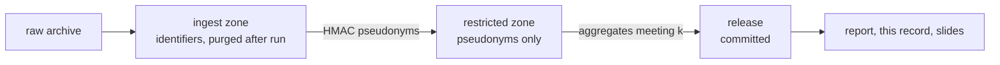

<!-- Generated by the report stage from src/enron_case/report/templates/decision-record.md.
     Edit the template, not this file. Every number is injected from release tables. -->

# Decision record

**Context.** A headers-only analysis of the public Enron email corpus as an engineering case
study: clean the header record, pseudonymize it, look for one change in the communication
network, and measure how many people can be re-identified from person-level output, which we
therefore do not publish. The corpus is public; the pipeline is built as if it were not.

## Architecture

Data zones with a path guard per package and an import-boundary test
([docs/architecture.md](architecture.md) has every diagram).

The header reader stops at the first blank line of each message: body bytes pass through the
decompressor and are skipped, never decoded, parsed, held, stored or logged. Every table
crossing a zone is checked against a written contract.

## Trade-offs

- **Strict content line, including `Subject`.** Content fields ({{fields_content}}) are never
  stored: a `Subject` line is discarded as the header is scanned. We lose threads and reply times and dedupe on sender, second and recipients alone:
  {{dq_deduplicate_removed}} copies removed.
- **Rule-based identity resolution.** Deterministic, explainable rules weighted to precision,
  because a false merge invents a central person while a false split only dilutes one:
  {{dq_resolve_identities_count_in}} addresses to {{dq_resolve_identities_count_out}} entities.
  Missed aliases are the price.
- **Keyed HMAC pseudonyms, and their limit.** Stable for one key, not confirmable by hashing
  guessed addresses. It is still pseudonymization: whoever holds the key can test a candidate,
  and structure re-identifies people. Our own attack on the person-level output (R0)
  re-identified a share of {{risk_r0_a1_reid_top1}} of targets for the outsider,
  {{risk_r0_a2_reid_top1}} for an insider who knows a few custodians and
  {{risk_r0_a3_reid_top1}} for one who knows them all, as anyone holding the corpus does.
- **Aggregates-only release.** Nothing person-level is published; every cell meets
  k = {{k_min}}. {{aggregate_risk_phrase}} {{utility_phrase}}

**Finding.** {{finding_statement}} {{record_summary}}

**Behaviour.** {{headline_statement}} {{replication_summary}}

**Structure (H26, post hoc).** {{departure_summary}}

## What changes with real customer data

- **Metadata-only connectors**: mail scopes return headers only, so bodies and attachments
  never leave the source; `Subject` still arrives and is discarded at the allowlist. Teams and
  Slack have no such scope: their text is dropped in memory.
- **Customer-side key custody and an entity registry**, so pseudonyms survive changes in
  identity resolution.
- **Retention schedule, data residency, works council review** of the questions, the minimum
  group size and the outputs before the first run.
- **Formal privacy budget**: differential privacy across every published output instead of the
  noise sketch (R2).

## Not done, and why

- **No behavioural or structural finding.** {{not_established_summary}} Those checks, the
  record profile and the replication and departure tests are post hoc.
- **Dropped for time**: the dedupe-rule sensitivity variant.
- **A sketch, not a guarantee**: the noise release (R2) has no formal privacy budget.
- **Identity quality on real data.** {{identity_quality_phrase}} The report lists every
  limit.
